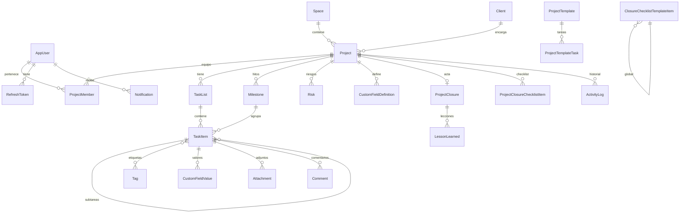

# PLAN.md — ProjectM: gestor de proyectos estilo ClickUp (MVP)

## Contexto
Equipo interno (un solo tenant) necesita un gestor de proyectos web en español, estilo ClickUp básico pero sólido, con ciclo de vida completo de proyecto (apertura → seguimiento → cierre con acta). El directorio `ProjectM` está vacío: se construye desde cero.
Restricciones del entorno confirmadas: **no hay .NET SDK local** → todo build/test/migración del backend corre en contenedores `mcr.microsoft.com/dotnet/sdk:9.0`; Node 24 y Docker 28 sí están. Adjuntos en **disco local + volumen Docker** detrás de `IFileStorage`. **git init** y un commit por fase.

> Al aprobar este plan, el primer paso es copiar este contenido a `ProjectM/PLAN.md` y crear `CLAUDE.md`.

---

## 1. Arquitectura

```
[React SPA (Vite)] --HTTPS /api, /hubs--> [nginx (web)] --proxy--> [ASP.NET Core 9 API] --EF Core--> [SQL Server 2022]
                                                                       |-- SignalR hub /hubs/notifications
                                                                       |-- IFileStorage -> volumen /data/attachments
```
- **Backend: monolito modular por "vertical slices"**: cada feature (Auth, Users, Spaces, Projects, Closure, Lists, Tasks, CustomFields, Attachments, Comments, Activity, Notifications, Dashboard) tiene endpoints (Minimal APIs en `MapGroup`), servicio, DTOs y validadores (FluentValidation) en su carpeta.
- **Dominio separado** (`ProjectM.Domain`, sin dependencias): entidades, enums y reglas (máquina de estados de proyecto/tarea, validación de cierre, cálculo de avance). Permite pruebas unitarias puras.
- **Autorización por proyecto** con *resource-based authorization*: `IAuthorizationService.AuthorizeAsync(user, projectId, ProjectOperations.X)` en **cada** endpoint que toca un proyecto o sus hijos. Un único `ProjectAuthorizationHandler` resuelve rol global + pertenencia + estado del proyecto (Cerrado ⇒ toda escritura denegada con 409 `PROYECTO_CERRADO`, salvo reabrir por Admin).
- **Eventos de dominio → actividad y notificaciones**: las entidades registran eventos; un interceptor de `SaveChanges` los despacha tras confirmar. Handlers: `ActivityLogger` (escribe `ActivityLog`) y `NotificationDispatcher` → `INotificationChannel[]` (v1: `InAppChannel` que persiste `Notification` y emite por SignalR). Correo/WhatsApp = nuevos `INotificationChannel` + tabla de preferencias (fuera de alcance, arquitectura lista).
- **Errores consistentes**: `IExceptionHandler` global → `ProblemDetails` (RFC 7807) con extensión `code` (p. ej. `VALIDACION`, `NO_ENCONTRADO`, `PROHIBIDO`, `PROYECTO_CERRADO`, `CONFLICTO_CONCURRENCIA`, `TAREAS_ABIERTAS`). 400 incluye `errors` por campo.
- **Paginación** estándar `?page=1&pageSize=25` (máx 100) → `{ items, page, pageSize, totalCount }`.
- **Concurrencia optimista**: `RowVersion` en Project y Task (409 al chocar).
- **Soft delete** en Task/Comment/Attachment (filtro global) para preservar historial.
- **OpenAPI** integrado de .NET 9 + UI Scalar en Development.

### Seguridad
- ASP.NET Identity (PBKDF2), política de contraseña ≥10 caracteres, lockout 5 intentos/15 min.
- JWT de acceso (15 min, en memoria del SPA) + **refresh token rotativo** en cookie `HttpOnly; Secure; SameSite=Strict; Path=/api/auth`, guardado hasheado en BD con revocación.
- Rate limiting (`AddRateLimiter`) en `/api/auth/login` y `/refresh`: 5 req/min por IP (429 en español).
- CORS restringido a `ALLOWED_ORIGINS` (env); en Docker el SPA y la API comparten origen vía nginx.
- Sin secretos en el repo: `.env` (gitignored) + `.env.example`; config por variables de entorno (`ConnectionStrings__Default`, `Jwt__Key`, `Seed__AdminPassword`, …).
- Adjuntos: límite de tamaño (20 MB), lista blanca de extensiones/MIME, nombre en disco = GUID, descarga solo vía endpoint autorizado.
- SignalR: token por `access_token` query solo para `/hubs`.

---

## 2. Roles y matriz de permisos

Roles globales: **Admin, Gestor, Miembro, Observador**. Pertenencia por proyecto en `ProjectMember`.

| Acción | Admin | Gestor (del proyecto) | Gestor (no asignado) | Miembro (miembro) | Observador (miembro) | No miembro |
|---|---|---|---|---|---|---|
| Ver proyecto/tareas | ✔ | ✔ | ✔ si miembro | ✔ | ✔ | ✘ |
| Crear proyecto | ✔ | ✔ | ✔ | ✘ | ✘ | ✘ |
| Editar proyecto, miembros, listas, campos, hitos, riesgos | ✔ | ✔ | ✘ | ✘ | ✘ | ✘ |
| Crear/editar/mover tareas, comentar, adjuntar | ✔ | ✔ | ✔ si miembro | ✔ | ✘ (solo lectura) | ✘ |
| Iniciar/ejecutar cierre, cierre forzado | ✔ | ✔ | ✘ | ✘ | ✘ | ✘ |
| Reabrir proyecto Cerrado | ✔ | ✘ | ✘ | ✘ | ✘ | ✘ |
| Usuarios, plantillas, checklist de cierre global | ✔ | plantillas de tareas | — | ✘ | ✘ | ✘ |

Proyecto Cerrado ⇒ solo lectura para todos (incluido Admin, que primero debe reabrir con justificación).

---

## 3. Modelo de datos (ERD)



Entidades clave (campos principales):
- **AppUser** (Identity): FullName, Initials/AvatarColor, IsActive, CreatedAt. **RefreshToken**: TokenHash, ExpiresAt, RevokedAt, ReplacedBy.
- **Space**: Name, Description, Color. **Client**: Name.
- **Project**: SpaceId, Code (único), Name, ClientId?, Objective, Scope, PlannedStart/End, ActualStart/End, Budget (decimal 18,2)?, Currency, ManagerId, Status (`Planeacion, Activo, EnPausa, EnCierre, Cerrado`), Health (`EnTiempo, EnRiesgo, Retrasado` — manual), TemplateId?, ClosedAt/ClosedById, RowVersion.
- **ProjectMember**: (ProjectId, UserId) PK, AddedAt.
- **TaskList**: ProjectId, Name, Position.
- **TaskItem**: ProjectId (desnormalizado para auth/consultas), ListId, ParentTaskId? (subtarea, 1 nivel), MilestoneId?, Title, Description (markdown), AssigneeId?, Status (`Pendiente, EnProgreso, EnRevision, Completada, Bloqueada`), Priority (`Baja, Normal, Alta, Urgente`), StartDate, DueDate, CompletedAt, Position (double, orden fraccional para Kanban), BlockedReason?, CreatedById, timestamps, IsDeleted, RowVersion. *Vencida* es derivado: `DueDate < hoy && Status != Completada`.
- **Tag**: Name, Color (de la paleta). **TaskTag** join.
- **CustomFieldDefinition**: ProjectId, Name, Type (`Texto, Numero, Fecha, Seleccion`), OptionsJson, IsRequired, Position. **CustomFieldValue**: (TaskId, FieldId) PK, TextValue, NumberValue, DateValue, OptionKey.
- **Attachment**: TaskId, FileName, ContentType, SizeBytes, StorageKey, UploadedById.
- **Comment**: TaskId, AuthorId, Body, MentionsJson, EditedAt, IsDeleted.
- **Milestone**: ProjectId, Name, DueDate, CompletedAt. **Risk**: ProjectId, Title, Description, Probability/Impact (1–3), Status (`Abierto, Mitigado, Cerrado`), OwnerId, Mitigation.
- **ProjectTemplate** + **ProjectTemplateTask**: ListName, Title, Description, Priority, StartOffsetDays, DurationDays, Position.
- **ClosureChecklistTemplateItem** (global, Admin): Text, IsRequired, Position. **ProjectClosureChecklistItem**: copia al iniciar cierre + IsDone, DoneById, DoneAt, Notes.
- **ProjectClosure**: Summary, Deliverables (json lista), PlannedStart/End vs ActualStart/End (snapshot), TotalTasks, CompletedTasks, OpenTasksAtClose, IsForced, ForceJustification, ClosedById, ClosedAt. **LessonLearned**: Category, WhatWentWell, WhatToImprove, Recommendation.
- **ActivityLog**: ProjectId, TaskId?, ActorId, Type, DataJson, CreatedAt. **Notification**: UserId, Type, Title, Body, Link, ReadAt, CreatedAt.

**Índices**: Tasks(ProjectId, Status) · Tasks(ListId, Position) · Tasks(AssigneeId, Status, DueDate) · Tasks(ParentTaskId) · Tasks(DueDate) filtrado `CompletedAt IS NULL AND IsDeleted = 0` · Projects(Status), (SpaceId), (ManagerId), Code único · ProjectMember(UserId) · ActivityLog(ProjectId, CreatedAt DESC), (TaskId, CreatedAt) · Notifications(UserId, ReadAt, CreatedAt DESC) · Comments(TaskId, CreatedAt) · RefreshToken(TokenHash) único.

### Reglas de dominio
- **Proyecto**: `Planeacion → Activo → EnPausa ⇄ Activo → EnCierre → Cerrado`; `EnCierre → Activo` (cancelar cierre); `Cerrado → Activo` solo Admin con motivo. Activar fija ActualStart.
- **Avance %** = tareas Completadas / total tareas (incluye subtareas, excluye eliminadas); 0 si no hay tareas.
- **Tarea**: pasar a Completada fija CompletedAt; salir de Completada lo limpia; Bloqueada exige BlockedReason; subtareas comparten ProjectId del padre.
- **Cierre**: requiere todos los ítems obligatorios del checklist marcados + acta (resumen) + 0 tareas abiertas, **o** `force=true` con justificación ≥ 20 caracteres (queda registrado en acta y actividad). Al cerrar: snapshot de métricas, ActualEnd = hoy, estado Cerrado.

---

## 4. Endpoints (`/api/v1`)

| Grupo | Endpoints |
|---|---|
| Auth | `POST auth/login` · `POST auth/refresh` · `POST auth/logout` · `GET auth/me` · `POST auth/change-password` |
| Usuarios (Admin) | `GET users?q&role&page` · `POST users` · `PUT users/{id}` · `POST users/{id}/deactivate` · `POST users/{id}/reset-password` · `GET users/lookup?q` (cualquier autenticado, para asignar) |
| Espacios | `GET/POST spaces` · `PUT/DELETE spaces/{id}` |
| Clientes | `GET/POST clients` |
| Proyectos | `GET projects?spaceId&status&q&page` · `POST projects` (apertura con plantilla y equipo) · `GET/PUT projects/{id}` · `POST projects/{id}/activate|pause|resume` · `GET projects/{id}/summary` (avance, salud, conteos, hitos) · `GET/POST/DELETE projects/{id}/members` |
| Seguimiento | `GET/POST/PUT/DELETE projects/{id}/milestones` · `GET/POST/PUT/DELETE projects/{id}/risks` · `GET projects/{id}/blockers` (tareas bloqueadas/vencidas + riesgos abiertos) |
| Cierre | `POST projects/{id}/closure/start` · `GET projects/{id}/closure` · `PUT projects/{id}/closure` (borrador del acta + lecciones) · `PUT projects/{id}/closure/checklist/{itemId}` · `POST projects/{id}/closure/cancel` · `POST projects/{id}/close {force, justification}` · `POST projects/{id}/reopen {reason}` (Admin) |
| Plantillas | `GET/POST/PUT/DELETE project-templates` · `GET/PUT closure-checklist-template` (Admin) |
| Listas | `GET/POST projects/{id}/lists` · `PUT/DELETE lists/{id}` · `POST projects/{id}/lists/reorder` |
| Tareas | `GET tasks?projectId&listId&status&assigneeId&priority&tagId&dueFrom&dueTo&overdue&q&parentId&sort&page` · `POST tasks` · `GET/PATCH/DELETE tasks/{id}` · `PATCH tasks/{id}/status` · `PATCH tasks/{id}/move {listId,status,beforeId,afterId}` · `GET tasks/{id}/subtasks` |
| Etiquetas | `GET/POST tags` · `PUT/DELETE tags/{id}` · `PUT tasks/{id}/tags` |
| Campos pers. | `GET/POST projects/{id}/custom-fields` · `PUT/DELETE custom-fields/{id}` · `PUT tasks/{id}/custom-fields/{fieldId}` |
| Adjuntos | `POST tasks/{id}/attachments` (multipart) · `GET tasks/{id}/attachments` · `GET attachments/{id}/download` · `DELETE attachments/{id}` |
| Calendario | `GET calendar?from&to&projectId&assigneeId` (tareas + hitos) |
| Comentarios | `GET/POST tasks/{id}/comments` · `PUT/DELETE comments/{id}` |
| Actividad | `GET projects/{id}/activity?page` · `GET tasks/{id}/activity` |
| Notificaciones | `GET notifications?unreadOnly&page` · `GET notifications/unread-count` · `POST notifications/{id}/read` · `POST notifications/read-all` |
| Dashboard | `GET dashboard?projectId` → tareas por estado, vencidas, carga por persona, proyectos por estado (limitado a proyectos visibles) |
| SignalR | `/hubs/notifications` — grupos `user:{id}` y `project:{id}`; eventos `notification`, `activity`, `taskChanged` |

Notificaciones generadas: asignación de tarea, mención en comentario, comentario en tarea propia/asignada, cambio de estado de tarea asignada, tarea por vencer (job diario `BackgroundService`), proyecto cerrado/reabierto (equipo).

---

## 5. Estructura de carpetas

```
ProjectM/
├─ PLAN.md · CLAUDE.md · README.md · .env.example · .gitignore · docker-compose.yml · docker-compose.override.yml (dev)
├─ scripts/            dotnet.ps1 (wrapper: corre dotnet en contenedor sdk:9.0 con caché NuGet), test.ps1, ef.ps1
├─ backend/
│  ├─ ProjectM.sln · Directory.Build.props · .config/dotnet-tools.json (dotnet-ef)
│  ├─ src/ProjectM.Domain/        Entities/, Enums/, Rules/ (ProjectStateMachine, ClosureValidator, ProgressCalculator), Events/
│  ├─ src/ProjectM.Api/
│  │   ├─ Program.cs · Dockerfile
│  │   ├─ Infrastructure/  Persistence/ (AppDbContext, Configurations/, Migrations/, Interceptors/), Identity/, Auth/ (JWT, refresh),
│  │   │                   Authorization/ (ProjectOperations, ProjectAuthorizationHandler), Storage/ (IFileStorage, LocalFileStorage),
│  │   │                   Realtime/ (NotificationsHub), Notifications/ (INotificationChannel, InAppChannel, Dispatcher),
│  │   │                   Errors/ (GlobalExceptionHandler, AppException), Pagination/, Seed/ (DemoSeeder)
│  │   └─ Features/        Auth/ Users/ Spaces/ Clients/ Projects/ Closure/ Templates/ Lists/ Tasks/ Tags/ CustomFields/
│  │                       Attachments/ Calendar/ Comments/ Activity/ Notifications/ Dashboard/   (cada una: *Endpoints.cs, *Service.cs, Dtos.cs, Validators.cs)
│  └─ tests/
│     ├─ ProjectM.UnitTests/         xUnit + FluentAssertions: reglas de dominio
│     └─ ProjectM.IntegrationTests/  WebApplicationFactory contra SQL Server del compose (BD efímera por corrida)
└─ frontend/
   ├─ package.json · vite.config.ts · Dockerfile · nginx.conf
   └─ src/
      ├─ styles/tokens.css (paleta + semánticos, claro/oscuro) · index.css (@import tailwind + @theme)
      ├─ app/ (router, providers, AuthContext, QueryClient, SignalR provider)
      ├─ api/ (cliente fetch con refresh automático, tipos, hooks TanStack Query por feature)
      ├─ components/ui/ (Button, Badge, StatusBadge, PriorityBadge, Input, Select, Textarea, Modal, Drawer, Tabs, Avatar, Toast, EmptyState, Pagination, DataTable, Spinner)
      ├─ components/layout/ (Sidebar árbol Espacio>Proyecto>Lista, Topbar, NotificationBell)
      └─ features/ auth/ projects/ (apertura wizard, resumen, seguimiento, riesgos, cierre) tasks/ (detalle en Drawer, subtareas, campos, adjuntos)
                   views/ (ListView, KanbanView, CalendarView) comments/ activity/ notifications/ dashboard/ admin/ (usuarios, plantillas, checklist)
```

Frontend: React 19 + TS + Vite + **Tailwind v4** (`@tailwindcss/vite`, tema vía `@theme`) + dnd-kit (Kanban y reprogramar en calendario) + TanStack Query + React Router + React Hook Form + Zod + `@microsoft/signalr` + date-fns (locale `es`) + lucide-react. Calendario: vista mensual/semanal propia con date-fns (coherente con tokens y dnd-kit). Pruebas: Vitest + Testing Library. Formato: ESLint + Prettier.

---

## 6. Sistema de diseño (tokens)

Bases exactas = tono **500**; escalas derivadas (se validan con test automático de contraste):

| Token | 50 | 100 | 200 | 300 | 400 | **500** | 600 | 700 | 800 | 900 |
|---|---|---|---|---|---|---|---|---|---|---|
| primary | #EEF7FB | #D7ECF6 | #B3DBEF | #8DC9E7 | #74BDE0 | **#5DB1DA** | #3D96C4 | #2B7AA3 | #235F7E | #1B475E |
| secondary | #F3F4F8 | #E4E7EF | #C9CEDD | #AAB2C9 | #8C97B6 | **#6F7EA4** | #5E6B92 | #4F5C80 | #3B4563 | #282F45 |
| accent | #E9FEF7 | #C8FCEB | #9CFADB | #6FF8CC | #58F7C5 | **#46F7BE** | #1FD69C | #12A97A | #0E7A58 | #0A563F |
| success | #EEF9F5 | #D3F1E7 | #ABE4D2 | #88DAC1 | #76D5B8 | **#65D0AF** | #34A383 | #237A60 | #1B5E4A | #134335 |
| danger | #FDECEC | #F9CFD0 | #F09FA2 | #E36A6F | #C93A40 | **#B1060D** | #94050B | #770409 | #5A0307 | #3D0205 |
| neutral (matiz #6F7EA4) | #F6F7FA | #EDEFF5 | #DADEE9 | #BEC4D4 | #9AA2B9 | #78819B | #5D657D | #474E63 | #30364A | #1D2131 |

Implementación:
- `tokens.css`: variables `--pm-primary-500: 93 177 218` (canales RGB) para soportar opacidad; `@theme` de Tailwind mapea `--color-primary-500: rgb(var(--pm-primary-500))` etc. Componentes usan solo clases de tokens (`bg-primary-700`, `text-danger-600`), **nunca hex sueltos** (regla ESLint/grep en CI local).
- Tokens semánticos: `--pm-bg`, `--pm-surface`, `--pm-surface-raised`, `--pm-text`, `--pm-text-muted`, `--pm-border`, `--pm-focus-ring`, `--pm-sidebar-bg`, `--pm-sidebar-text`. Definidos en `:root` (claro) y en `[data-theme="dark"]` (valores preparados, sin toggle en v1).

Reglas de contraste (WCAG AA, calculadas):
- Texto blanco sobre #5DB1DA (2.4:1), #46F7BE, #65D0AF **no cumple** → sobre esos fondos se usa texto `neutral-900`.
- Botón primario con texto blanco: `primary-700` #2B7AA3 (≈4.8:1), hover `primary-800`. Éxito con texto blanco: `success-700` #237A60 (≈5.2:1). Peligro: `danger-500` #B1060D (≈7.1:1).
- Secondary #6F7EA4 con blanco ≈4.0:1 (solo texto grande) → sidebar usa fondo `secondary-800` #3B4563 con texto blanco/`secondary-100`.
- Texto de acento sobre blanco: `accent-800` #0E7A58 (≈5.3:1).
- Test `tokens.contrast.test.ts` verifica todos los pares texto/fondo declarados.

Mapeo de estados (badge fondo/texto · punto/columna Kanban):
| Estado | Badge | Punto/borde |
|---|---|---|
| Pendiente | secondary-100 / secondary-800 | secondary-500 |
| En progreso | primary-100 / primary-800 | primary-500 |
| En revisión | accent-100 / accent-900 | accent-500 |
| Completada | success-100 / success-800 | success-500 |
| Bloqueada / Vencida | danger-50 / danger-700 | danger-500 |

Prioridad: Urgente = danger · Alta = primary-700 · Normal = secondary · Baja = neutral. Estado de proyecto: Planeación secondary, Activo primary, En pausa neutral, En cierre accent, Cerrado success.

---

## 7. Docker y flujo de desarrollo (sin .NET local)
- `docker-compose.yml`: `db` (mssql/server:2022, volumen `sqldata`, healthcheck), `api` (multi-stage sdk→aspnet:9.0, volumen `attachments`, aplica migraciones al arrancar si `Database__MigrateOnStartup=true`, seed si `Seed__Demo=true`), `web` (build Vite → nginx, proxy `/api` y `/hubs` con soporte WebSocket). Perfil `test`: servicio `tests` que corre `dotnet test` contra `db`.
- `scripts/dotnet.ps1 <args>` → `docker run --rm -v ${PWD}/backend:/src -v nuget-cache:/root/.nuget/packages -w /src mcr.microsoft.com/dotnet/sdk:9.0 dotnet <args>` (build, add package, `dotnet ef migrations add` vía tool manifest).
- Frontend en dev con Node local (`npm run dev`, proxy Vite a la API en Docker).

---

## 8. Fases verticales (cada una: compila, pruebas, resumen, commit)

**Fase 0 — Fundaciones**: git init, PLAN.md, CLAUDE.md, .gitignore/.env.example, solución .NET (Domain/Api/tests), Program.cs base (ProblemDetails, OpenAPI, CORS, health `/health`), DbContext vacío, Docker Compose arrancando db+api+web, frontend Vite+Tailwind v4 con `tokens.css`, componentes UI base, test de contraste, layout (sidebar/topbar).

**Fase 1 — Auth, usuarios y roles**: Identity + JWT + refresh rotativo en cookie, rate limiting y lockout, seed de roles y Admin inicial (password desde env), CRUD usuarios (Admin), `ProjectAuthorizationHandler` base. Front: login, guard de rutas, refresco transparente, admin de usuarios. Pruebas: login ok/fallido, lockout, 429, refresh/revocación, acceso por rol.

**Fase 2 — Proyectos (apertura/seguimiento base/cierre)**: Spaces, Clients, Projects, Members, Templates, Milestones, Risks, checklist global, Closure completo; entidad TaskItem/TaskList mínima (necesaria para plantilla inicial y validación de tareas abiertas). Front: árbol en sidebar, wizard de apertura (datos → equipo → plantilla), resumen del proyecto (avance, salud, hitos, riesgos/bloqueos), flujo de cierre (checklist, acta, lecciones, cierre forzado), vista solo lectura y reapertura Admin. Pruebas: máquina de estados, cierre con/sin tareas abiertas, forzado sin justificación → 400, solo lectura tras cierre (409), reabrir solo Admin, matriz de permisos por proyecto.

**Fase 3 — Tareas**: CRUD completo, subtareas, listas, estado/prioridad/fechas, etiquetas, campos personalizados (4 tipos con validación por tipo), adjuntos (`LocalFileStorage`), filtros + paginación, `move` con orden fraccional, concurrencia. Front: Drawer de detalle de tarea. Pruebas: transiciones de estado (CompletedAt, Bloqueada requiere motivo), Observador no puede escribir, no miembro 403/404, validación de campos personalizados, adjunto fuera de lista blanca.

**Fase 4 — Vistas**: Lista (tabla agrupada por lista/estado, edición inline, filtros), Kanban (dnd-kit, columnas por estado, reordenar y cambiar estado con actualización optimista y rollback), Calendario (mes/semana, arrastrar para reprogramar, hitos). Pruebas de componentes clave.

**Fase 5 — Comentarios, actividad y notificaciones**: eventos de dominio → ActivityLog; comentarios con @menciones; NotificationDispatcher + InAppChannel + SignalR; job diario de "por vencer"; campana con contador, panel y marcar leídas; actividad en vivo en detalle de tarea y proyecto. Pruebas: notificación al asignar/mencionar, aislamiento por usuario.

**Fase 6 — Dashboard y entrega**: endpoint agregado + gráficos (barras/donut simples en SVG/Recharts con colores de tokens), DemoSeeder completo (Admin, 2 Gestores, 4 Miembros, 1 Observador; 2 espacios; 4 proyectos en Planeación / Activo / Activo en riesgo / Cerrado con acta; ~60 tareas, comentarios, notificaciones), README (requisitos, `.env`, `docker compose up`, usuarios demo, pruebas), revisión final de seguridad.

---

## 9. Verificación
- Por fase: `scripts/dotnet.ps1 build` sin warnings críticos; `docker compose --profile test run --rm tests` (unit + integración contra SQL Server real); `npm run lint && npm run test && npm run build` en `frontend/`.
- End-to-end al final: `docker compose up --build` → abrir `http://localhost:8080`, iniciar sesión con usuarios demo de cada rol, recorrer: apertura con plantilla → mover tareas en Kanban → comentar con mención (notificación en vivo en otra sesión) → intentar cerrar con tareas abiertas (bloqueado) → cierre forzado con justificación → verificar solo lectura → reabrir como Admin → dashboard. Verificación visual en el navegador integrado (contraste, responsive).
- `CLAUDE.md` se actualiza al final de cada fase con comandos y decisiones.
