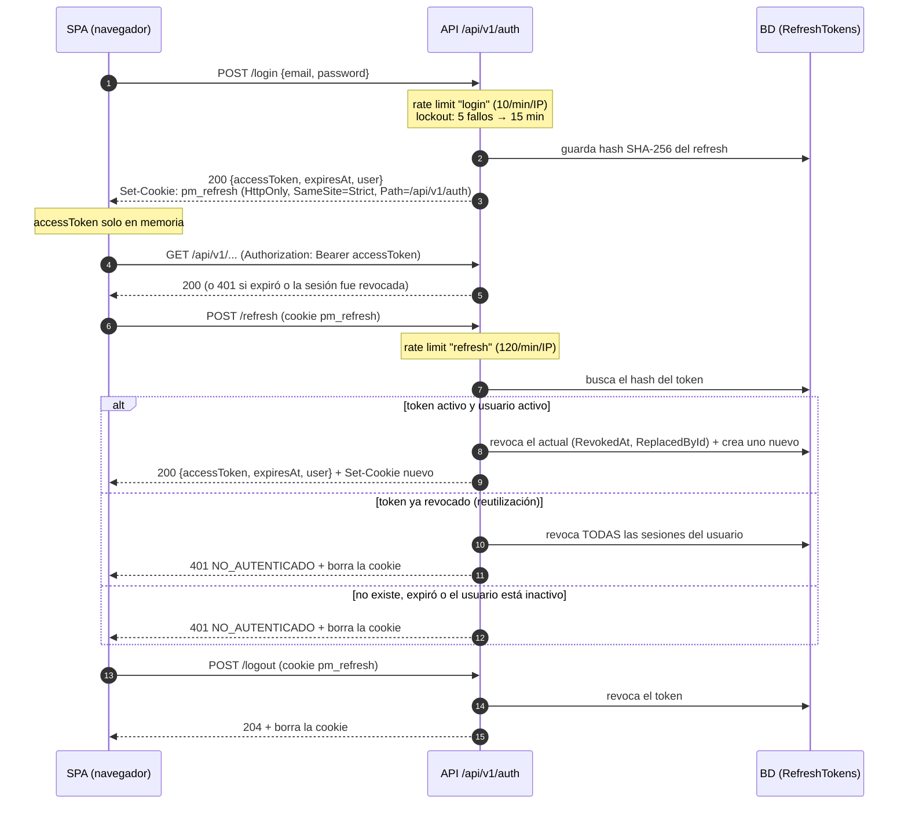

# API REST de ProjectM (v1)

> Documento generado leyendo **solo el código fuente** de la rama `vercel`. Cada afirmación cita entre paréntesis el archivo del que sale. Lo que el código no deja claro va marcado como **⚠️ A CONFIRMAR**.

**Total de endpoints HTTP documentados: 93** — 92 llamadas `Map{Get|Post|Put|Patch|Delete}` en `backend/src/ProjectM.Api/Features/**` más `GET /health` (backend/src/ProjectM.Api/Program.cs). Aparte de eso hay un hub de SignalR (`/hubs/notifications`, que no es REST) y, solo en Development, las rutas de OpenAPI/Scalar (backend/src/ProjectM.Api/Program.cs).

| Feature | Archivo | Endpoints |
|---|---|---|
| Sistema | backend/src/ProjectM.Api/Program.cs | 1 |
| Autenticación | backend/src/ProjectM.Api/Features/Auth/AuthEndpoints.cs | 5 |
| Usuarios | backend/src/ProjectM.Api/Features/Users/UserEndpoints.cs | 6 |
| Espacios y clientes | backend/src/ProjectM.Api/Features/Spaces/SpaceEndpoints.cs | 7 |
| Proyectos | backend/src/ProjectM.Api/Features/Projects/ProjectEndpoints.cs | 11 |
| Seguimiento (hitos, riesgos, bloqueos) | backend/src/ProjectM.Api/Features/Projects/TrackingEndpoints.cs | 9 |
| Cierre de proyecto | backend/src/ProjectM.Api/Features/Closure/ClosureEndpoints.cs | 7 |
| Plantillas | backend/src/ProjectM.Api/Features/Templates/TemplateEndpoints.cs | 7 |
| Tareas | backend/src/ProjectM.Api/Features/Tasks/TaskEndpoints.cs | 9 |
| Calendario | backend/src/ProjectM.Api/Features/Tasks/CalendarEndpoints.cs | 2 |
| Listas, campos, etiquetas y adjuntos | backend/src/ProjectM.Api/Features/Tasks/TaskSupportEndpoints.cs | 18 |
| Comentarios, actividad y notificaciones | backend/src/ProjectM.Api/Features/Collaboration/CollaborationEndpoints.cs | 10 |
| Dashboard | backend/src/ProjectM.Api/Features/Dashboard/DashboardEndpoints.cs | 1 |
| **Total** | | **93** |

---

## 1. Conceptos generales

### 1.1 URL base y CORS

- Todos los endpoints de negocio cuelgan del grupo **`/api/v1`**, que lleva `.RequireAuthorization()`: si un endpoint no dice `AllowAnonymous`, pide un JWT válido (backend/src/ProjectM.Api/Program.cs).
- `GET /health` y el hub `/hubs/notifications` quedan **fuera** de `/api/v1` (backend/src/ProjectM.Api/Program.cs).
- CORS: los orígenes permitidos salen de `Cors:AllowedOrigins` (lista separada por comas), con `AllowAnyHeader`, `AllowAnyMethod` y `AllowCredentials` (backend/src/ProjectM.Api/Program.cs). Por defecto la lista está vacía (backend/src/ProjectM.Api/appsettings.json).
- La API espera estar detrás de proxies. Lee `X-Forwarded-For`/`X-Forwarded-Proto` y confía en `Proxy:ForwardLimit` saltos (1 por defecto). Con eso obtiene la IP real que usa el rate limiting (backend/src/ProjectM.Api/Program.cs).
- En la configuración documentada del proyecto, nginx (`web`, puerto 8080) hace proxy de `/api` y `/hubs`, y la API escucha en `127.0.0.1:5010` (CLAUDE.md).
- Solo en el entorno Development se publican `MapOpenApi()` y `MapScalarApiReference()` (backend/src/ProjectM.Api/Program.cs). ⚠️ A CONFIRMAR: las rutas exactas (`/openapi/v1.json`, `/scalar/v1`) son los valores por defecto de esas librerías y el código no las fija.

### 1.2 Formato JSON

- Los enums se serializan **como string** (`JsonStringEnumConverter`), tanto en HTTP como en SignalR (backend/src/ProjectM.Api/Program.cs).
- Las opciones JSON son las de Minimal APIs (`ConfigureHttpJsonOptions`), es decir, propiedades en camelCase y lectura sin distinguir mayúsculas. Es el valor por defecto de ASP.NET Core (backend/src/ProjectM.Api/Program.cs).
- Los diccionarios con clave enum (`tasksByStatus`, `projectsByStatus`) usan como clave el nombre del enum, por ejemplo `"EnProgreso"` (backend/src/ProjectM.Api/Features/Projects/ProjectDtos.cs, backend/src/ProjectM.Api/Features/Dashboard/DashboardEndpoints.cs).

**Valores de enums** (backend/src/ProjectM.Domain/Projects/Enums.cs, backend/src/ProjectM.Domain/Tasks/TaskItem.cs, backend/src/ProjectM.Domain/Tasks/TaskExtras.cs):

| Enum | Valores |
|---|---|
| `ProjectStatus` | `Planeacion`, `Activo`, `EnPausa`, `EnCierre`, `Cerrado` |
| `ProjectHealth` | `EnTiempo`, `EnRiesgo`, `Retrasado` |
| `RiskStatus` | `Abierto`, `Mitigado`, `Cerrado` |
| `TaskItemStatus` | `Pendiente`, `EnProgreso`, `EnRevision`, `Completada`, `Bloqueada` ("Vencida" no es un estado: se calcula con la fecha) |
| `TaskPriority` | `Baja`, `Normal`, `Alta`, `Urgente` |
| `CustomFieldType` | `Texto`, `Numero`, `Fecha`, `Seleccion` |

- **Roles globales** (strings): `Admin`, `Gestor`, `Miembro`, `Observador` (backend/src/ProjectM.Domain/Users/AppUser.cs).
- **Colores/tonos** válidos para espacios y etiquetas: `primary`, `secondary`, `accent`, `success`, `danger`, `neutral` (backend/src/ProjectM.Api/Features/Spaces/SpaceEndpoints.cs).

### 1.3 Fechas

- **Fechas de calendario** (`plannedStart`, `plannedEnd`, `actualStart`, `actualEnd`, `startDate`, `dueDate`, `dueDate` de hitos) son `DateOnly` y viajan como `"aaaa-mm-dd"` (backend/src/ProjectM.Domain/Projects/Project.cs, backend/src/ProjectM.Domain/Tasks/TaskItem.cs, backend/src/ProjectM.Domain/Projects/Tracking.cs).
- **Instantes** (`createdAt`, `updatedAt`, `completedAt`, `closedAt`, `readAt`, `expiresAt`…) son `DateTimeOffset` en UTC; `AppClock.Now` devuelve `TimeProvider.GetUtcNow()` (backend/src/ProjectM.Api/Infrastructure/AppClock.cs).
- "Hoy" (para vencidas, días restantes, etc.) se calcula en la zona `App:TimeZone` (IANA). Si no se configura o no es válida, se usa UTC (backend/src/ProjectM.Api/Infrastructure/AppClock.cs).
- Una tarea **vencida** es una tarea no `Completada` con `dueDate < hoy` (backend/src/ProjectM.Domain/Tasks/TaskItem.cs, backend/src/ProjectM.Api/Features/Tasks/TaskEndpoints.cs).

### 1.4 Paginación

Los listados paginados devuelven `PagedResult<T>` (backend/src/ProjectM.Api/Infrastructure/Pagination/Paging.cs):

```json
{ "items": [ ... ], "page": 1, "pageSize": 25, "totalCount": 137 }
```

- Parámetros de query: `page` (entero, mínimo 1; por defecto 1) y `pageSize` (se limita a 1–100; por defecto 25) (backend/src/ProjectM.Api/Infrastructure/Pagination/Paging.cs).
- Algunos endpoints cambian el `pageSize` por defecto: tareas 100, comentarios 50 y notificaciones 20. Siempre con máximo 100 (backend/src/ProjectM.Api/Features/Tasks/TaskEndpoints.cs, backend/src/ProjectM.Api/Features/Collaboration/CollaborationEndpoints.cs).
- Búsquedas `q`: `ILIKE '%texto%'` sin distinguir mayúsculas, con los comodines `%`, `_` y `\` del usuario escapados (backend/src/ProjectM.Api/Infrastructure/Persistence/Search.cs).

### 1.5 Concurrencia optimista (`rowVersion`)

- `Project` y `TaskItem` tienen `uint RowVersion` mapeado a la columna de sistema `xmin` de PostgreSQL con `IsRowVersion()` (backend/src/ProjectM.Domain/Projects/Project.cs, backend/src/ProjectM.Domain/Tasks/TaskItem.cs, backend/src/ProjectM.Api/Infrastructure/Persistence/Configurations/ProjectConfigurations.cs, backend/src/ProjectM.Api/Infrastructure/Persistence/Configurations/TaskConfigurations.cs).
- El detalle de proyecto y el de tarea devuelven `rowVersion` **como string** (`RowVersion.ToString()`) (backend/src/ProjectM.Api/Features/Projects/ProjectEndpoints.cs, backend/src/ProjectM.Api/Features/Tasks/TaskEndpoints.cs).
- `PUT /projects/{id}` y `PUT /tasks/{id}` aceptan `rowVersion` (string) en el cuerpo (backend/src/ProjectM.Api/Features/Projects/ProjectEndpoints.cs#ConcurrencyHelper):
  - vacío o ausente: **no se comprueba** la concurrencia;
  - no es un `uint` válido: 400 `VALIDACION` (campo `rowVersion`);
  - no coincide: EF lanza `DbUpdateConcurrencyException`, que se convierte en **409 `CONFLICTO_CONCURRENCIA`** (backend/src/ProjectM.Api/Infrastructure/Errors/GlobalExceptionHandler.cs).
- Los demás endpoints de escritura de tareas (`PATCH status`, `move`, `dates`, tags, campos) **no** reciben `rowVersion` (backend/src/ProjectM.Api/Features/Tasks/TaskDtos.cs, backend/src/ProjectM.Api/Features/Tasks/CalendarEndpoints.cs).

### 1.6 Formato de errores

Todos los errores son **ProblemDetails (RFC 7807)** con las extensiones `code` y `traceId` (backend/src/ProjectM.Api/Program.cs, backend/src/ProjectM.Api/Infrastructure/Errors/GlobalExceptionHandler.cs):

```json
{
  "status": 400,
  "title": "Uno o más campos no son válidos.",
  "code": "VALIDACION",
  "errors": { "name": ["El nombre es obligatorio (máx. 100)."] },
  "traceId": "0HN..."
}
```

Cómo se traducen las excepciones (backend/src/ProjectM.Api/Infrastructure/Errors/GlobalExceptionHandler.cs):

| Excepción | HTTP | `code` |
|---|---|---|
| `AppException` | el que traiga (400/401/403/404/409/423) | el que traiga |
| `DomainException` con `Kind = Validation` | 400 | el código del dominio |
| `DomainException` con `Kind = Conflict` (por defecto) | 409 | el código del dominio |
| `FluentValidation.ValidationException` | 400 | `VALIDACION` + `errors` (claves en camelCase) |
| `DbUpdateConcurrencyException` | 409 | `CONFLICTO_CONCURRENCIA` |
| `BadHttpRequestException` | su `StatusCode` (normalmente 400) | `VALIDACION` ("La solicitud no es válida.") |
| cualquier otra | 500 | `ERROR_INTERNO` (se registra en el log) |

- Las respuestas de estado sin cuerpo (por ejemplo, un 401/403 del middleware de autenticación/autorización) pasan por `UseStatusCodePages` + `AddProblemDetails`. Si no traen `code`, se rellena así: 401 → `NO_AUTENTICADO`, 403 → `PROHIBIDO`, 404 → `NO_ENCONTRADO`, 429 → `DEMASIADAS_SOLICITUDES` y cualquier otro → `ERROR_INTERNO` (backend/src/ProjectM.Api/Program.cs). ⚠️ A CONFIRMAR: no se ha comprobado en ejecución que el *challenge* de JwtBearer acabe con este cuerpo ProblemDetails.
- ⚠️ A CONFIRMAR: un JSON mal formado, un enum inválido o un parámetro obligatorio que falta producen `BadHttpRequestException` → 400 `VALIDACION` **solo si Minimal APIs lanza la excepción**, cosa que por defecto pasa en Development. En otros entornos el framework podría responder 400 sin excepción, y entonces el mapeo de `Program.cs` asignaría `code = ERROR_INTERNO` porque no contempla el 400 (backend/src/ProjectM.Api/Program.cs).
- Cuando un endpoint tiene `.Validate<T>()` y llega sin cuerpo, responde 400 `VALIDACION` "El cuerpo de la solicitud es obligatorio." (backend/src/ProjectM.Api/Infrastructure/Validation/ValidationFilter.cs).
- Los errores de ASP.NET Identity (contraseña débil, correo duplicado…) se devuelven como 400 `VALIDACION`, con `errors.email` o `errors.password`/`errors.role` y mensajes en español (backend/src/ProjectM.Api/Infrastructure/Auth/IdentityExtensions.cs).
- El 429 del rate limiter se escribe a mano, con `status`, `title` y `code = DEMASIADAS_SOLICITUDES` y sin pasar por `IProblemDetailsService`, así que **no lleva `traceId`** (backend/src/ProjectM.Api/Infrastructure/ServiceRegistration.cs).

#### Tabla completa de códigos

Constantes de `ErrorCodes` (backend/src/ProjectM.Api/Infrastructure/Errors/AppException.cs):

| Código | HTTP habitual | Significado |
|---|---|---|
| `VALIDACION` | 400 | Datos inválidos (FluentValidation, `AppException.Validation`, `Guard` del dominio) |
| `NO_ENCONTRADO` | 404 | No existe o no tienes acceso (también para proyectos que no puedes ver) |
| `PROHIBIDO` | 403 | Sin permiso |
| `NO_AUTENTICADO` | 401 | Sin sesión, token inválido o sesión de refresh expirada |
| `CONFLICTO_CONCURRENCIA` | 409 | `rowVersion` desactualizado |
| `PROYECTO_CERRADO` | 409 | Escritura sobre un proyecto `Cerrado` |
| `TAREAS_ABIERTAS` | 409 | Cierre sin forzar con tareas abiertas |
| `TRANSICION_INVALIDA` | 409 | Transición de estado no permitida |
| `DEMASIADAS_SOLICITUDES` | 429 | Rate limit |
| `CREDENCIALES_INVALIDAS` | 401 | Login fallido |
| `ERROR_INTERNO` | 500 | Error inesperado |

Códigos literales que **no** están en `ErrorCodes` pero sí se emiten:

| Código | HTTP | Origen |
|---|---|---|
| `CUENTA_BLOQUEADA` | 423 | Login con la cuenta bloqueada (backend/src/ProjectM.Api/Features/Auth/AuthEndpoints.cs) |
| `AUTO_DEGRADACION` | 409 | Un Admin intenta quitarse el rol o desactivarse (backend/src/ProjectM.Api/Features/Users/UserEndpoints.cs) |
| `ESPACIO_CON_PROYECTOS` | 409 | Borrar un espacio que tiene proyectos (backend/src/ProjectM.Api/Features/Spaces/SpaceEndpoints.cs) |
| `GESTOR_REQUERIDO` | 409 | Quitar del equipo al gestor responsable (backend/src/ProjectM.Api/Features/Projects/ProjectEndpoints.cs) |
| `LISTA_CON_TAREAS` | 409 | Borrar una lista que tiene tareas (backend/src/ProjectM.Api/Features/Tasks/TaskSupportEndpoints.cs) |
| `ULTIMA_LISTA` | 409 | Borrar la única lista del proyecto (backend/src/ProjectM.Api/Features/Tasks/TaskSupportEndpoints.cs) |
| `CAMPO_CON_VALORES` | 409 | Cambiar el tipo de un campo personalizado que ya tiene valores (backend/src/ProjectM.Api/Features/Tasks/TaskSupportEndpoints.cs) |
| `CAMPOS_REQUERIDOS` | 400 | Completar una tarea con campos obligatorios vacíos (backend/src/ProjectM.Api/Features/Tasks/TaskEndpoints.cs#TaskRules) |
| `CAMPO_REQUERIDO` | 400 | Vaciar un campo personalizado obligatorio (backend/src/ProjectM.Domain/Tasks/TaskExtras.cs) |
| `CAMPO_INVALIDO` | 400 | Valor que no corresponde al tipo del campo (backend/src/ProjectM.Domain/Tasks/TaskExtras.cs) |
| `MOTIVO_BLOQUEO_REQUERIDO` | 400 | Pasar a `Bloqueada` sin motivo (backend/src/ProjectM.Domain/Tasks/TaskItem.cs) |
| `RANGO_FECHAS` | 400 | Fecha de fin/vencimiento anterior a la de inicio, validada en el dominio (backend/src/ProjectM.Domain/Common/Entity.cs#Guard) |
| `CHECKLIST_INCOMPLETO` | 409 | Cierre con ítems obligatorios pendientes (backend/src/ProjectM.Domain/Projects/Closure.cs) |
| `ACTA_INCOMPLETA` | 400 | Cierre sin resumen en el acta (backend/src/ProjectM.Domain/Projects/Closure.cs) |
| `JUSTIFICACION_REQUERIDA` | 400 | Cierre forzado con justificación de menos de 20 caracteres (backend/src/ProjectM.Domain/Projects/Closure.cs) |
| `MOTIVO_REQUERIDO` | 400 | Reapertura con motivo de menos de 10 caracteres (backend/src/ProjectM.Domain/Projects/Project.cs) |

`TAREAS_ABIERTAS`, `TRANSICION_INVALIDA` y `PROYECTO_CERRADO` también los lanza el dominio como `DomainException` (409) (backend/src/ProjectM.Domain/Projects/Project.cs, backend/src/ProjectM.Domain/Projects/Closure.cs).

### 1.7 Autorización

**Políticas de rol** (backend/src/ProjectM.Api/Infrastructure/Auth/Policies.cs):
- `Admin`: rol `Admin`.
- `AdminOrGestor`: rol `Admin` o `Gestor`.

Si falla la política, el middleware responde 403 (`PROHIBIDO`, ver §1.6).

**Permisos por proyecto** (`ProjectGuard` + `ProjectRules`) (backend/src/ProjectM.Api/Infrastructure/Authorization/ProjectAuthorization.cs). "Participa" significa ser miembro del proyecto o su gestor responsable (`ManagerId`). El rol que cuenta es el de mayor privilegio que tenga el usuario (`Roles.All.FirstOrDefault`, en el orden Admin > Gestor > Miembro > Observador).

| Permiso | Quién lo tiene | ¿Escritura? |
|---|---|---|
| `View` | Admin, o cualquiera que participe | No |
| `EditTasks` | Admin, gestor responsable, o miembro con rol `Gestor`/`Miembro` | Sí |
| `Manage` | Admin, o gestor responsable con rol `Gestor` | Sí |
| `Close` | Admin, o gestor responsable con rol `Gestor` | Sí |
| `Reopen` | Solo Admin | No (se permite sobre proyectos cerrados) |

Orden de comprobación de `ProjectGuard.EnsureAsync` (backend/src/ProjectM.Api/Infrastructure/Authorization/ProjectAuthorization.cs):
1. Si el proyecto no existe o no tienes `View`: **404 `NO_ENCONTRADO`** ("El proyecto…"), para no revelar que existe.
2. Si el proyecto está `Cerrado` y el permiso es de escritura: **409 `PROYECTO_CERRADO`**.
3. Si no tienes el permiso pedido: **403 `PROHIBIDO`**.

`EnsureForTaskAsync` resuelve primero el proyecto de la tarea. Si la tarea no existe (o está borrada, por el filtro global `IsDeleted`), responde 404 "La tarea…" (backend/src/ProjectM.Api/Infrastructure/Authorization/ProjectAuthorization.cs, backend/src/ProjectM.Api/Infrastructure/Persistence/Configurations/TaskConfigurations.cs).

En la documentación de cada endpoint se abrevia así:
- **Guard(View)** → puede devolver 404.
- **Guard(EditTasks|Manage|Close)** → puede devolver 404, 409 `PROYECTO_CERRADO` o 403.
- **Guard(Reopen)** → puede devolver 404 o 403.

El objeto `permissions` del detalle de proyecto (`ProjectPermissionsDto`: `canEditTasks`, `canManage`, `canClose`, `canReopen`) aplica estas reglas y además pone en `false` los permisos de escritura si el proyecto está cerrado. `canReopen` solo es `true` si el proyecto está cerrado (backend/src/ProjectM.Api/Infrastructure/Authorization/ProjectAuthorization.cs#PermissionsFor).

### 1.8 Autenticación

- **Access token**: JWT HS256 con una duración de `Jwt:AccessTokenMinutes` (15 min por defecto). Claims: `sub` (id), `email`, `name`, `jti`, `security_stamp` y un claim de rol por cada rol (`ClaimTypes.Role`). Se envía como `Authorization: Bearer <token>` (backend/src/ProjectM.Api/Infrastructure/Auth/TokenService.cs, backend/src/ProjectM.Api/Infrastructure/Auth/JwtOptions.cs, backend/src/ProjectM.Api/Infrastructure/ServiceRegistration.cs). El SPA lo guarda solo en memoria (CLAUDE.md).
- **Validación**: issuer, audience y firma, con `ClockSkew` de 30 s. En cada request, `OnTokenValidated` comprueba que el usuario exista, esté activo y que su `SecurityStamp` coincida con el del token. Ese estado se guarda 30 s en `IMemoryCache` y se invalida al momento al desactivar al usuario o cambiarle el rol o la contraseña. Si falla, la sesión queda revocada y se responde 401 (backend/src/ProjectM.Api/Infrastructure/ServiceRegistration.cs, backend/src/ProjectM.Api/Infrastructure/Auth/UserSessionCache.cs).
- **Refresh token**: 64 bytes aleatorios en Base64URL. En la base de datos solo se guarda su hash SHA-256. Dura `Jwt:RefreshTokenDays` (7 días por defecto) (backend/src/ProjectM.Api/Infrastructure/Auth/TokenService.cs, backend/src/ProjectM.Api/Infrastructure/Auth/JwtOptions.cs).
- **Cookie** `pm_refresh`: `HttpOnly`, `SameSite=Strict`, `Path=/api/v1/auth`, `Secure` según `Auth:SecureCookies` (true por defecto) y `Expires` igual a la caducidad del refresh (backend/src/ProjectM.Api/Features/Auth/AuthEndpoints.cs, backend/src/ProjectM.Api/Infrastructure/Auth/JwtOptions.cs).
- **Rotación**: cada `POST /auth/refresh` revoca el token presentado (`RevokedAt`, `ReplacedById`) y emite uno nuevo (backend/src/ProjectM.Api/Infrastructure/Auth/TokenService.cs#RotateAsync).
- **Detección de reutilización**: si se presenta un refresh token **ya revocado**, se revocan **todas** las sesiones activas del usuario y se responde 401 (backend/src/ProjectM.Api/Infrastructure/Auth/TokenService.cs#RotateAsync, backend/src/ProjectM.Api/Features/Auth/AuthEndpoints.cs).
- **Rate limiting** por IP con ventana fija de 1 minuto y sin cola (backend/src/ProjectM.Api/Infrastructure/ServiceRegistration.cs, backend/src/ProjectM.Api/Infrastructure/Auth/JwtOptions.cs):
  - política `login`: `Auth:LoginPermitLimitPerMinute` (10 por defecto);
  - política `refresh`: `Auth:RefreshPermitLimitPerMinute` (120 por defecto);
  - al superar el límite: 429 `DEMASIADAS_SOLICITUDES`.
- **Bloqueo de cuenta** (Identity): 5 fallos seguidos bloquean la cuenta 15 minutos, también para usuarios nuevos (backend/src/ProjectM.Api/Infrastructure/ServiceRegistration.cs).
- **Política de contraseñas** (Identity): mínimo 10 caracteres, con al menos un dígito, una minúscula y una mayúscula; no exige símbolos. El correo es único (backend/src/ProjectM.Api/Infrastructure/ServiceRegistration.cs).



### 1.9 Tiempo real (SignalR)

Fuentes: backend/src/ProjectM.Api/Infrastructure/Realtime/NotificationsHub.cs, backend/src/ProjectM.Api/Infrastructure/ServiceRegistration.cs, backend/src/ProjectM.Api/Infrastructure/Notifications/Channels.cs, backend/src/ProjectM.Api/Infrastructure/Events/DomainEventDispatcher.cs y backend/src/ProjectM.Api/Program.cs.

- **Ruta**: `/hubs/notifications` (`MapHub<NotificationsHub>`), con protocolo JSON y enums como string (backend/src/ProjectM.Api/Program.cs).
- **Autenticación**: el hub tiene `[Authorize]`. En las rutas que empiezan por `/hubs` el JWT también se acepta en el query string `?access_token=<jwt>`, que es lo que necesitan los WebSockets (backend/src/ProjectM.Api/Infrastructure/ServiceRegistration.cs, backend/src/ProjectM.Api/Infrastructure/Realtime/NotificationsHub.cs). nginx no registra los query strings en el log (CLAUDE.md).
- **Grupos**:
  - `user:{userId}`: la conexión entra automáticamente al conectarse (`OnConnectedAsync`).
  - `project:{projectId}`: se entra con `JoinProject`.
- **Métodos del servidor** (los invoca el cliente):
  - `JoinProject(Guid projectId)`: comprueba con `ProjectRules` que tengas `View`. Si el proyecto no existe o no tienes acceso, lanza `HubException("No tienes acceso a este proyecto.")`.
  - `LeaveProject(Guid projectId)`: saca la conexión del grupo del proyecto.
- **Eventos al cliente**:
  - `notification`: se envía al grupo `user:{id}` con un `NotificationMessage { id, userId, type, title, body, link, projectId, taskId, createdAt }` (backend/src/ProjectM.Api/Infrastructure/Notifications/Channels.cs). `type` es uno de `TaskAssigned`, `TaskStatusChanged`, `Mention`, `Comment`, `TaskDueSoon`, `TaskOverdue`, `ProjectClosed`, `ProjectReopened`, `AddedToProject` (backend/src/ProjectM.Domain/Collaboration/Collaboration.cs#NotificationTypes). El autor de una acción nunca recibe la notificación de su propia acción (backend/src/ProjectM.Api/Infrastructure/Events/DomainEventDispatcher.cs).
  - `projectChanged`: se envía al grupo `project:{id}` con `{ projectId, taskId, type }` después de confirmar la transacción, uno por cada par (proyecto, tarea). `type` es el tipo de actividad registrado (`ActivityTypes`: `ProjectCreated`, `TaskCreated`, `TaskUpdated`, `TaskStatusChanged`, `TaskAssigned`, `TaskDeleted`, `CommentAdded`, `AttachmentAdded`, `ProjectStatusChanged`, `ProjectClosed`, `ProjectReopened`, `MemberAdded`) (backend/src/ProjectM.Api/Infrastructure/Events/DomainEventDispatcher.cs, backend/src/ProjectM.Domain/Collaboration/Collaboration.cs).
- **Trabajo en segundo plano**: `DueDateNotifier` se ejecuta cada hora y genera las notificaciones `TaskDueSoon` (la tarea vence mañana; como máximo una cada 20 h) y `TaskOverdue` (una sola por tarea, para tareas vencidas en los últimos 7 días). Ignora proyectos cerrados y tareas sin responsable. Se desactiva con `Notifications:DueDateJob=false` (backend/src/ProjectM.Api/Infrastructure/Notifications/DueDateNotifier.cs, backend/src/ProjectM.Api/Program.cs).

---

## 2. Sistema

### 1. `GET /health`
- **Propósito**: comprueba que la API puede conectarse a la base de datos.
- **Auth**: anónimo (`AllowAnonymous`). Está fuera de `/api/v1`.
- **Respuesta**:
  - `200 { "status": "ok" }`;
  - `503 { "status": "db_unavailable" }` si `CanConnectAsync` falla.
- Fuente: (backend/src/ProjectM.Api/Program.cs)

---

## 3. Autenticación — `/api/v1/auth`

Fuente de toda la sección: (backend/src/ProjectM.Api/Features/Auth/AuthEndpoints.cs). DTO de usuario `UserInfo { id: Guid, email, fullName, role }`, donde `role` es el rol de mayor privilegio (o `Observador` si no tiene ninguno).

### 2. `POST /api/v1/auth/login`
- **Propósito**: iniciar sesión.
- **Auth**: anónimo. Usa la política de rate limit `login`.
- **Cuerpo** `LoginRequest`:

| Campo | Tipo | Reglas |
|---|---|---|
| `email` | string | obligatorio, formato de correo |
| `password` | string | obligatorio |

- **Respuesta**: `200 AuthResponse { accessToken: string, expiresAt: DateTimeOffset, user: UserInfo }` y `Set-Cookie: pm_refresh`.
- **Errores**:
  - 400 `VALIDACION`;
  - 401 `CREDENCIALES_INVALIDAS`: el usuario no existe, está inactivo o la contraseña es incorrecta. El mensaje es genérico para no revelar si el correo existe;
  - 423 `CUENTA_BLOQUEADA`: lockout de 15 min;
  - 429 `DEMASIADAS_SOLICITUDES`.

### 3. `POST /api/v1/auth/refresh`
- **Propósito**: rotar el refresh token y obtener un nuevo access token.
- **Auth**: anónimo. Usa la política de rate limit `refresh`. Necesita la cookie `pm_refresh`. No tiene cuerpo.
- **Respuesta**: `200 AuthResponse` y una cookie nueva.
- **Errores**:
  - 401 `NO_AUTENTICADO` ("La sesión expiró…"): falta la cookie, el token no existe, está revocado (y en ese caso se revocan todas las sesiones), expiró o el usuario está inactivo. En todos estos casos se borra la cookie, salvo cuando no venía cookie;
  - 429 `DEMASIADAS_SOLICITUDES`.
- Fuente adicional: (backend/src/ProjectM.Api/Infrastructure/Auth/TokenService.cs).

### 4. `POST /api/v1/auth/logout`
- **Propósito**: cerrar la sesión actual.
- **Auth**: anónimo. Usa la cookie si viene.
- **Comportamiento**: revoca el refresh token de la cookie (si existe y está activo) y borra la cookie.
- **Respuesta**: `204 No Content`.

### 5. `GET /api/v1/auth/me`
- **Propósito**: devuelve el usuario autenticado.
- **Auth**: autenticado.
- **Respuesta**: `200 UserInfo`.
- **Errores**: 401; 404 `NO_ENCONTRADO` si el usuario ya no existe.

### 6. `POST /api/v1/auth/change-password`
- **Propósito**: cambiar la propia contraseña.
- **Auth**: autenticado.
- **Cuerpo** `ChangePasswordRequest`:

| Campo | Tipo | Reglas |
|---|---|---|
| `currentPassword` | string | obligatorio |
| `newPassword` | string | obligatorio, mínimo 10 caracteres, más la política de Identity (§1.8) |

- **Comportamiento**: revoca **todos** los refresh tokens del usuario e invalida la caché de sesión.
- **Respuesta**: `204`.
- **Errores**:
  - 400 `VALIDACION` (incluye "La contraseña actual no es correcta." en `errors.password`, de backend/src/ProjectM.Api/Infrastructure/Auth/IdentityExtensions.cs);
  - 401;
  - 404.
- ⚠️ A CONFIRMAR: si el access token actual deja de valer al instante depende de que `UserManager.ChangePasswordAsync` actualice el `SecurityStamp` (comportamiento de Identity; el código no lo hace de forma explícita).

---

## 4. Usuarios — `/api/v1/users`

Fuente: (backend/src/ProjectM.Api/Features/Users/UserEndpoints.cs).
- `UserDto { id, email, fullName, role, isActive, createdAt }`.
- `UserLookupDto { id, fullName, email }`.

Los endpoints 7–11 requieren la **política `Admin`** (403 si no se cumple).

### 7. `GET /api/v1/users`
- **Propósito**: listado administrativo de usuarios, ordenado por nombre.
- **Auth**: política `Admin`.
- **Query**:
  - `q` (string; busca en nombre o correo);
  - `role` (string, nombre exacto del rol);
  - `active` (bool);
  - `page`, `pageSize` (§1.4; por defecto 25).
- **Respuesta**: `200 PagedResult<UserDto>`.

### 8. `POST /api/v1/users`
- **Propósito**: crear un usuario con el correo ya confirmado.
- **Auth**: política `Admin`.
- **Cuerpo** `CreateUserRequest`:

| Campo | Tipo | Reglas |
|---|---|---|
| `email` | string | obligatorio, correo válido, máx. 256 |
| `fullName` | string | obligatorio, máx. 150 |
| `role` | string | uno de `Admin`, `Gestor`, `Miembro`, `Observador` |
| `password` | string | obligatorio, mínimo 10, más la política de Identity |

- **Respuesta**: `201 UserDto` con `Location: /api/v1/users/{id}`. Esa ruta no tiene un `GET` asociado.
- **Errores**: 400 `VALIDACION`, incluido el correo duplicado (`errors.email`); 403.

### 9. `PUT /api/v1/users/{id:guid}`
- **Propósito**: editar correo, nombre, rol y estado activo.
- **Auth**: política `Admin`.
- **Cuerpo** `UpdateUserRequest`:

| Campo | Tipo | Reglas |
|---|---|---|
| `email` | string | obligatorio, correo válido, máx. 256 |
| `fullName` | string | obligatorio, máx. 150 |
| `role` | string | rol válido |
| `isActive` | bool | — |

- **Comportamiento**:
  - un cambio de rol actualiza el `SecurityStamp`, lo que invalida los tokens emitidos con el rol anterior;
  - desactivar al usuario actualiza el stamp y revoca todos sus refresh tokens;
  - en ambos casos se invalida la caché de sesión.
- **Respuesta**: `200 UserDto`.
- **Errores**:
  - 400 `VALIDACION`;
  - 403;
  - 404;
  - 409 `AUTO_DEGRADACION`: el Admin intenta quitarse el rol `Admin` o desactivarse a sí mismo.

### 10. `POST /api/v1/users/{id:guid}/deactivate`
- **Propósito**: desactivar un usuario.
- **Auth**: política `Admin`.
- **Comportamiento**: `isActive=false`, se actualiza el stamp, se revocan sus refresh tokens y se invalida la caché.
- **Respuesta**: `204`.
- **Errores**: 403; 404; 409 `AUTO_DEGRADACION` (sobre uno mismo).

### 11. `POST /api/v1/users/{id:guid}/reset-password`
- **Propósito**: el Admin fija una contraseña nueva para el usuario.
- **Auth**: política `Admin`.
- **Cuerpo** `ResetPasswordRequest`: `newPassword` (string, obligatorio, mínimo 10, más la política de Identity).
- **Comportamiento**: quita el bloqueo (`LockoutEnd = null`), revoca los refresh tokens e invalida la caché.
- **Respuesta**: `204`.
- **Errores**: 400; 403; 404.

### 12. `GET /api/v1/users/lookup`
- **Propósito**: búsqueda ligera de usuarios **activos** para elegir responsables o miembros.
- **Auth**: cualquier usuario autenticado.
- **Query**: `q` (string, opcional; busca en nombre o correo).
- **Respuesta**: `200 UserLookupDto[]`, como máximo 50, ordenado por nombre. No está paginado.

---

## 5. Espacios y clientes

Fuente: (backend/src/ProjectM.Api/Features/Spaces/SpaceEndpoints.cs).
- `SpaceDto { id, name, description, color, projectCount }`.
- `ClientDto { id, name }`.

### 13. `GET /api/v1/spaces`
- **Propósito**: listar espacios ordenados por posición y nombre.
- **Auth**: autenticado.
- **Respuesta**: `200 SpaceDto[]`. `projectCount` cuenta solo los proyectos **visibles** para el usuario (`ProjectGuard.VisibleProjects`).

### 14. `GET /api/v1/spaces/tree`
- **Propósito**: árbol Espacio > Proyecto > Lista para la barra lateral.
- **Auth**: autenticado.
- **Respuesta**: `200 TreeSpaceDto[]`, donde:
  - `TreeSpaceDto { id, name, color, projects: TreeProjectDto[] }`;
  - `TreeProjectDto { id, code, name, status, lists: { id, name }[] }`.
- **Notas**:
  - solo incluye proyectos visibles;
  - si el usuario no es Admin ni Gestor, se ocultan los espacios sin proyectos visibles.

### 15. `POST /api/v1/spaces`
- **Propósito**: crear un espacio.
- **Auth**: política `AdminOrGestor`.
- **Cuerpo** `SaveSpaceRequest`:

| Campo | Tipo | Reglas |
|---|---|---|
| `name` | string | obligatorio, máx. 100, único (si no, 400 `VALIDACION` con `errors.name`) |
| `description` | string? | máx. 500 |
| `color` | string? | uno de los tonos de §1.2; por defecto `primary` |

- **Respuesta**: `201 SpaceDto` (`projectCount: 0`) con `Location: /api/v1/spaces/{id}`.
- **Errores**: 400; 403.

### 16. `PUT /api/v1/spaces/{id:guid}`
- **Propósito**: editar un espacio.
- **Auth**: política `AdminOrGestor`.
- **Cuerpo**: `SaveSpaceRequest`. Si `color` es `null`, se conserva el actual.
- **Respuesta**: `200 SpaceDto`. Aquí `projectCount` cuenta **todos** los proyectos del espacio, no solo los visibles.
- **Errores**: 400 (incluye nombre duplicado); 403; 404.

### 17. `DELETE /api/v1/spaces/{id:guid}`
- **Propósito**: eliminar un espacio.
- **Auth**: política `Admin`.
- **Respuesta**: `204`.
- **Errores**: 403; 404; 409 `ESPACIO_CON_PROYECTOS`.

### 18. `GET /api/v1/clients`
- **Propósito**: listar clientes ordenados por nombre (máximo 100).
- **Auth**: autenticado.
- **Query**: `q` (string, opcional).
- **Respuesta**: `200 ClientDto[]`.

### 19. `POST /api/v1/clients`
- **Propósito**: crear un cliente. Es idempotente por nombre exacto.
- **Auth**: política `AdminOrGestor`.
- **Cuerpo** `CreateClientRequest`: `name` (string, obligatorio, máx. 150).
- **Respuesta**:
  - `200 ClientDto` si ya existía uno con ese nombre;
  - `201 ClientDto` (`Location: /api/v1/clients/{id}`) si es nuevo.
- **Errores**: 400; 403.

---

## 6. Proyectos — `/api/v1/projects`

Fuente: (backend/src/ProjectM.Api/Features/Projects/ProjectEndpoints.cs, backend/src/ProjectM.Api/Features/Projects/ProjectDtos.cs).

**`ProjectDetailDto`**:
- identidad y contexto: `id`, `code` (`PRJ-0001`), `name`, `spaceId`, `spaceName`, `clientId`, `clientName`;
- contenido: `objective`, `scope`;
- fechas: `plannedStart`, `plannedEnd`, `actualStart`, `actualEnd`;
- presupuesto: `budget` (decimal?), `currency`;
- responsable: `managerId`, `managerName`;
- estado: `status`, `health`, `createdAt`, `closedAt`, `rowVersion` (string);
- colecciones: `members: MemberDto[]` y `lists: ListDto[]`;
- `permissions: ProjectPermissionsDto`.

Tipos auxiliares:
- `MemberDto { userId, fullName, email, role, isManager }`;
- `ListDto { id, name, position, taskCount }` (cuenta tareas no borradas).

### 20. `GET /api/v1/projects`
- **Propósito**: listar los proyectos visibles.
- **Auth**: autenticado. El listado ya viene filtrado por `VisibleProjects`: el Admin ve todos y el resto, aquellos en los que participa (backend/src/ProjectM.Api/Infrastructure/Authorization/ProjectAuthorization.cs).
- **Query**:
  - `spaceId` (Guid?);
  - `status` (`ProjectStatus`?);
  - `q` (string; busca en nombre, código o nombre del cliente);
  - `page`, `pageSize` (por defecto 25).
- **Orden**: primero los no cerrados, y luego por `plannedEnd` ascendente.
- **Respuesta**: `200 PagedResult<ProjectListItemDto>`, con:
  - `ProjectListItemDto { id, code, name, spaceId, spaceName, clientName, status, health, managerId, managerName, plannedStart, plannedEnd, totalTasks, completedTasks, overdueTasks, progress }`;
  - `progress` es el porcentaje redondeado de completadas sobre el total (backend/src/ProjectM.Domain/Projects/Project.cs#ProjectMetrics).
- **Errores**: 400 si `status` no es un valor válido (ver §1.6).

### 21. `POST /api/v1/projects`
- **Propósito**: abrir (crear) un proyecto.
- **Auth**: política `AdminOrGestor`.
- **Cuerpo** `CreateProjectRequest`:

| Campo | Tipo | Reglas |
|---|---|---|
| `spaceId` | Guid | obligatorio; el espacio debe existir |
| `name` | string | obligatorio, máx. 150 |
| `clientId` | Guid? | si viene, el cliente debe existir |
| `clientName` | string? | máx. 150; se usa si no hay `clientId`: busca por nombre exacto o crea el cliente |
| `objective` | string? | máx. 2000 |
| `scope` | string? | máx. 4000 |
| `plannedStart` | DateOnly | — |
| `plannedEnd` | DateOnly | ≥ `plannedStart` |
| `budget` | decimal? | ≥ 0 |
| `currency` | string? | exactamente 3 letras si viene; se guarda en mayúsculas; por defecto `USD` |
| `managerId` | Guid? | por defecto, el usuario actual. Solo un Admin puede indicar otro. El gestor debe estar activo y tener rol Gestor o Admin |
| `memberIds` | Guid[]? | máx. 100; todos deben existir y estar activos. El gestor se añade siempre |
| `templateId` | Guid? | si viene, la plantilla debe existir |
| `activateNow` | bool | si es `true`, el proyecto pasa a `Activo` y se fija `actualStart = hoy` |

- **Comportamiento**:
  - Si hay plantilla, crea sus listas y tareas. Cada tarea empieza en `plannedStart + startOffsetDays` y vence a los `max(durationDays,1) - 1` días de su inicio.
  - Si no hay plantilla, crea una lista `General`.
  - Registra los eventos `ProjectCreated` y `MemberAdded`; este último genera notificaciones a los miembros, excepto al creador.
- **Respuesta**: `201 ProjectDetailDto` con `Location: /api/v1/projects/{id}`.
- **Errores**:
  - 400 `VALIDACION` en `spaceId`, `managerId`, `clientId`, `memberIds`, `templateId` o cualquier regla del validador;
  - 403.

### 22. `GET /api/v1/projects/{id:guid}`
- **Propósito**: detalle de un proyecto.
- **Auth**: Guard(View).
- **Respuesta**: `200 ProjectDetailDto`.
- **Errores**: 404.

### 23. `PUT /api/v1/projects/{id:guid}`
- **Propósito**: editar los datos del proyecto.
- **Auth**: Guard(Manage).
- **Cuerpo** `UpdateProjectRequest`:
  - mismas reglas que al crear para `spaceId`, `name`, `clientId`, `clientName`, `objective`, `scope`, `plannedStart`, `plannedEnd`, `budget` y `currency`;
  - `managerId` (Guid, obligatorio, distinto de vacío);
  - `health` (`ProjectHealth`);
  - `rowVersion` (string?, §1.5).
- **Comportamiento**:
  - Cambiar `managerId` solo lo puede hacer un Admin (si no, 403 "Solo un Admin puede cambiar el gestor responsable."). El nuevo gestor debe ser Gestor o Admin y estar activo, y se añade como miembro si no lo era.
  - Si `currency` viene vacía, se conserva la actual.
- **Respuesta**: `200 ProjectDetailDto`.
- **Errores**:
  - 400 `VALIDACION`;
  - 403;
  - 404;
  - 409 `PROYECTO_CERRADO`;
  - 409 `CONFLICTO_CONCURRENCIA`.
- ⚠️ A CONFIRMAR: `health` es un enum no anulable en un record posicional. Si se omite en el JSON, se deserializa con su valor por defecto (`EnTiempo`) y **sobrescribe** el actual. Es el comportamiento de System.Text.Json y no hay validador que lo impida.

### 24. `POST /api/v1/projects/{id:guid}/activate`
- **Propósito**: pasar de `Planeacion` a `Activo`. Fija `actualStart = hoy` si estaba vacío.
- **Auth**: Guard(Manage). No tiene cuerpo.
- **Respuesta**: `200 ProjectDetailDto`.
- **Errores**:
  - 403;
  - 404;
  - 409 `PROYECTO_CERRADO`;
  - 409 `TRANSICION_INVALIDA` (si el estado de origen no es `Planeacion`).
- Fuente adicional: (backend/src/ProjectM.Domain/Projects/Project.cs).

### 25. `POST /api/v1/projects/{id:guid}/pause`
- **Propósito**: pasar de `Activo` a `EnPausa`.
- **Auth**: Guard(Manage). Respuesta y errores iguales al n.º 24 (backend/src/ProjectM.Domain/Projects/Project.cs).

### 26. `POST /api/v1/projects/{id:guid}/resume`
- **Propósito**: pasar de `EnPausa` a `Activo`.
- **Auth**: Guard(Manage). Respuesta y errores iguales al n.º 24 (backend/src/ProjectM.Domain/Projects/Project.cs).

### 27. `GET /api/v1/projects/{id:guid}/summary`
- **Propósito**: KPIs del proyecto.
- **Auth**: Guard(View).
- **Respuesta**: `200 ProjectSummaryDto`, con:
  - `progress`, `totalTasks`, `completedTasks`, `overdueTasks`, `blockedTasks`: cuentan todas las tareas no borradas, **incluidas las subtareas**;
  - `openRisks`: riesgos `Abierto`;
  - `highRisks`: riesgos abiertos con severidad ≥ 6;
  - `tasksByStatus`: diccionario con todos los estados;
  - `daysRemaining`: `plannedEnd − hoy`, o `null` si el proyecto está cerrado;
  - `milestones: MilestoneSummaryDto[]`, con `MilestoneSummaryDto { id, name, dueDate, completedAt, totalTasks, completedTasks, isOverdue }`.
- **Errores**: 404.

### 28. `GET /api/v1/projects/{id:guid}/members`
- **Propósito**: equipo del proyecto, ordenado por nombre.
- **Auth**: Guard(View).
- **Respuesta**: `200 MemberDto[]`.
- **Errores**: 404.

### 29. `POST /api/v1/projects/{id:guid}/members`
- **Propósito**: añadir un miembro. Es idempotente: si ya era miembro, no hace nada.
- **Auth**: Guard(Manage).
- **Cuerpo** `AddMemberRequest`: `userId` (Guid). No tiene validador FluentValidation.
- **Comportamiento**: si el usuario es nuevo en el proyecto, registra el evento `MemberAdded`, que envía al usuario la notificación `AddedToProject`.
- **Respuesta**: `200 MemberDto[]`.
- **Errores**:
  - 400 `VALIDACION` (`userId`: el usuario no existe o está inactivo);
  - 403;
  - 404;
  - 409 `PROYECTO_CERRADO`.

### 30. `DELETE /api/v1/projects/{id:guid}/members/{userId:guid}`
- **Propósito**: quitar a un miembro. Si no era miembro, no falla.
- **Auth**: Guard(Manage).
- **Respuesta**: `200 MemberDto[]` (la lista actualizada).
- **Errores**:
  - 403;
  - 404;
  - 409 `PROYECTO_CERRADO`;
  - 409 `GESTOR_REQUERIDO` (no se puede quitar al gestor responsable).

---

## 7. Seguimiento — `/api/v1/projects/{projectId:guid}/…`

Fuente: (backend/src/ProjectM.Api/Features/Projects/TrackingEndpoints.cs).
- `MilestoneDto { id, name, description, dueDate, completedAt, totalTasks, completedTasks }`.
- `RiskDto { id, title, description, probability, impact, severity (= probability × impact), status, ownerId, ownerName, mitigation, createdAt }`.

### 31. `GET …/milestones`
- **Propósito**: hitos del proyecto, ordenados por `dueDate`.
- **Auth**: Guard(View).
- **Respuesta**: `200 MilestoneDto[]`.
- **Errores**: 404.

### 32. `POST …/milestones`
- **Propósito**: crear un hito.
- **Auth**: Guard(Manage).
- **Cuerpo** `SaveMilestoneRequest`:

| Campo | Tipo | Reglas |
|---|---|---|
| `name` | string | obligatorio, máx. 150 |
| `description` | string? | máx. 1000 |
| `dueDate` | DateOnly | — |
| `completed` | bool? | si es `true`, se fija `completedAt = ahora` |

- **Respuesta**: `201 MilestoneDto` con `Location: /api/v1/projects/{projectId}/milestones/{id}`. Esa ruta no tiene un `GET` asociado.
- **Errores**: 400; 403; 404; 409 `PROYECTO_CERRADO`.

### 33. `PUT …/milestones/{id:guid}`
- **Propósito**: editar un hito.
- **Auth**: Guard(Manage).
- **Cuerpo**: `SaveMilestoneRequest`. El campo `completed` funciona así:
  - `null`: no cambia nada;
  - `true`: conserva el `completedAt` existente o pone "ahora";
  - `false`: lo pone a `null`.
- **Respuesta**: `200 MilestoneDto`.
- **Errores**: 400; 403; 404 (también "El hito…" si no pertenece al proyecto); 409 `PROYECTO_CERRADO`.

### 34. `DELETE …/milestones/{id:guid}`
- **Propósito**: eliminar un hito. Antes desvincula sus tareas (`milestoneId = null`), incluidas las borradas.
- **Auth**: Guard(Manage).
- **Respuesta**: `204`.
- **Errores**: 403; 404; 409 `PROYECTO_CERRADO`.

### 35. `GET …/risks`
- **Propósito**: riesgos del proyecto, ordenados por estado y luego por severidad descendente.
- **Auth**: Guard(View).
- **Respuesta**: `200 RiskDto[]`.
- **Errores**: 404.

### 36. `POST …/risks`
- **Propósito**: crear un riesgo.
- **Auth**: Guard(Manage).
- **Cuerpo** `SaveRiskRequest`:

| Campo | Tipo | Reglas |
|---|---|---|
| `title` | string | obligatorio, máx. 200 |
| `description` | string? | máx. 2000 |
| `probability` | int | 1–3 |
| `impact` | int | 1–3 |
| `status` | `RiskStatus`? | si es `null`, se queda en `Abierto` (valor por defecto de la entidad) |
| `ownerId` | Guid? | debe ser miembro del proyecto |
| `mitigation` | string? | máx. 2000 |

- **Respuesta**: `201 RiskDto` con `Location: /api/v1/projects/{projectId}/risks/{id}`. Esa ruta no tiene un `GET` asociado.
- **Errores**:
  - 400 (incluye `ownerId` no miembro);
  - 403;
  - 404;
  - 409 `PROYECTO_CERRADO`.
- Fuente adicional: (backend/src/ProjectM.Domain/Projects/Tracking.cs).

### 37. `PUT …/risks/{id:guid}`
- **Propósito**: editar un riesgo.
- **Auth**: Guard(Manage).
- **Cuerpo**: `SaveRiskRequest`. Si `status` es `null`, se conserva; `ownerId: null` deja el riesgo sin responsable.
- **Respuesta**: `200 RiskDto`.
- **Errores**: 400; 403; 404; 409 `PROYECTO_CERRADO`.

### 38. `DELETE …/risks/{id:guid}`
- **Propósito**: eliminar un riesgo.
- **Auth**: Guard(Manage).
- **Respuesta**: `204`.
- **Errores**: 403; 404; 409 `PROYECTO_CERRADO`.

### 39. `GET …/blockers`
- **Propósito**: vista de bloqueos del proyecto.
- **Auth**: Guard(View).
- **Respuesta**: `200 BlockersDto { blockedTasks, overdueTasks, openRisks }`:
  - `blockedTasks: TaskSummaryDto[]`: tareas `Bloqueada`, como máximo 100;
  - `overdueTasks: TaskSummaryDto[]`: tareas vencidas, como máximo 100;
  - `openRisks: RiskDto[]`: riesgos `Abierto`.
  - Las dos listas de tareas van ordenadas por `dueDate`.
  - `TaskSummaryDto { id, projectId, listId, parentTaskId, title, status, priority, startDate, dueDate, assigneeId, assigneeName, blockedReason }` (backend/src/ProjectM.Api/Features/Tasks/TaskSummaryDto.cs).
- **Errores**: 404.

---

## 8. Cierre de proyecto — `/api/v1/projects/{projectId:guid}/…`

Fuente: (backend/src/ProjectM.Api/Features/Closure/ClosureEndpoints.cs, backend/src/ProjectM.Domain/Projects/Project.cs, backend/src/ProjectM.Domain/Projects/Closure.cs).

Todos devuelven **`ClosureDto`**:
- `status`;
- `checklist: ChecklistItemDto[] { id, text, isRequired, isDone, doneByName, doneAt, notes }`;
- `summary`, `deliverables: string[]`;
- `lessons: LessonDto[] { id, category, whatWentWell, whatToImprove, recommendation }`;
- `metrics { totalTasks, completedTasks, openTasks, progress }`. Si el proyecto está cerrado, salen de lo congelado en el acta;
- `plannedStart`, `plannedEnd`, `actualStart`;
- `actualEnd`: si el proyecto está `EnCierre` y aún no tiene fecha de fin, se devuelve "hoy";
- `isForced`, `forceJustification`, `closedByName`, `closedAt`;
- `problems: { code, message }[]`: solo se rellena en `EnCierre`. Es lo que falta para un cierre normal (`CHECKLIST_INCOMPLETO`, `ACTA_INCOMPLETA`, `TAREAS_ABIERTAS`).

### 40. `GET …/closure`
- **Propósito**: estado del cierre y del acta.
- **Auth**: Guard(View).
- **Respuesta**: `200 ClosureDto`.
- **Errores**: 404.

### 41. `POST …/closure/start`
- **Propósito**: iniciar el cierre. Desde `Activo` o `EnPausa` pasa a `EnCierre`.
- **Auth**: Guard(Close). No tiene cuerpo.
- **Comportamiento**: copia el checklist global si el proyecto aún no tenía uno y crea el borrador del acta.
- **Respuesta**: `200 ClosureDto`.
- **Errores**: 403; 404; 409 `PROYECTO_CERRADO`; 409 `TRANSICION_INVALIDA`.

### 42. `PUT …/closure`
- **Propósito**: editar el acta.
- **Auth**: Guard(Close). El proyecto debe estar `EnCierre`; si no, 409 `TRANSICION_INVALIDA`.
- **Cuerpo** `UpdateClosureRequest`:

| Campo | Tipo | Reglas |
|---|---|---|
| `summary` | string? | máx. 4000. **Siempre se sobrescribe**: si es `null`, borra el resumen |
| `deliverables` | string[]? | máx. 50, cada uno no vacío y de máx. 300. Si es `null`, no cambia. Se descartan los vacíos tras recortar espacios |
| `lessons` | LessonDto[]? | máx. 50. Cada una con `category` obligatoria (máx. 100) y los textos con máx. 2000. Si es `null`, no cambia; si viene, **reemplaza** todas las lecciones (el `id` enviado se ignora) |

- **Respuesta**: `200 ClosureDto`.
- **Errores**: 400; 403; 404; 409 `PROYECTO_CERRADO`; 409 `TRANSICION_INVALIDA`.

### 43. `PUT …/closure/checklist/{itemId:guid}`
- **Propósito**: marcar o desmarcar un ítem del checklist y anotarlo.
- **Auth**: Guard(Close). Requiere que el proyecto esté `EnCierre`.
- **Cuerpo** `UpdateChecklistItemRequest`:
  - `isDone` (bool): cuando cambia, se fijan o borran `doneBy` y `doneAt`;
  - `notes` (string?, máx. 1000; siempre se sobrescribe).
- **Respuesta**: `200 ClosureDto`.
- **Errores**: 400; 403; 404 (también "El ítem…"); 409 `PROYECTO_CERRADO`; 409 `TRANSICION_INVALIDA`.

### 44. `POST …/closure/cancel`
- **Propósito**: cancelar el cierre. Pasa de `EnCierre` a `Activo`.
- **Auth**: Guard(Close).
- **Respuesta**: `200 ClosureDto`.
- **Errores**: 403; 404; 409 `PROYECTO_CERRADO`; 409 `TRANSICION_INVALIDA`.

### 45. `POST …/close`
- **Propósito**: cerrar el proyecto. Pasa de `EnCierre` a `Cerrado`.
- **Auth**: Guard(Close).
- **Cuerpo** `CloseProjectRequest`:
  - `force` (bool);
  - `justification` (string?, máx. 2000; si se fuerza con tareas abiertas, mínimo 20 caracteres tras recortar espacios).
- **Reglas** (solo se devuelve el **primer** problema):
  - el proyecto debe estar `EnCierre` (si no, 409 `TRANSICION_INVALIDA`);
  - checklist obligatorio completo (si no, 409 `CHECKLIST_INCOMPLETO`);
  - el acta tiene resumen (si no, 400 `ACTA_INCOMPLETA`);
  - no quedan tareas abiertas (si no, 409 `TAREAS_ABIERTAS`), salvo con `force=true` y una justificación válida (si es inválida, 400 `JUSTIFICACION_REQUERIDA`).
- **Comportamiento**:
  - congela en el acta las fechas planeadas y reales, las métricas y si fue forzado;
  - fija `actualEnd = hoy` y `closedAt`;
  - registra los eventos `ProjectStatusChanged` y `ProjectClosed`. Este último notifica a los miembros con `ProjectClosed`.
- **Respuesta**: `200 ClosureDto`.
- **Errores**: los de las reglas, más 400 `VALIDACION`, 403, 404 y 409 `PROYECTO_CERRADO`.

### 46. `POST …/reopen`
- **Propósito**: reabrir un proyecto cerrado. Pasa de `Cerrado` a `Activo` y borra `actualEnd`, `closedAt` y `closedById`.
- **Auth**: Guard(Reopen), es decir, solo Admin. Reopen no cuenta como escritura, así que funciona sobre proyectos cerrados.
- **Cuerpo** `ReopenProjectRequest`: `reason` (string, obligatorio, 10–1000 caracteres).
- **Comportamiento**: registra los eventos `ProjectStatusChanged` y `ProjectReopened`. Este último envía la notificación `ProjectReopened`.
- **Respuesta**: `200 ClosureDto`.
- **Errores**:
  - 400 `VALIDACION`;
  - 400 `MOTIVO_REQUERIDO`;
  - 403;
  - 404;
  - 409 `TRANSICION_INVALIDA` (si el proyecto no está cerrado).

---

## 9. Plantillas

Fuente: (backend/src/ProjectM.Api/Features/Templates/TemplateEndpoints.cs).
- `TemplateTaskDto { listName, title, description, priority, startOffsetDays, durationDays }`.
- `TemplateDto { id, name, description, tasks: TemplateTaskDto[] }`.

### 47. `GET /api/v1/project-templates`
- **Propósito**: listar plantillas ordenadas por nombre.
- **Auth**: autenticado.
- **Respuesta**: `200 TemplateListItemDto[] { id, name, description, taskCount, listCount }`.

### 48. `GET /api/v1/project-templates/{id:guid}`
- **Propósito**: detalle de una plantilla.
- **Auth**: autenticado.
- **Respuesta**: `200 TemplateDto`.
- **Errores**: 404.

### 49. `POST /api/v1/project-templates`
- **Propósito**: crear una plantilla.
- **Auth**: política `AdminOrGestor`.
- **Cuerpo** `SaveTemplateRequest`:

| Campo | Tipo | Reglas |
|---|---|---|
| `name` | string | obligatorio, máx. 150, único (si no, 400 `errors.name`) |
| `description` | string? | máx. 1000 |
| `tasks` | TemplateTaskDto[] | obligatorio (no nulo), máx. 300 |
| `tasks[].listName` | string | obligatorio, máx. 100 |
| `tasks[].title` | string | obligatorio, máx. 200 |
| `tasks[].description` | string? | máx. 4000 |
| `tasks[].priority` | `TaskPriority` | — |
| `tasks[].startOffsetDays` | int | 0–3650 |
| `tasks[].durationDays` | int | 1–3650 |

- **Respuesta**: `201 TemplateDto` con `Location: /api/v1/project-templates/{id}`.
- **Errores**: 400; 403.

### 50. `PUT /api/v1/project-templates/{id:guid}`
- **Propósito**: editar una plantilla. **Reemplaza** todas sus tareas.
- **Auth**: política `AdminOrGestor`.
- **Cuerpo**: `SaveTemplateRequest`.
- **Respuesta**: `200 TemplateDto`.
- **Errores**: 400; 403; 404.

### 51. `DELETE /api/v1/project-templates/{id:guid}`
- **Propósito**: eliminar una plantilla. Sus tareas se borran en cascada (backend/src/ProjectM.Api/Infrastructure/Persistence/Configurations/ProjectConfigurations.cs).
- **Auth**: política `AdminOrGestor`.
- **Respuesta**: `204`.
- **Errores**: 403; 404.

### 52. `GET /api/v1/closure-checklist-template`
- **Propósito**: checklist de cierre global, ordenado por posición.
- **Auth**: autenticado.
- **Respuesta**: `200 ChecklistTemplateItemDto[] { id, text, isRequired }`.

### 53. `PUT /api/v1/closure-checklist-template`
- **Propósito**: reemplazar el checklist global completo. Solo afecta a los cierres que se inicien después.
- **Auth**: política `Admin`.
- **Cuerpo** `SaveChecklistTemplateRequest`:
  - `items: { id?, text, isRequired }[]`: obligatorio, máx. 50;
  - `text`: obligatorio, máx. 300;
  - el `id` enviado se ignora.
- **Respuesta**: `200 ChecklistTemplateItemDto[]`.
- **Errores**: 400; 403.

---

## 10. Tareas — `/api/v1/tasks`

Fuente: (backend/src/ProjectM.Api/Features/Tasks/TaskEndpoints.cs, backend/src/ProjectM.Api/Features/Tasks/TaskDtos.cs, backend/src/ProjectM.Domain/Tasks/TaskItem.cs).

**`TaskListItemDto`**:
- identidad y ubicación: `id`, `projectId`, `projectName`, `listId`, `listName`, `parentTaskId`;
- contenido: `title`, `status`, `priority`, `startDate`, `dueDate`;
- responsable e hito: `assigneeId`, `assigneeName`, `milestoneId`;
- orden: `position` (double);
- contadores: `subtaskCount`, `completedSubtasks`, `attachmentCount`, `commentCount`;
- `isOverdue`;
- `tags: TagDto[] { id, name, color }`.

**`TaskDetailDto`**:
- identidad y ubicación: `id`, `projectId`, `projectName`, `listId`, `listName`, `parentTaskId`, `parentTitle`;
- contenido: `title`, `description`, `status`, `blockedReason`, `priority`, `startDate`, `dueDate`, `completedAt`;
- responsable e hito: `assigneeId`, `assigneeName`, `milestoneId`, `milestoneName`;
- auditoría: `createdByName`, `createdAt`, `updatedAt`;
- `isOverdue`, `rowVersion` (string);
- colecciones: `tags`, `subtasks: SubtaskDto[] { id, title, status, assigneeId, assigneeName, dueDate }`, `customFields: CustomFieldValueDto[] { fieldId, name, type, options, isRequired, value (string canónico) }` y `attachments: AttachmentDto[]`;
- `canEdit` (bool). En las respuestas de escritura siempre es `true`.

Las tareas borradas desaparecen por un filtro global `IsDeleted` (backend/src/ProjectM.Api/Infrastructure/Persistence/Configurations/TaskConfigurations.cs). Las ediciones de título, descripción, prioridad, fechas, hito o lista generan el evento `TaskUpdated` automáticamente (backend/src/ProjectM.Api/Infrastructure/Persistence/AppDbContext.cs).

### 54. `GET /api/v1/tasks`
- **Propósito**: listar y filtrar tareas (vistas Lista y Kanban).
- **Auth**:
  - con `projectId`: Guard(View);
  - sin él: solo tareas de los proyectos visibles.
- **Query** (todos opcionales):

| Parámetro | Tipo | Efecto |
|---|---|---|
| `projectId` | Guid | filtra por proyecto (exige View) |
| `listId` | Guid | por lista |
| `status` | `TaskItemStatus[]` (se puede repetir: `?status=Pendiente&status=EnProgreso`) | por estados |
| `assigneeId` | Guid | por responsable |
| `mine` | bool | si es `true`, equivale a `assigneeId = usuario actual` (tiene prioridad) |
| `priority` | `TaskPriority` | por prioridad |
| `tagId` | Guid | por etiqueta |
| `milestoneId` | Guid | por hito |
| `dueFrom`, `dueTo` | DateOnly | rango de vencimiento (incluye los extremos) |
| `overdue` | bool | si es `true`, solo vencidas |
| `q` | string | busca en el título |
| `parentId` | Guid | subtareas de esa tarea |
| `includeSubtasks` | bool | sin `parentId`: por defecto solo tareas raíz; con `true` incluye subtareas |
| `sort` | string | `position` (por defecto), `dueDate` (las que no tienen fecha al final), `-dueDate`, `priority` (de Urgente a Baja), `title`, `createdAt`, `-createdAt`. Un valor desconocido equivale a `position` |
| `page`, `pageSize` | int | `pageSize` por defecto **100** (máx. 100) |

- **Respuesta**: `200 PagedResult<TaskListItemDto>`.
- **Errores**: 400 si un parámetro tiene un formato inválido (§1.6); 404 si se pasa un `projectId` no visible.

### 55. `POST /api/v1/tasks`
- **Propósito**: crear una tarea o una subtarea (alta rápida).
- **Auth**: Guard(EditTasks) sobre el proyecto de la lista.
- **Cuerpo** `CreateTaskRequest`:

| Campo | Tipo | Reglas |
|---|---|---|
| `listId` | Guid | obligatorio; la lista debe existir (si no, 400 `listId`) |
| `parentTaskId` | Guid? | la tarea padre debe estar en el mismo proyecto y ser raíz (un solo nivel). La subtarea hereda la lista del padre |
| `title` | string | obligatorio, máx. 200 |
| `description` | string? | máx. 20000 |
| `assigneeId` | Guid? | debe ser miembro del proyecto |
| `status` | `TaskItemStatus`? | si no es `Pendiente`, se aplica `ChangeStatus` |
| `blockedReason` | string? | obligatorio si `status=Bloqueada` (si no, 400 `MOTIVO_BLOQUEO_REQUERIDO`); máx. 500 (validado en el dominio) |
| `priority` | `TaskPriority`? | por defecto `Normal` |
| `startDate`, `dueDate` | DateOnly? | `dueDate` ≥ `startDate` |
| `milestoneId` | Guid? | debe pertenecer al proyecto |
| `tagIds` | Guid[]? | máx. 20; los ids que no existen se ignoran sin error |
| `customFields` | `{ [fieldId: Guid]: string? }` | se valida cada campo del proyecto según su tipo (400 `CAMPO_INVALIDO`); los obligatorios **no** se exigen aquí |

- **Comportamiento**:
  - la tarea se coloca al final de la lista (máxima posición + 1000);
  - se registra el evento `TaskCreated`, y también `TaskAssigned` si tiene responsable.
- **Respuesta**: `201 TaskDetailDto` con `Location: /api/v1/tasks/{id}`.
- **Errores**:
  - 400 `VALIDACION` (`listId`, `parentTaskId`, `assigneeId`, `milestoneId`, validador);
  - 400 `MOTIVO_BLOQUEO_REQUERIDO`;
  - 400 `RANGO_FECHAS`;
  - 400 `CAMPO_INVALIDO`;
  - 403;
  - 404;
  - 409 `PROYECTO_CERRADO`.
- ⚠️ A CONFIRMAR: crear una tarea directamente con `status=Completada` **no** comprueba los campos personalizados obligatorios (`EnsureRequiredFieldsAsync` solo se llama en `PATCH status` y en `move`). No está claro si es intencionado.

### 56. `GET /api/v1/tasks/{id:guid}`
- **Propósito**: detalle de una tarea.
- **Auth**: Guard(View) sobre el proyecto de la tarea.
- **Respuesta**: `200 TaskDetailDto`, con `canEdit = permissions.canEditTasks`.
- **Errores**: 404.

### 57. `PUT /api/v1/tasks/{id:guid}`
- **Propósito**: reemplazar los campos básicos de la tarea.
- **Auth**: Guard(EditTasks).
- **Cuerpo** `UpdateTaskRequest`:

| Campo | Tipo | Reglas |
|---|---|---|
| `title` | string | obligatorio, máx. 200 |
| `description` | string? | máx. 20000 |
| `assigneeId` | Guid? | miembro del proyecto; `null` deja la tarea sin responsable |
| `priority` | `TaskPriority` | — |
| `startDate`, `dueDate` | DateOnly? | `dueDate` ≥ `startDate` |
| `milestoneId` | Guid? | debe pertenecer al proyecto |
| `rowVersion` | string? | §1.5 |

- **Respuesta**: `200 TaskDetailDto`.
- **Errores**:
  - 400 `VALIDACION`;
  - 400 `RANGO_FECHAS`;
  - 403;
  - 404;
  - 409 `PROYECTO_CERRADO`;
  - 409 `CONFLICTO_CONCURRENCIA`.
- ⚠️ A CONFIRMAR: `priority` no es anulable. Si se omite en el JSON, se deserializa como `Baja` (valor 0) y sobrescribe la prioridad actual.

### 58. `DELETE /api/v1/tasks/{id:guid}`
- **Propósito**: borrado lógico de la tarea **y de sus subtareas** (`isDeleted = true`).
- **Auth**: Guard(EditTasks).
- **Comportamiento**: registra el evento `TaskDeleted`.
- **Respuesta**: `204`.
- **Errores**: 403; 404; 409 `PROYECTO_CERRADO`.

### 59. `PATCH /api/v1/tasks/{id:guid}/status`
- **Propósito**: cambiar el estado de la tarea.
- **Auth**: Guard(EditTasks).
- **Cuerpo** `ChangeStatusRequest`:
  - `status` (`TaskItemStatus`, valor del enum);
  - `blockedReason` (string?, máx. 500; obligatorio para `Bloqueada`).
- **Comportamiento**:
  - `Completada`: exige los campos personalizados obligatorios y fija `completedAt`;
  - salir de `Completada` borra `completedAt`;
  - `blockedReason` solo se guarda si el estado es `Bloqueada`;
  - registra el evento `TaskStatusChanged`, que notifica al responsable.
- **Respuesta**: `200 TaskDetailDto`.
- **Errores**:
  - 400 `VALIDACION`;
  - 400 `CAMPOS_REQUERIDOS`;
  - 400 `MOTIVO_BLOQUEO_REQUERIDO`;
  - 403;
  - 404;
  - 409 `PROYECTO_CERRADO`.

### 60. `PATCH /api/v1/tasks/{id:guid}/move`
- **Propósito**: mover la tarea (arrastrar en Kanban o Lista). Puede cambiar la lista y/o el estado, y la recoloca entre dos tareas vecinas.
- **Auth**: Guard(EditTasks).
- **Cuerpo** `MoveTaskRequest`:
  - `listId` (Guid?, debe ser una lista del proyecto; las subtareas acompañan al padre);
  - `status` (`TaskItemStatus`?, mismas reglas que el n.º 59);
  - `blockedReason` (string?, máx. 500);
  - `beforeId` (Guid?): tarea vecina **anterior**;
  - `afterId` (Guid?): tarea vecina **posterior**.
- **Orden fraccional**:
  - sin vecinas, la posición es 1000;
  - solo con `afterId`: posición de `afterId` − 1000;
  - solo con `beforeId`: posición de `beforeId` + 1000;
  - con ambas: el punto medio. Si el hueco es menor que 1e-6, se renumeran todas las tareas del proyecto de 1000 en 1000 antes de calcular.
- **Respuesta**: `200 TaskListItemDto`.
- **Errores**:
  - 400 `VALIDACION`: `listId` "La lista no pertenece al proyecto." o `beforeId` "Las tareas vecinas no pertenecen al proyecto.". El error va en `beforeId` aunque el problema sea `afterId`;
  - 400 `CAMPOS_REQUERIDOS`;
  - 400 `MOTIVO_BLOQUEO_REQUERIDO`;
  - 403;
  - 404;
  - 409 `PROYECTO_CERRADO`.

### 61. `GET /api/v1/tasks/{id:guid}/subtasks`
- **Propósito**: subtareas de una tarea, ordenadas por posición.
- **Auth**: Guard(View).
- **Respuesta**: `200 TaskListItemDto[]`. No está paginado.
- **Errores**: 404.

### 62. `PUT /api/v1/tasks/{id:guid}/tags`
- **Propósito**: reemplazar las etiquetas de la tarea.
- **Auth**: Guard(EditTasks).
- **Cuerpo** `SetTagsRequest`: `tagIds` (Guid[], obligatorio, máx. 20). Los ids que no existen se ignoran.
- **Respuesta**: `200 TaskDetailDto`.
- **Errores**: 400; 403; 404; 409 `PROYECTO_CERRADO`.

---

## 11. Calendario

Fuente: (backend/src/ProjectM.Api/Features/Tasks/CalendarEndpoints.cs).

### 63. `GET /api/v1/calendar`
- **Propósito**: tareas cuyo rango `[startDate ?? dueDate, dueDate ?? startDate]` se cruza con `[from, to]`, más los hitos que vencen en ese rango.
- **Auth**:
  - con `projectId`: Guard(View);
  - sin él: solo proyectos visibles.
- **Query**:

| Parámetro | Tipo | Reglas |
|---|---|---|
| `from` | DateOnly | **obligatorio** |
| `to` | DateOnly | **obligatorio**; `to ≥ from` y como máximo 62 días de diferencia (si no, 400 `VALIDACION` en `to`) |
| `projectId` | Guid? | — |
| `mine` | bool? | si es `true`, filtra por el usuario actual |
| `assigneeId` | Guid? | — |

- **Respuesta**: `200 CalendarDto { tasks, milestones }`:
  - `tasks: TaskListItemDto[]`: como máximo 1000, ordenadas por `dueDate` y `position`. Incluye subtareas y solo tareas con al menos una fecha;
  - `milestones: CalendarMilestoneDto[] { id, projectId, projectName, name, dueDate, completedAt }`.
- **Errores**: 400; 404.

### 64. `PATCH /api/v1/tasks/{id:guid}/dates`
- **Propósito**: reprogramación rápida (arrastrar en el calendario).
- **Auth**: Guard(EditTasks).
- **Cuerpo** `SetDatesRequest`:
  - `startDate` (DateOnly?);
  - `dueDate` (DateOnly?, ≥ `startDate`).
  - Ambos se **reemplazan**: `null` borra la fecha.
- **Respuesta**: `200 TaskListItemDto`.
- **Errores**: 400 `VALIDACION`; 400 `RANGO_FECHAS`; 403; 404; 409 `PROYECTO_CERRADO`.

---

## 12. Listas y campos personalizados

Fuente: (backend/src/ProjectM.Api/Features/Tasks/TaskSupportEndpoints.cs).
- `ListDto { id, name, position, taskCount }`.
- `CustomFieldDto { id, name, type, options, isRequired, position }`.

### 65. `GET /api/v1/projects/{projectId:guid}/lists`
- **Propósito**: listas del proyecto, ordenadas por posición.
- **Auth**: Guard(View).
- **Respuesta**: `200 ListDto[]`.
- **Errores**: 404.

### 66. `POST /api/v1/projects/{projectId:guid}/lists`
- **Propósito**: crear una lista, que se añade al final.
- **Auth**: Guard(Manage).
- **Cuerpo** `SaveListRequest`: `name` (string, obligatorio, máx. 100).
- **Respuesta**: `201 ListDto` con `Location: /api/v1/lists/{id}`. Esa ruta no tiene un `GET` asociado.
- **Errores**: 400; 403; 404; 409 `PROYECTO_CERRADO`.

### 67. `POST /api/v1/projects/{projectId:guid}/lists/reorder`
- **Propósito**: reordenar las listas.
- **Auth**: Guard(Manage).
- **Cuerpo** `ReorderListsRequest`:
  - `ids` (Guid[]): **todas** las listas del proyecto en el nuevo orden;
  - la posición de cada lista es su índice en el arreglo;
  - no tiene validador FluentValidation.
- **Respuesta**: `200 ListDto[]`.
- **Errores**:
  - 400 `VALIDACION` (`ids`: "Debes enviar todas las listas del proyecto.");
  - 403;
  - 404;
  - 409 `PROYECTO_CERRADO`.
- ⚠️ A CONFIRMAR: si el cuerpo no trae `ids` (es `null`), `req.Ids.Count` lanzaría una `NullReferenceException`, que acabaría en un **500 `ERROR_INTERNO`** en vez de un 400.

### 68. `PUT /api/v1/lists/{id:guid}`
- **Propósito**: renombrar una lista.
- **Auth**: Guard(Manage) sobre el proyecto de la lista.
- **Cuerpo**: `SaveListRequest`.
- **Respuesta**: `200 ListDto`.
- **Errores**: 400; 403; 404 ("La lista…"); 409 `PROYECTO_CERRADO`.

### 69. `DELETE /api/v1/lists/{id:guid}`
- **Propósito**: eliminar una lista.
- **Auth**: Guard(Manage).
- **Comportamiento**: borra físicamente con ella las tareas que tenía en borrado lógico (primero las subtareas).
- **Respuesta**: `204`.
- **Errores**:
  - 403;
  - 404;
  - 409 `PROYECTO_CERRADO`;
  - 409 `LISTA_CON_TAREAS` (si tiene tareas no borradas);
  - 409 `ULTIMA_LISTA`.

### 70. `GET /api/v1/projects/{projectId:guid}/custom-fields`
- **Propósito**: campos personalizados del proyecto, ordenados por posición.
- **Auth**: Guard(View).
- **Respuesta**: `200 CustomFieldDto[]`.
- **Errores**: 404.

### 71. `POST /api/v1/projects/{projectId:guid}/custom-fields`
- **Propósito**: crear un campo personalizado.
- **Auth**: Guard(Manage).
- **Cuerpo** `SaveCustomFieldRequest`:

| Campo | Tipo | Reglas |
|---|---|---|
| `name` | string | obligatorio, máx. 100 |
| `type` | `CustomFieldType` | valor del enum |
| `options` | string[]? | con `Seleccion`: al menos una, sin vacías ni repetidas. Máx. 50 opciones de máx. 100 caracteres. Con otros tipos se ignora y se guarda `[]` |
| `isRequired` | bool | se exige al completar la tarea, no en el alta rápida |

- **Respuesta**: `201 CustomFieldDto` con `Location: /api/v1/custom-fields/{id}`. Esa ruta no tiene un `GET` asociado.
- **Errores**: 400; 403; 404; 409 `PROYECTO_CERRADO`.

### 72. `PUT /api/v1/custom-fields/{id:guid}`
- **Propósito**: editar un campo personalizado.
- **Auth**: Guard(Manage) sobre el proyecto del campo.
- **Cuerpo**: `SaveCustomFieldRequest`.
- **Comportamiento**: en un campo `Seleccion`, se **borran** los valores guardados que ya no estén entre las opciones.
- **Respuesta**: `200 CustomFieldDto`.
- **Errores**:
  - 400;
  - 403;
  - 404 ("El campo…");
  - 409 `PROYECTO_CERRADO`;
  - 409 `CAMPO_CON_VALORES` (cambiar el tipo cuando ya hay valores).

### 73. `DELETE /api/v1/custom-fields/{id:guid}`
- **Propósito**: eliminar un campo personalizado junto con sus valores.
- **Auth**: Guard(Manage).
- **Respuesta**: `204`.
- **Errores**: 403; 404; 409 `PROYECTO_CERRADO`.

### 74. `PUT /api/v1/tasks/{taskId:guid}/custom-fields/{fieldId:guid}`
- **Propósito**: fijar o borrar el valor de un campo personalizado en una tarea.
- **Auth**: Guard(EditTasks) sobre el proyecto de la tarea.
- **Cuerpo** `SetCustomFieldRequest`: `value` (string?). No tiene validador FluentValidation.
- **Formato del valor según el tipo** (backend/src/ProjectM.Domain/Tasks/TaskExtras.cs):
  - `Texto`: máx. 1000;
  - `Numero`: decimal con cultura invariante;
  - `Fecha`: `aaaa-mm-dd`;
  - `Seleccion`: una de las opciones.
  - Vacío o `null` borra el valor, pero en un campo obligatorio da 400 `CAMPO_REQUERIDO`.
- **Comportamiento**: actualiza `updatedAt` de la tarea.
- **Respuesta**: `200 TaskDetailDto`.
- **Errores**:
  - 400 `CAMPO_REQUERIDO`;
  - 400 `CAMPO_INVALIDO`;
  - 403;
  - 404 (la tarea, o "El campo…" si no es del proyecto);
  - 409 `PROYECTO_CERRADO`.

---

## 13. Etiquetas (globales) — `/api/v1/tags`

Fuente: (backend/src/ProjectM.Api/Features/Tasks/TaskSupportEndpoints.cs). `TagDto { id, name, color }`.

### 75. `GET /api/v1/tags`
- **Propósito**: todas las etiquetas, ordenadas por nombre.
- **Auth**: autenticado.
- **Respuesta**: `200 TagDto[]`.

### 76. `POST /api/v1/tags`
- **Propósito**: crear una etiqueta. Es idempotente por nombre exacto.
- **Auth**: autenticado. Si el usuario tiene rol `Observador`, responde 403.
- **Cuerpo** `SaveTagRequest`:
  - `name` (string, obligatorio, máx. 50);
  - `color` (string?, uno de los tonos de §1.2; por defecto `secondary`).
- **Respuesta**:
  - `200 TagDto` si ya existía;
  - `201 TagDto` (`Location: /api/v1/tags/{id}`, sin `GET` asociado) si es nueva.
- **Errores**: 400; 403.

### 77. `PUT /api/v1/tags/{id:guid}`
- **Propósito**: editar una etiqueta.
- **Auth**: política `AdminOrGestor`.
- **Cuerpo**: `SaveTagRequest`. Si `color` es `null`, se conserva.
- **Respuesta**: `200 TagDto`.
- **Errores**: 400 (incluye nombre duplicado en `errors.name`); 403; 404.

### 78. `DELETE /api/v1/tags/{id:guid}`
- **Propósito**: eliminar una etiqueta.
- **Auth**: política `AdminOrGestor`.
- **Respuesta**: `204`.
- **Errores**: 403; 404.

---

## 14. Adjuntos

Fuente: (backend/src/ProjectM.Api/Features/Tasks/TaskSupportEndpoints.cs, backend/src/ProjectM.Api/Infrastructure/Storage/FileStorage.cs). `AttachmentDto { id, fileName, contentType, sizeBytes, uploadedByName, createdAt }`.

### 79. `GET /api/v1/tasks/{taskId:guid}/attachments`
- **Propósito**: adjuntos de la tarea, del más reciente al más antiguo. Los borrados no aparecen (filtro `IsDeleted`).
- **Auth**: Guard(View).
- **Respuesta**: `200 AttachmentDto[]`.
- **Errores**: 404.
- Fuente adicional: (backend/src/ProjectM.Api/Infrastructure/Persistence/Configurations/TaskConfigurations.cs).

### 80. `POST /api/v1/tasks/{taskId:guid}/attachments`
- **Propósito**: subir un archivo.
- **Auth**: Guard(EditTasks). Antiforgery desactivado.
- **Cuerpo**: `multipart/form-data` con el archivo en el campo **`file`** (`IFormFile? file`).
- **Reglas**:
  - el archivo no puede estar vacío;
  - tamaño ≤ `Storage:MaxFileSizeMb` (20 MB por defecto);
  - nombre de 1 a 255 caracteres;
  - extensión permitida: `.pdf .doc .docx .xls .xlsx .ppt .pptx .odt .ods .txt .csv .md .png .jpg .jpeg .gif .webp .zip`.
  - El tipo MIME se **deduce de la extensión**; no se usa el encabezado que envía el cliente.
  - El límite multipart global es 25 MB (backend/src/ProjectM.Api/Program.cs).
- **Comportamiento**: registra el evento `AttachmentAdded`.
- **Respuesta**: `201 AttachmentDto` con `Location: /api/v1/attachments/{id}/download`.
- **Errores**: 400 `VALIDACION` (`file`); 403; 404; 409 `PROYECTO_CERRADO`.
- ⚠️ A CONFIRMAR: el código no define qué error (código y `code`) devuelve un cuerpo que supere el límite multipart de 25 MB o el límite de Kestrel.

### 81. `GET /api/v1/attachments/{id:guid}/download`
- **Propósito**: descargar un adjunto.
- **Auth**: Guard(View) sobre la tarea del adjunto.
- **Respuesta**: `200` con el archivo binario (`Results.File`). Lleva el `Content-Type` guardado, el nombre original como descarga y admite peticiones de rango (`Range`).
- **Errores**: 404 (el adjunto, o "El archivo…" si falta en el almacenamiento).

### 82. `DELETE /api/v1/attachments/{id:guid}`
- **Propósito**: borrado lógico del adjunto. El archivo físico se conserva para el historial.
- **Auth**: Guard(EditTasks).
- **Respuesta**: `204`.
- **Errores**: 403; 404; 409 `PROYECTO_CERRADO`.

---

## 15. Comentarios, actividad y notificaciones

Fuente: (backend/src/ProjectM.Api/Features/Collaboration/CollaborationEndpoints.cs).
- `CommentDto { id, taskId, authorId, authorName, body, mentions: Guid[], createdAt, editedAt, canEdit }`.
- `ActivityDto { id, projectId, taskId, actorId, actorName ("Sistema" si no hay actor), type, message, data (string JSON o null), createdAt }`.
- `NotificationDto { id, type, title, body, link, projectId, taskId, createdAt, readAt }`.

### 83. `GET /api/v1/tasks/{taskId:guid}/comments`
- **Propósito**: comentarios de la tarea.
- **Auth**: Guard(View).
- **Query**: `page`, `pageSize` (por defecto **50**).
- **Paginación**: las páginas se cortan de la más reciente a la más antigua, pero dentro de cada página los comentarios van en orden cronológico ascendente.
- **Respuesta**: `200 PagedResult<CommentDto>`. `canEdit` es `true` solo si eres el autor y tienes `canEditTasks`. Los comentarios borrados no aparecen.
- **Errores**: 404.

### 84. `POST /api/v1/tasks/{taskId:guid}/comments`
- **Propósito**: comentar una tarea.
- **Auth**: Guard(EditTasks).
- **Cuerpo** `SaveCommentRequest`:
  - `body` (string, obligatorio, máx. 5000);
  - `mentionIds` (Guid[]?, máx. 20). Solo se guardan los ids que son miembros del proyecto; los demás se descartan sin error.
- **Comportamiento**: registra el evento `CommentAdded`, que genera las notificaciones `Mention` (a los mencionados) y `Comment` (al responsable y al creador de la tarea que no estén mencionados).
- **Respuesta**: `201 CommentDto` con `Location: /api/v1/comments/{id}`. Esa ruta no tiene un `GET` asociado.
- **Errores**: 400; 403; 404; 409 `PROYECTO_CERRADO`.
- Fuente adicional: (backend/src/ProjectM.Api/Infrastructure/Events/DomainEventDispatcher.cs).

### 85. `PUT /api/v1/comments/{id:guid}`
- **Propósito**: editar un comentario.
- **Auth**: Guard(EditTasks), y además solo el **autor** (si no, 403 "Solo el autor puede editar el comentario.").
- **Cuerpo**: `SaveCommentRequest`. Las menciones se recalculan y se fija `editedAt`.
- **Respuesta**: `200 CommentDto`.
- **Errores**: 400; 403; 404; 409 `PROYECTO_CERRADO`.

### 86. `DELETE /api/v1/comments/{id:guid}`
- **Propósito**: borrado lógico de un comentario.
- **Auth**: Guard(EditTasks), y además ser el autor **o** tener `canManage` en el proyecto. Si no, 403.
- **Respuesta**: `204`.
- **Errores**: 403; 404; 409 `PROYECTO_CERRADO`.

### 87. `GET /api/v1/projects/{projectId:guid}/activity`
- **Propósito**: historial del proyecto, del más reciente al más antiguo.
- **Auth**: Guard(View).
- **Query**: `page`, `pageSize` (por defecto 25).
- **Respuesta**: `200 PagedResult<ActivityDto>`.
- **Errores**: 404.

### 88. `GET /api/v1/tasks/{taskId:guid}/activity`
- **Propósito**: historial de la tarea, del más reciente al más antiguo.
- **Auth**: Guard(View).
- **Respuesta**: `200 ActivityDto[]`, como máximo 100. No está paginado.
- **Errores**: 404.

### 89. `GET /api/v1/notifications`
- **Propósito**: notificaciones del usuario actual, de la más reciente a la más antigua.
- **Auth**: autenticado. Solo devuelve las propias.
- **Query**: `unreadOnly` (bool?); `page`, `pageSize` (por defecto **20**).
- **Respuesta**: `200 PagedResult<NotificationDto>`. `link` es una ruta del SPA, `/projects/{projectId}/tareas?task={taskId}` o `/projects/{projectId}` (backend/src/ProjectM.Api/Infrastructure/Events/DomainEventDispatcher.cs).

### 90. `GET /api/v1/notifications/unread-count`
- **Propósito**: contador de notificaciones no leídas.
- **Auth**: autenticado.
- **Respuesta**: `200 { "count": <int> }`.

### 91. `POST /api/v1/notifications/{id:guid}/read`
- **Propósito**: marcar una notificación propia como leída. Es idempotente.
- **Auth**: autenticado.
- **Respuesta**: `204`.
- **Errores**: 404 si la notificación no existe o no es tuya.

### 92. `POST /api/v1/notifications/read-all`
- **Propósito**: marcar todas las notificaciones propias como leídas.
- **Auth**: autenticado.
- **Respuesta**: `204`.

---

## 16. Dashboard

Fuente: (backend/src/ProjectM.Api/Features/Dashboard/DashboardEndpoints.cs).

### 93. `GET /api/v1/dashboard`
- **Propósito**: métricas agregadas de los proyectos visibles (opcionalmente, de uno solo).
- **Auth**:
  - autenticado;
  - con `projectId`: Guard(View).
- **Query**: `projectId` (Guid?).
- **Respuesta**: `200 DashboardDto`:

| Campo | Cálculo |
|---|---|
| `activeProjects` | proyectos visibles en estado `Activo` |
| `openTasks` | tareas no completadas (incluidas subtareas) de proyectos **no cerrados** |
| `overdueTasks` | de esas, las vencidas |
| `completedLast7Days` | tareas con `completedAt` en los últimos 7 días, contando **todos** los proyectos visibles (también los cerrados) |
| `myOpenTasks` | tareas abiertas asignadas al usuario |
| `tasksByStatus` | diccionario con todos los estados, solo de proyectos no cerrados |
| `projectsByStatus` | diccionario con todos los estados de proyecto |
| `workload` | `WorkloadDto[] { userId, name ("Sin asignar" si no hay responsable), pendiente, enProgreso, enRevision, bloqueada, overdue, total }`, primero los asignados y luego por `total` descendente |
| `overdue` | `OverdueTaskDto[] { id, projectId, projectName, title, dueDate, assigneeName, daysLate }`, las 10 más antiguas |
| `upcomingMilestones` | `UpcomingMilestoneDto[] { id, projectId, projectName, name, dueDate }`: hitos sin completar que vencen entre hoy y hoy + 14 días, como máximo 10 |

- **Errores**: 404 si se pasa un `projectId` no visible.

---

## 17. Resumen de puntos ⚠️ A CONFIRMAR

1. Rutas exactas de OpenAPI/Scalar en Development: no las fija el código (§1.1).
2. Que el 401/403 del middleware de autenticación/autorización salga como ProblemDetails con `code` no se ha comprobado en ejecución (§1.6).
3. Un 400 por JSON o parámetros inválidos fuera de Development podría llevar `code = ERROR_INTERNO` (§1.6).
4. `POST /auth/change-password`: no está claro si el access token actual deja de valer al instante; depende de Identity (n.º 6).
5. `PUT /projects/{id}`: si se omite `health`, se pone `EnTiempo` (n.º 23).
6. `POST /tasks` con `status=Completada` no comprueba los campos obligatorios (n.º 55).
7. `PUT /tasks/{id}`: si se omite `priority`, se pone `Baja` (n.º 57).
8. `POST /projects/{id}/lists/reorder` sin `ids` probablemente da 500 (n.º 67).
9. No está definido el error que devuelve una subida de adjunto por encima del límite multipart o de Kestrel (n.º 80).
