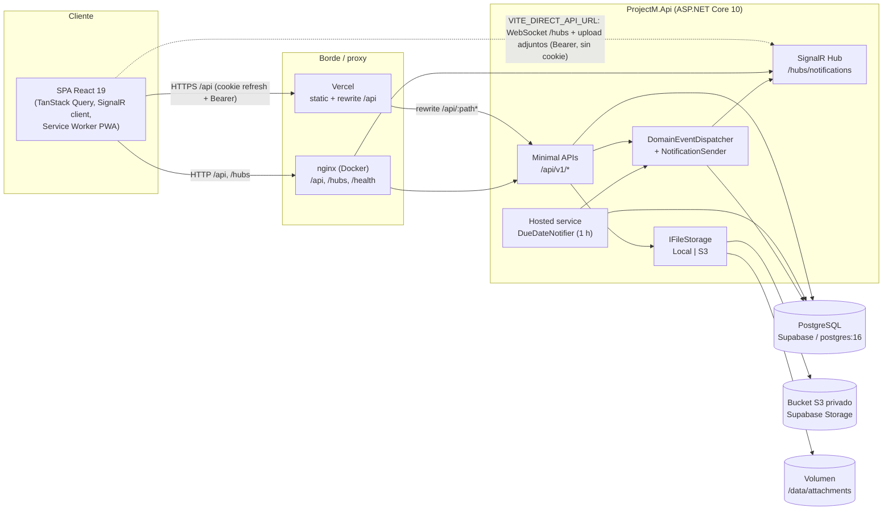
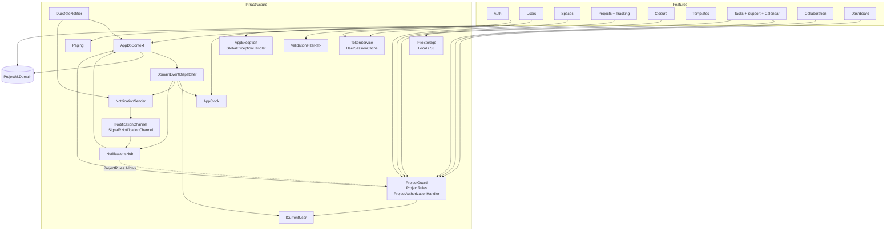
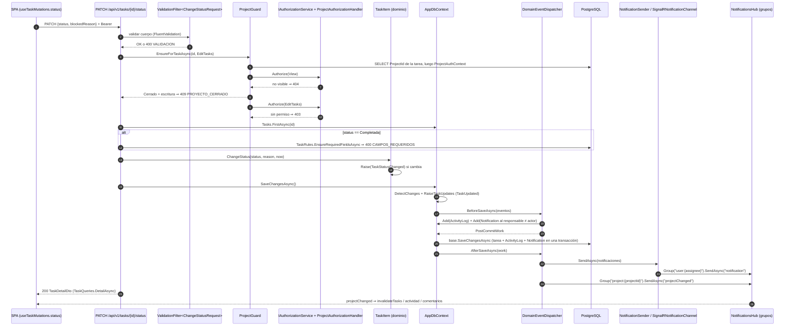

# Arquitectura de ProjectM

> Documento derivado **exclusivamente del código fuente** de la rama `vercel`. Cada afirmación cita el archivo que la evidencia (rutas relativas a la raíz del repositorio). Donde el código no permite concluir algo con certeza se marca **⚠️ A CONFIRMAR** con el motivo.
>
> Rama `vercel`: frontend en Vercel, API en Render (Docker), PostgreSQL y Storage S3 en Supabase. La rama `main` conserva SQL Server (`Microsoft.EntityFrameworkCore.SqlServer` y `UseSqlServer` en `main:backend/src/ProjectM.Api/ProjectM.Api.csproj` y `main:backend/src/ProjectM.Api/Program.cs`) y solo almacenamiento local (`main:backend/src/ProjectM.Api/Program.cs`, registro único de `LocalFileStorage`).

## Índice

1. [Vista general](#1-vista-general)
2. [Backend](#2-backend)
3. [Frontend](#3-frontend)
4. [Decisiones de diseño y patrones](#4-decisiones-de-diseño-y-patrones)
5. [Seguridad](#5-seguridad)
6. [Pruebas](#6-pruebas)
7. [Puntos a confirmar](#7-puntos-a-confirmar)

---

## 1. Vista general

ProjectM es una SPA React que consume una API REST versionada (`/api/v1`) y un hub SignalR (`/hubs/notifications`) servidos por una única aplicación ASP.NET Core 10 (`backend/src/ProjectM.Api/Program.cs`). La API persiste en PostgreSQL vía EF Core + Npgsql (`backend/src/ProjectM.Api/Program.cs`, `UseNpgsql`) y guarda los adjuntos en disco local o en un bucket S3 según `Storage:Provider` (`backend/src/ProjectM.Api/Program.cs`). Un servicio en segundo plano (`DueDateNotifier`) revisa vencimientos cada hora (`backend/src/ProjectM.Api/Infrastructure/Notifications/DueDateNotifier.cs`).

Hay dos topologías de despliegue:

| Topología | Frontend | Proxy hacia la API | API | BD | Adjuntos |
|---|---|---|---|---|---|
| Docker Compose (`docker-compose.yml`) | nginx sirviendo `dist/` (`frontend/Dockerfile`) | nginx: `/api/`, `/hubs/` (WebSocket) y `/health` → `api:8080` (`frontend/nginx.conf`) | contenedor `api` (`backend/src/ProjectM.Api/Dockerfile`) publicado solo en `127.0.0.1:5010` (`docker-compose.yml`) | `postgres:16-alpine` (`docker-compose.yml`) | volumen `attachments` en `/data/attachments` (`docker-compose.yml`) |
| Vercel + Render + Supabase | Vercel, build Vite (`frontend/vercel.json`) | rewrite de Vercel `/api/:path*` → `https://projectm-api.onrender.com/api/:path*` (`frontend/vercel.json`); SignalR y subida de adjuntos van **directo** a la API con `VITE_DIRECT_API_URL` (`frontend/src/api/client.ts`, `frontend/src/app/realtime.tsx`, `frontend/src/api/tasks.ts`) | servicio Docker `projectm-api` en Render, plan `starter` (`render.yaml`) | Supabase (cadena en `ConnectionStrings__Default`, `render.yaml`) | Supabase Storage vía S3 (`Storage__Provider=S3`, `render.yaml`) |

Notas:
- El hub de SignalR **no** pasa por el rewrite de Vercel: solo `/api/:path*` se reescribe (`frontend/vercel.json`) y el cliente conecta a `${DIRECT_API_ORIGIN}/hubs/notifications` (`frontend/src/app/realtime.tsx`).
- `HS → DISP` en el diagrama es simplificación: `DueDateNotifier` no usa el dispatcher de eventos, sino que crea `Notification` y llama directamente a `NotificationSender` (`backend/src/ProjectM.Api/Infrastructure/Notifications/DueDateNotifier.cs`).

---

## 2. Backend

### 2.1 Proyectos y dependencias

| Proyecto | Rol | Dependencias |
|---|---|---|
| `backend/src/ProjectM.Domain` | Entidades, enums, reglas puras, eventos de dominio, `DomainException` | Solo `Microsoft.Extensions.Identity.Stores` (`backend/src/ProjectM.Domain/ProjectM.Domain.csproj`) para `AppUser : IdentityUser<Guid>` (`backend/src/ProjectM.Domain/Users/AppUser.cs`) |
| `backend/src/ProjectM.Api` | Host web: endpoints por feature + infraestructura | Referencia a Domain; AWSSDK.S3, FluentValidation, JwtBearer, Identity EF Core, OpenApi, Npgsql EF Core, Scalar (`backend/src/ProjectM.Api/ProjectM.Api.csproj`) |
| `backend/tests/ProjectM.UnitTests` | Pruebas de reglas puras | xUnit, FluentAssertions (`backend/tests/ProjectM.UnitTests/ProjectM.UnitTests.csproj`) |
| `backend/tests/ProjectM.IntegrationTests` | Pruebas HTTP/SignalR contra PostgreSQL real | `Microsoft.AspNetCore.Mvc.Testing`, `Microsoft.AspNetCore.SignalR.Client` (`backend/tests/ProjectM.IntegrationTests/ProjectM.IntegrationTests.csproj`) |

Configuración común: `net10.0`, `Nullable`, `ImplicitUsings`, `InvariantGlobalization=false` (`backend/Directory.Build.props`).

### 2.2 Dominio (`ProjectM.Domain`)

- **Base `Entity`**: `Id = Guid.NewGuid()` y lista de eventos con `Raise` / `ClearDomainEvents` (`backend/src/ProjectM.Domain/Common/Entity.cs`). `IDomainEvent` es una interfaz marcadora (mismo archivo).
- **`Guard`**: validaciones de texto obligatorio/opcional y rango de fechas que lanzan `DomainException` (`backend/src/ProjectM.Domain/Common/Entity.cs`).
- **`DomainException(code, message, kind)`** con `DomainErrorKind.Validation` (→400) o `Conflict` (→409) (`backend/src/ProjectM.Domain/Common/DomainException.cs`, traducción en `backend/src/ProjectM.Api/Infrastructure/Errors/GlobalExceptionHandler.cs`).
- **Proyecto** (`backend/src/ProjectM.Domain/Projects/Project.cs`): máquina de estados `Planeacion → Activo ⇄ EnPausa → EnCierre → Cerrado`, con `Activate`, `Pause`, `Resume`, `StartClosure`, `CancelClosure`, `Close`, `Reopen`; `Transition` rechaza cualquier cambio si está `Cerrado` (`PROYECTO_CERRADO`). Emite `ProjectStatusChanged`, `ProjectClosed`, `ProjectReopened`. Enums en `backend/src/ProjectM.Domain/Projects/Enums.cs`.
- **Cierre** (`backend/src/ProjectM.Domain/Projects/Closure.cs`): checklist plantilla/proyecto, acta `ProjectClosure`, lecciones aprendidas y `ClosureRules.Validate` (checklist obligatorio, resumen del acta, tareas abiertas solo con cierre forzado y justificación ≥ 20 caracteres).
- **Tarea** (`backend/src/ProjectM.Domain/Tasks/TaskItem.cs`): `Status` con setter privado; `ChangeStatus` exige motivo para `Bloqueada`, gestiona `CompletedAt` y emite `TaskStatusChanged` solo si cambia; `Assign` emite `TaskAssigned`; `SetDates` valida rango; "Vencida" no es estado sino derivado (`IsOverdue`). `Position` es `double` (orden fraccional) y `RowVersion` es `uint` (xmin).
- **Extras de tarea** (`backend/src/ProjectM.Domain/Tasks/TaskExtras.cs`): `Tag`, `TaskTag`, `CustomFieldDefinition`/`CustomFieldValue` (con `Parse`/validación por tipo) y `Attachment`.
- **Colaboración** (`backend/src/ProjectM.Domain/Collaboration/Collaboration.cs`): `Comment`, `ActivityLog`, `Notification`, constantes `ActivityTypes`/`NotificationTypes` y eventos `TaskCreated`, `TaskUpdated`, `TaskDeleted`, `CommentAdded`, `AttachmentAdded`, `MemberAdded`, `ProjectCreated`.
- **Seguimiento** (`backend/src/ProjectM.Domain/Projects/Tracking.cs`): `Milestone`, `Risk`, `ProjectTemplate`, `ProjectTemplateTask`. **Espacios** (`backend/src/ProjectM.Domain/Projects/Space.cs`): `Space`, `Client`.
- **Usuarios** (`backend/src/ProjectM.Domain/Users/AppUser.cs`): `AppUser`, `AppRole`, roles globales `Admin`, `Gestor`, `Miembro`, `Observador`, y `RefreshToken` (solo hash).

> Nota: no todas las reglas de negocio viven en Domain. `TaskRules` (campos obligatorios al completar, responsable miembro del proyecto, hito del proyecto) y `TaskOrdering` dependen de `AppDbContext` y están en `backend/src/ProjectM.Api/Features/Tasks/TaskEndpoints.cs`.

### 2.3 Módulos por feature (`ProjectM.Api/Features/*`)

Cada feature expone un método de extensión `Map<Feature>Endpoints(this RouteGroupBuilder)` que se registra bajo el grupo `/api/v1` con `RequireAuthorization()` global (`backend/src/ProjectM.Api/Program.cs`). Los DTOs son `record` y los validadores `AbstractValidator<T>` conviven en el mismo archivo o en `*Dtos.cs`. **No hay clases de "servicio" separadas por feature**: la lógica está en los handlers estáticos y, en algunos casos, en clases auxiliares dentro del mismo archivo (`ProjectLifecycle`, `ProjectQueries`, `TaskQueries`, `TaskRules`, `TaskOrdering`, `ConcurrencyHelper`).

| Feature | Archivo(s) | Rutas principales | Responsabilidad | Autorización |
|---|---|---|---|---|
| Auth | `backend/src/ProjectM.Api/Features/Auth/AuthEndpoints.cs` | `POST /auth/login`, `/auth/refresh`, `/auth/logout`, `GET /auth/me`, `POST /auth/change-password` | Login con Identity (bloqueo tras fallos), emisión de JWT + refresh en cookie, rotación, logout, cambio de contraseña (revoca sesiones) | login/refresh/logout `AllowAnonymous` con rate limiting en login y refresh |
| Users | `backend/src/ProjectM.Api/Features/Users/UserEndpoints.cs` | `/users` (CRUD, `deactivate`, `reset-password`), `GET /users/lookup` | Administración de usuarios; al cambiar rol/desactivar/resetear actualiza `SecurityStamp`, revoca refresh tokens e invalida la caché de sesión | grupo `/users` con política `Admin`; `lookup` cualquier autenticado |
| Spaces | `backend/src/ProjectM.Api/Features/Spaces/SpaceEndpoints.cs` | `/spaces`, `/spaces/tree`, `/clients` | Espacios, árbol de navegación (solo proyectos visibles vía `guard.VisibleProjects()`), clientes | crear/editar `AdminOrGestor`, borrar espacio `Admin` |
| Projects | `backend/src/ProjectM.Api/Features/Projects/ProjectEndpoints.cs`, `ProjectDtos.cs` | `/projects` (listado paginado, detalle, alta, edición), `activate`/`pause`/`resume`, `summary`, `members` | Apertura (con plantilla o lista "General"), edición con `rowVersion`, ciclo de vida (`ProjectLifecycle`), resumen de avance, equipo | alta `AdminOrGestor`; el resto por `ProjectGuard` (`View`/`Manage`) |
| Projects › Tracking | `backend/src/ProjectM.Api/Features/Projects/TrackingEndpoints.cs` | `/projects/{id}/milestones`, `/risks`, `/blockers` | Hitos, riesgos (score probabilidad × impacto), vista de bloqueos (bloqueadas, vencidas, riesgos abiertos) | `ProjectGuard` (`View` lectura, `Manage` escritura) |
| Closure | `backend/src/ProjectM.Api/Features/Closure/ClosureEndpoints.cs` | `/projects/{id}/closure`, `closure/start`, `closure/checklist/{itemId}`, `closure/cancel`, `close`, `reopen` | Proceso de cierre: checklist, acta, lecciones, cierre (normal/forzado) y reapertura | `ProjectGuard` con `Close` o `Reopen` |
| Templates | `backend/src/ProjectM.Api/Features/Templates/TemplateEndpoints.cs` | `/project-templates`, `/closure-checklist-template` | Plantillas de proyecto y checklist global de cierre | plantillas `AdminOrGestor`; checklist global `Admin` |
| Tasks | `backend/src/ProjectM.Api/Features/Tasks/TaskEndpoints.cs`, `TaskDtos.cs`, `TaskSummaryDto.cs` | `/tasks` (listado con filtros, alta, detalle, `PUT`, `DELETE`), `PATCH /tasks/{id}/status`, `PATCH /tasks/{id}/move`, `subtasks`, `tags` | CRUD de tareas, subtareas (un nivel), cambio de estado, movimiento con orden fraccional, borrado lógico | `ProjectGuard` (`View`/`EditTasks`) |
| Tasks › Support | `backend/src/ProjectM.Api/Features/Tasks/TaskSupportEndpoints.cs` | `/projects/{id}/lists`, `/lists/{id}`, `/projects/{id}/custom-fields`, `/custom-fields/{id}`, `/tasks/{id}/custom-fields/{fieldId}`, `/tags`, `/tasks/{id}/attachments`, `/attachments/{id}/download` | Listas, campos personalizados, etiquetas globales, adjuntos (lista blanca de extensiones y tamaño máximo) | `ProjectGuard` (`Manage` para listas/campos, `EditTasks`/`View` para adjuntos); editar/borrar etiqueta `AdminOrGestor` |
| Tasks › Calendar | `backend/src/ProjectM.Api/Features/Tasks/CalendarEndpoints.cs` | `GET /calendar`, `PATCH /tasks/{id}/dates` | Tareas que cruzan un rango + hitos; reprogramación | `ProjectGuard` / `VisibleProjects()` |
| Collaboration | `backend/src/ProjectM.Api/Features/Collaboration/CollaborationEndpoints.cs` | `/tasks/{id}/comments`, `/comments/{id}`, `/projects/{id}/activity`, `/tasks/{id}/activity`, `/notifications` (+ `unread-count`, `read`, `read-all`) | Comentarios con menciones (filtradas a miembros), historial, notificaciones propias | `ProjectGuard`; notificaciones filtradas por `UserId` del usuario actual |
| Dashboard | `backend/src/ProjectM.Api/Features/Dashboard/DashboardEndpoints.cs` | `GET /dashboard?projectId=` | Métricas agregadas sobre proyectos visibles; tareas de proyectos cerrados no cuentan como carga | `ProjectGuard.VisibleProjects()` |

### 2.4 Infraestructura (`ProjectM.Api/Infrastructure/*`)

| Componente | Archivo | Descripción |
|---|---|---|
| **Auth / JWT** | `backend/src/ProjectM.Api/Infrastructure/ServiceRegistration.cs`, `Infrastructure/Auth/TokenService.cs`, `Infrastructure/Auth/JwtOptions.cs` | Identity Core (contraseña ≥ 10 con dígito/minúscula/mayúscula, bloqueo 5 intentos/15 min, email único). JWT HS256 con `sub`, `email`, `name`, `jti`, `security_stamp` y roles; `Jwt:Key` ≥ 32 caracteres o la app no arranca. Defaults: access 15 min, refresh 7 días. |
| Validación de sesión | `backend/src/ProjectM.Api/Infrastructure/ServiceRegistration.cs`, `Infrastructure/Auth/UserSessionCache.cs` | `OnTokenValidated` compara `IsActive` y `SecurityStamp` del usuario (caché en memoria de 30 s, invalidable) → tokens de usuarios desactivados o con rol/contraseña cambiados dejan de valer. |
| Refresh token | `backend/src/ProjectM.Api/Infrastructure/Auth/TokenService.cs`, `backend/src/ProjectM.Domain/Users/AppUser.cs` | 64 bytes aleatorios, se guarda solo SHA-256; rotación con `ReplacedById`; reutilizar un token revocado revoca **todas** las sesiones del usuario. |
| Rate limiting | `backend/src/ProjectM.Api/Infrastructure/ServiceRegistration.cs`, `Infrastructure/Auth/JwtOptions.cs` (`AuthOptions`) | Ventana fija de 1 min por IP remota, políticas `login` (10) y `refresh` (120); rechazo como ProblemDetails 429 con `code = DEMASIADAS_SOLICITUDES`. |
| Usuario actual | `backend/src/ProjectM.Api/Infrastructure/Auth/CurrentUser.cs` | `ICurrentUser` a partir de claims; `Role` = el primero de `Roles.All` (mayor privilegio). |
| Políticas por rol | `backend/src/ProjectM.Api/Infrastructure/Auth/Policies.cs` | `Admin` y `AdminOrGestor`. |
| **Autorización por proyecto** | `backend/src/ProjectM.Api/Infrastructure/Authorization/ProjectAuthorization.cs` | `ProjectPermission` (`View`, `EditTasks`, `Manage`, `Close`, `Reopen`); `ProjectRules.Allows` (función pura); `ProjectAuthorizationHandler : AuthorizationHandler<ProjectRequirement, ProjectAuthContext>`; `ProjectGuard` (`VisibleProjects`, `EnsureAsync`, `EnsureForTaskAsync`, `PermissionsFor`). Orden de chequeo: no visible → 404; cerrado + escritura → 409 `PROYECTO_CERRADO`; sin permiso → 403. |
| **Errores** | `backend/src/ProjectM.Api/Infrastructure/Errors/AppException.cs`, `GlobalExceptionHandler.cs`, `backend/src/ProjectM.Api/Program.cs` | `AppException` (fábricas `NotFound`, `Forbidden`, `Conflict`, `BadRequest`, `Validation`) y `ErrorCodes`. `GlobalExceptionHandler` mapea `AppException`, `DomainException`, `ValidationException` (errores por campo en camelCase), `DbUpdateConcurrencyException` (409 `CONFLICTO_CONCURRENCIA`), `BadHttpRequestException` y el resto (500). `AddProblemDetails` añade `traceId` y un `code` por defecto según status. |
| **Eventos** | `backend/src/ProjectM.Api/Infrastructure/Events/DomainEventDispatcher.cs`, `Infrastructure/Persistence/AppDbContext.cs` | `BeforeSaveAsync` traduce eventos a `ActivityLog` + `Notification` (nunca notifica al autor) y acumula `PostCommitWork`; `AfterSaveAsync` entrega notificaciones y emite `projectChanged` al grupo del proyecto. |
| **Notificaciones** | `backend/src/ProjectM.Api/Infrastructure/Notifications/Channels.cs` | `INotificationChannel` (v1: `SignalRNotificationChannel`, nombre `in-app`, envía `notification` al grupo `user:{id}`); `NotificationSender` entrega a todos los canales registrados y aísla fallos por canal. |
| Vencimientos | `backend/src/ProjectM.Api/Infrastructure/Notifications/DueDateNotifier.cs` | `BackgroundService`: espera 30 s, luego cada hora. Avisa "vence mañana" (máx. uno cada ~20 h) y "vencida" (una sola vez, vencidas en los últimos 7 días), solo tareas asignadas, abiertas y de proyectos no cerrados. Registrado salvo `Notifications:DueDateJob=false` (`backend/src/ProjectM.Api/Program.cs`). |
| **Realtime** | `backend/src/ProjectM.Api/Infrastructure/Realtime/NotificationsHub.cs` | Hub `[Authorize]`; al conectar une a `user:{id}`; `JoinProject` valida `ProjectPermission.View` con `ProjectRules` y une a `project:{id}`; `LeaveProject`. Serialización JSON con enums como string (`backend/src/ProjectM.Api/Program.cs`). |
| **Persistencia** | `backend/src/ProjectM.Api/Infrastructure/Persistence/AppDbContext.cs`, `Configurations/*.cs`, `Migrations/` | `IdentityDbContext<AppUser, AppRole, Guid>` con tablas renombradas (`Users`, `Roles`, …); convención `string` → `varchar(500)` y `decimal(18,2)`; `Id` con `ValueGeneratedNever` y `DomainEvents` ignorado en toda `Entity`. Una única migración `20261016220932_Inicial` (`backend/src/ProjectM.Api/Infrastructure/Persistence/Migrations/`). |
| Cadena de conexión | `backend/src/ProjectM.Api/Infrastructure/Persistence/ConnectionStrings.cs` | Acepta formato Npgsql clave=valor o URI `postgres(ql)://` (la de Supabase), que convierte forzando `SslMode=Require` salvo `?sslmode=` explícito. `EnableRetryOnFailure(5)` (`backend/src/ProjectM.Api/Program.cs`). |
| Búsqueda | `backend/src/ProjectM.Api/Infrastructure/Persistence/Search.cs` | Patrón `%term%` escapando `\`, `%`, `_` para `EF.Functions.ILike` (uso en `Features/Tasks/TaskEndpoints.cs`, `Features/Projects/ProjectEndpoints.cs`). |
| Paginación | `backend/src/ProjectM.Api/Infrastructure/Pagination/Paging.cs` | `PagedResult<T>(Items, Page, PageSize, TotalCount)`; default 25, máximo 100; `ToPagedAsync`. |
| **Seed** | `backend/src/ProjectM.Api/Infrastructure/Seed/IdentitySeeder.cs`, `ReferenceDataSeeder.cs`, `DemoSeeder.cs` | Roles + Admin inicial desde `Seed:AdminEmail/AdminPassword`; checklist de cierre y plantilla "Proyecto estándar"; datos demo opcionales (`Seed:Demo` + `Seed:DemoPassword`) con fechas relativas a hoy, usuarios `@projectm.demo`, idempotente y limpiando eventos de dominio antes de guardar. Se ejecutan en cada arranque (`backend/src/ProjectM.Api/Program.cs`). |
| **Storage** | `backend/src/ProjectM.Api/Infrastructure/Storage/FileStorage.cs`, `S3FileStorage.cs` | `IFileStorage` (`SaveAsync`, `OpenReadAsync`, `DeleteAsync`). `LocalFileStorage`: clave GUID hex de 32 caracteres, ruta `<root>/<2 primeros>/<clave>`, valida la clave (evita path traversal). `S3FileStorage`: `ForcePathStyle`, checksums `WHEN_REQUIRED` (compatibilidad Supabase/R2/MinIO), bucket privado, la descarga pasa por la API. Lista blanca de extensiones y `MaxFileSizeMb` (20) en `StorageOptions`. |
| **Validación** | `backend/src/ProjectM.Api/Infrastructure/Validation/ValidationFilter.cs` | `ValidationFilter<T>` (`IEndpointFilter`) + extensión `.Validate<T>()`; si existe validador y falta el cuerpo → 400. Validadores registrados con `AddValidatorsFromAssemblyContaining<Program>()` (`backend/src/ProjectM.Api/Program.cs`). |
| **Reloj** | `backend/src/ProjectM.Api/Infrastructure/AppClock.cs` | `Now` en UTC; `Today` en la zona `App:TimeZone` (IANA), UTC si falta o no existe. |

### 2.5 Dependencias entre componentes

Evidencia: inyección de dependencias en `backend/src/ProjectM.Api/Program.cs` y `backend/src/ProjectM.Api/Infrastructure/ServiceRegistration.cs`; constructor primario de `AppDbContext(options, DomainEventDispatcher? dispatcher)` (`Infrastructure/Persistence/AppDbContext.cs`); `DomainEventDispatcher(ICurrentUser, AppClock, NotificationSender, IHubContext<NotificationsHub>, ILogger)` (`Infrastructure/Events/DomainEventDispatcher.cs`); `NotificationsHub(AppDbContext)` (`Infrastructure/Realtime/NotificationsHub.cs`).

Ciclos de vida registrados (`backend/src/ProjectM.Api/Program.cs`): `AppClock`, `ProjectAuthorizationHandler`, `INotificationChannel`, `IFileStorage` → singleton; `ProjectGuard`, `ProjectQueries`, `ProjectLifecycle`, `TaskQueries`, seeders, `DomainEventDispatcher`, `NotificationSender` → scoped; `AppDbContext` → scoped (`AddDbContext`).

### 2.6 Pipeline de middleware (orden en `Program.cs`)

Fuente: `backend/src/ProjectM.Api/Program.cs`.

1. `UseForwardedHeaders()` — `X-Forwarded-For` y `X-Forwarded-Proto`, `ForwardLimit = Proxy:ForwardLimit` (default 1), redes/proxies conocidos vaciados.
2. `UseExceptionHandler()` — usa `GlobalExceptionHandler`.
3. `UseStatusCodePages()` — respuestas de error sin cuerpo pasan a ProblemDetails (con `code` por defecto).
4. *(solo Development)* `MapOpenApi()` + `MapScalarApiReference()`.
5. `UseCors()` — política por defecto con `Cors:AllowedOrigins` (lista separada por comas), cualquier header/método, `AllowCredentials`.
6. `UseAuthentication()` — JWT Bearer (token por query `access_token` solo en `/hubs`).
7. `UseRateLimiter()` — políticas `login` y `refresh`.
8. `UseAuthorization()`.
9. Arranque: migración opcional (`Database:MigrateOnStartup`) y seeders `Identity` → `ReferenceData` → `Demo`.
10. Endpoints: `GET /health` anónimo (comprueba `CanConnectAsync`, 503 si no hay BD); grupo `/api/v1` con `RequireAuthorization()` y los 12 `Map*Endpoints`; `MapHub<NotificationsHub>("/hubs/notifications")`.

Otros ajustes globales: enums como string en JSON (`ConfigureHttpJsonOptions`) y en SignalR; límite multipart 25 MB (`FormOptions`).

> El rate limiter está **después** de la autenticación; como las políticas particionan por IP y se aplican solo a endpoints con `RequireRateLimiting`, el orden no altera su efecto (`backend/src/ProjectM.Api/Infrastructure/ServiceRegistration.cs`).

### 2.7 Secuencia de una escritura típica: cambiar estado de una tarea

Fuentes: `backend/src/ProjectM.Api/Features/Tasks/TaskEndpoints.cs` (`ChangeStatus`), `Infrastructure/Validation/ValidationFilter.cs`, `Infrastructure/Authorization/ProjectAuthorization.cs`, `backend/src/ProjectM.Domain/Tasks/TaskItem.cs`, `Infrastructure/Persistence/AppDbContext.cs`, `Infrastructure/Events/DomainEventDispatcher.cs`, `Infrastructure/Notifications/Channels.cs`, `frontend/src/app/realtime.tsx`.

Puntos finos verificados en el código:
- "Misma transacción": `ActivityLog`/`Notification` se agregan al change tracker antes de `base.SaveChangesAsync`, que EF ejecuta en una transacción implícita (`Infrastructure/Persistence/AppDbContext.cs`). No hay transacciones explícitas en `backend/src` (sin `BeginTransaction`). Las operaciones hechas con `ExecuteUpdateAsync`/`ExecuteDeleteAsync` (p. ej. borrado lógico en `Delete`, mover subtareas en `Move`, `SetTags`) se confirman **por separado** antes del `SaveChangesAsync` que registra el evento (`Features/Tasks/TaskEndpoints.cs`).
- La entrega post-commit es "best effort": `NotificationSender` y la emisión de `projectChanged` capturan y registran excepciones; no hay reintento ni tabla outbox (`Infrastructure/Notifications/Channels.cs`, `Infrastructure/Events/DomainEventDispatcher.cs`). La notificación queda persistida y el cliente la obtiene por `GET /notifications`.
- `ProjectStatusChanged` hacia o desde `Cerrado` no genera entrada propia: lo cubren `ProjectClosed`/`ProjectReopened` (`Infrastructure/Events/DomainEventDispatcher.cs`).

---

## 3. Frontend

### 3.1 Stack y estructura

React 19, React Router 7, TanStack Query 5, `@microsoft/signalr`, dnd-kit, react-hook-form + zod, date-fns, lucide-react; build Vite 8 + Tailwind v4 + `vite-plugin-pwa`; pruebas Vitest + Testing Library + jsdom; lint oxlint; formato Prettier (`frontend/package.json`). Alias `@` → `src` (`frontend/vite.config.ts`).

| Carpeta | Contenido |
|---|---|
| `frontend/src/api/` | Cliente HTTP (`client.ts`) y hooks/claves de TanStack Query por dominio (`projects.ts`, `tasks.ts`, `collab.ts`, `users.ts`) |
| `frontend/src/app/` | Proveedores transversales: `auth.tsx`, `theme.tsx`, `realtime.tsx`, `pwa.tsx`, `router.tsx` |
| `frontend/src/components/` | `layout/` (`AppShell`, `MainLayout`, `Nav`, `NotificationBell`, `SpaceTree`) y `ui/` (Badge, Button, Field, Overlay/Modal, Spinner, Toast, …) |
| `frontend/src/features/` | Pantallas por dominio: `admin`, `auth`, `collab`, `dashboard`, `design`, `projects`, `tasks` |
| `frontend/src/lib/` | Utilidades: `cn.ts`, `format.ts`, `status.ts` (estados → tonos) |
| `frontend/src/styles/` | `tokens.css` (paleta y temas), `contrast.ts` y pruebas de diseño |
| `frontend/src/test/` | `setup.ts`, `utils.tsx` |

Árbol de proveedores (`frontend/src/main.tsx`): `ThemeProvider` → `QueryClientProvider` → `ToastProvider` → `AuthProvider` → `RealtimeProvider` → `RouterProvider` + `PwaPrompts`.

### 3.2 Routing

`createBrowserRouter` (`frontend/src/app/router.tsx`): `/login` fuera del layout; el resto bajo `MainLayout`, que muestra un loader mientras se restaura la sesión y redirige a `/login` si no hay usuario (`frontend/src/components/layout/MainLayout.tsx`). Todas las páginas internas se cargan con `React.lazy` y se renderizan dentro de un `<Suspense>` en `MainLayout` (`frontend/src/app/router.tsx`, `frontend/src/components/layout/MainLayout.tsx`). Rutas: `/` (dashboard), `my-tasks`, `projects`, `projects/new` (Admin/Gestor), `projects/:projectId/:tab?`, `admin/users` (Admin), `admin/templates` (Admin/Gestor), `admin/closure-checklist` (Admin), `admin/design` (Admin), `*` → dashboard. `RequireRole` redirige a `/` si el rol no coincide (control de UI; la autorización real la aplica la API).

El detalle de tarea se abre desde cualquier vista con `?task=<id>`: `useTaskDrawer` lee/escribe el search param y `TaskDrawer` está montado en `MainLayout` (`frontend/src/features/tasks/TaskDrawer.tsx`, `frontend/src/components/layout/MainLayout.tsx`).

> ⚠️ A CONFIRMAR — CLAUDE.md afirma "bundle inicial < 500 kB". El código solo evidencia el uso de `React.lazy`; el tamaño no es verificable sin ejecutar `npm run build`.

### 3.3 Estado de servidor (TanStack Query)

- `QueryClient` global: `staleTime` 15 s, sin refetch al enfocar, reintentos solo para errores ≥ 500 o de red (máx. 2) (`frontend/src/main.tsx`).
- Claves jerárquicas: `['project', id, 'summary' | 'milestones' | 'risks' | 'blockers' | 'closure']`, `['tree']`, `['projects', filtros]` (`frontend/src/api/projects.ts`); `taskKeys` y `invalidateTasks` (invalida `['tasks']`, detalle, resumen, bloqueos, cierre, proyecto y `['calendar']`) (`frontend/src/api/tasks.ts`).
- Mutaciones: `useTaskMutations` escribe el detalle devuelto con `setQueryData` (`frontend/src/api/tasks.ts`); `useMoveTask` aplica **actualización optimista** en todas las listas `['tasks']` (posición fraccional calculada en cliente), revierte con el snapshot en `onError` e invalida en `onSettled` (`frontend/src/api/tasks.ts`).
- Realtime alimenta la caché por invalidación, no por parches (`frontend/src/app/realtime.tsx`).

### 3.4 Cliente HTTP (`frontend/src/api/client.ts`)

- **Access token solo en memoria** (variable de módulo `accessToken`); el refresh token es la cookie HttpOnly del backend.
- `send` agrega `Authorization: Bearer`, serializa JSON (o pasa `FormData`) y usa `credentials: 'include'` salvo en llamadas `direct` (`'omit'`).
- Ante **401** (excepto rutas `/auth/*`) hace un `refreshSession()` *single-flight* (promesa compartida) y reintenta una vez; si falla llama `onSessionLost` (que `AuthProvider` usa para limpiar la sesión, `frontend/src/app/auth.tsx`).
- `fetchRefresh` reintenta hasta 3 veces ante **429**, esperando `Retry-After` o `1500 ms × (intento+1)`.
- Errores ProblemDetails → `ApiError(status, code, title, errors)` con `field(name)`; `errorMessage` para toasts.
- Orígenes: `VITE_API_URL` (vacío = mismo origen) define `BASE = ${API_ORIGIN}/api/v1`; `VITE_DIRECT_API_URL` (por defecto igual a `VITE_API_URL`) se usa con `direct: true` — hoy solo en la subida de adjuntos (`frontend/src/api/tasks.ts`) — y para SignalR (`frontend/src/app/realtime.tsx`). Ejemplos de valores en `frontend/.env.example`.
- La sesión se restaura al cargar la app con `refreshSession()` (`frontend/src/app/auth.tsx`).

> ⚠️ A CONFIRMAR — el backend no envía cabecera `Retry-After` en el 429 (`OnRejected` en `backend/src/ProjectM.Api/Infrastructure/ServiceRegistration.cs` solo escribe el ProblemDetails), por lo que en la práctica se usa siempre el backoff fijo. Confirmar si es intencional.
>
> ⚠️ A CONFIRMAR — el comentario de `client.ts` dice que las llamadas directas son para "adjuntos grandes", pero la **descarga** de adjuntos no usa `direct: true` (solo `upload` en `frontend/src/api/tasks.ts`); en Vercel la descarga pasaría por el rewrite. Confirmar el comportamiento deseado para archivos grandes.

### 3.5 Tiempo real (`frontend/src/app/realtime.tsx`)

- `RealtimeProvider` crea una `HubConnection` cuando hay usuario: URL `${DIRECT_API_ORIGIN}/hubs/notifications`, `withCredentials: false`, `accessTokenFactory` con el token en memoria o un refresh, `withAutomaticReconnect`.
- `notification` → invalida notificaciones y muestra toast; `projectChanged` → `invalidateTasks`, actividad del proyecto y, si hay `taskId`, comentarios y actividad de la tarea.
- `useProjectRealtime(projectId)` invoca `JoinProject`/`LeaveProject` mientras la vista está montada (usado en `frontend/src/features/projects/ProjectPage.tsx`).
- Si la conexión falla, la app sigue funcionando sin tiempo real.

> ⚠️ A CONFIRMAR — `useProjectRealtime` solo se une si la conexión ya está `Connected` al montar; tras una reconexión automática SignalR no restaura la pertenencia a grupos y el efecto no se vuelve a ejecutar (dependencias `[conn, projectId]`), por lo que los `projectChanged` podrían dejar de llegar hasta cambiar de proyecto. No hay manejador `onreconnected` en el código.

### 3.6 Tema y sistema de diseño

- `ThemeProvider`/`ThemeSwitch` (`frontend/src/app/theme.tsx`): tema inicial según `prefers-color-scheme` y sus cambios; la elección explícita se guarda en `localStorage['pm-theme']`; aplica `data-theme` en `<html>` y sincroniza `<meta name="theme-color">` con `--pm-sidebar-bg`; fuerza tema claro en `beforeprint`.
- Script inline en `frontend/index.html` aplica el tema antes del primer pintado.
- `frontend/src/styles/tokens.css`: escalas 50–900 de `primary`, `secondary`, `accent`, `success`, `danger`, `neutral` como canales RGB y redefinición bajo `[data-theme='dark']`.
- `frontend/src/index.css`: `@theme inline` con `--color-*: initial` (elimina la paleta por defecto de Tailwind) y expone solo tokens (`bg`, `surface`, `surface-muted`, `fg`, `fg-muted`, `border`, tonos semánticos…); variante `touch` = `@media (pointer: coarse)`; utilidades `pt-safe`/`pb-safe` con `env(safe-area-inset-*)`.
- Mapeo de estados a tonos y clases de badge en `frontend/src/lib/status.ts` (Pendiente `secondary`, En progreso `primary`, En revisión `accent`, Completada `success`, Bloqueada `danger`).

### 3.7 PWA

- `vite-plugin-pwa` con `registerType: 'prompt'`, `injectRegister: false`, manifest en español con íconos y atajos; Workbox precachea solo el cascarón (`js, css, html, svg, png, ico, woff2`), `navigateFallback: /index.html` con denylist `/api/`, `/hubs/`, `/health`, y `NetworkOnly` para `/api/` y `/hubs/` (`frontend/vite.config.ts`).
- `PwaPrompts` registra el SW (`useRegisterSW`), comprueba actualizaciones cada hora y muestra avisos de "nueva versión" y "sin conexión"; `useInstallApp` gestiona `beforeinstallprompt` e instrucciones para iOS (`frontend/src/app/pwa.tsx`).
- `sw.js`, `manifest.webmanifest` e `index.html` sin caché en nginx (`frontend/nginx.conf`) y Vercel (`frontend/vercel.json`). Íconos generados con `frontend/pwa-assets.config.ts`.

### 3.8 Responsive y drag & drop

- Tablas → tarjetas bajo `md` en `ListView` (`tbody block md:table-row-group`, `thead hidden md:table-header-group`) (`frontend/src/features/tasks/ListView.tsx`).
- Filtros plegables en móvil (botón `md:hidden` "Filtros (n)") (`frontend/src/features/tasks/TaskToolbar.tsx`).
- Calendario arranca en modo Agenda si `max-width: 639px` (`frontend/src/features/tasks/CalendarView.tsx`).
- Modales como hoja inferior en móvil (`items-end`, `rounded-t-xl`, `max-h-[92dvh]`; centrados desde `sm`) (`frontend/src/components/ui/Overlay.tsx`).
- Variante `touch:` usada en botones, campos, layout, Kanban, calendario, etc. (p. ej. `frontend/src/components/ui/Button.tsx`, `frontend/src/components/ui/Field.tsx`).
- **dnd-kit**: Kanban con `DndContext` + `SortableContext` (`verticalListSortingStrategy`, `closestCorners`), sensores `MouseSensor` (distancia 5), `TouchSensor` (retardo 250 ms, tolerancia 8) y `KeyboardSensor`; al soltar calcula `beforeId`/`afterId` y llama `useMoveTask`; pasar a "Bloqueada" abre un modal de motivo (`frontend/src/features/tasks/KanbanView.tsx`). Calendario con `useDraggable`/`useDroppable` y los mismos sensores para reprogramar (`frontend/src/features/tasks/CalendarView.tsx`).

---

## 4. Decisiones de diseño y patrones

| Decisión / patrón | Descripción | Evidencia |
|---|---|---|
| Minimal APIs por feature (vertical slices) | Cada feature agrupa rutas, DTOs, validadores y consultas en su carpeta; `Program.cs` solo encadena `Map*Endpoints` | `backend/src/ProjectM.Api/Features/*/*Endpoints.cs`, `backend/src/ProjectM.Api/Program.cs` |
| Dominio sin infraestructura | Reglas de transición y cierre como métodos/funciones puras que lanzan `DomainException` | `backend/src/ProjectM.Domain/Projects/Project.cs`, `Projects/Closure.cs`, `Tasks/TaskItem.cs` |
| Autorización basada en recursos | `AuthorizationHandler<ProjectRequirement, ProjectAuthContext>` + punto único `ProjectGuard`; reglas puras `ProjectRules` | `backend/src/ProjectM.Api/Infrastructure/Authorization/ProjectAuthorization.cs` |
| No revelar existencia | Proyecto no visible ⇒ 404 en vez de 403 | `ProjectGuard.CheckAsync` en `Infrastructure/Authorization/ProjectAuthorization.cs` |
| Proyecto cerrado = solo lectura | 409 `PROYECTO_CERRADO` en el guard para permisos de escritura y en `Project.Transition` | `Infrastructure/Authorization/ProjectAuthorization.cs`, `backend/src/ProjectM.Domain/Projects/Project.cs` |
| Eventos de dominio + registro en la misma transacción | Entidades hacen `Raise`; `db.AddEvent` para cambios hechos con `ExecuteUpdate`; `SaveChangesAsync` despacha antes de guardar y entrega después. Es *outbox-like* pero sin outbox real (sin reintentos de entrega) | `Infrastructure/Persistence/AppDbContext.cs`, `Infrastructure/Events/DomainEventDispatcher.cs` |
| Auditoría automática de ediciones | `RaiseTaskUpdates` detecta en el change tracker cambios en título, descripción, prioridad, fechas, hito y lista ⇒ `TaskUpdated` | `Infrastructure/Persistence/AppDbContext.cs` |
| Canales de notificación enchufables | `INotificationChannel` + `NotificationSender` (`IEnumerable<INotificationChannel>`) | `Infrastructure/Notifications/Channels.cs` |
| Concurrencia optimista | `RowVersion` mapeado a `xmin` (`IsRowVersion`) en `Project` y `TaskItem`; el cliente reenvía `rowVersion` como string; conflicto ⇒ 409 `CONFLICTO_CONCURRENCIA` | `Infrastructure/Persistence/Configurations/ProjectConfigurations.cs`, `Configurations/TaskConfigurations.cs`, `ConcurrencyHelper` en `Features/Projects/ProjectEndpoints.cs`, `Infrastructure/Errors/GlobalExceptionHandler.cs` |
| Orden fraccional con rebalanceo | `Step = 1000`; insertar entre vecinas = punto medio; si el hueco < 1e-6 se renumera todo el proyecto | `TaskOrdering` en `Features/Tasks/TaskEndpoints.cs` |
| ProblemDetails con `code` estable | Errores siempre RFC 7807 con extensiones `code`, `traceId` y `errors` | `Infrastructure/Errors/GlobalExceptionHandler.cs`, `backend/src/ProjectM.Api/Program.cs` |
| Guids generados en cliente | `Entity.Id = Guid.NewGuid()` y `ValueGeneratedNever` para todas las entidades | `backend/src/ProjectM.Domain/Common/Entity.cs`, `Infrastructure/Persistence/AppDbContext.cs` |
| Borrado lógico | `IsDeleted` + `HasQueryFilter` en tareas y comentarios | `Configurations/TaskConfigurations.cs`, `Configurations/CollaborationConfigurations.cs` |
| Código de proyecto generado en BD | Secuencia `ProjectNumbers` (`nextval`) y columna calculada almacenada `PRJ-0001` | `Configurations/ProjectConfigurations.cs`, `Infrastructure/Persistence/AppDbContext.cs` |
| Tipos PostgreSQL nativos | `text[]` (entregables, opciones), `uuid[]` (menciones), `jsonb` (`ActivityLog.Data`), `text` para descripciones, índice parcial de vencimientos | `Configurations/ProjectConfigurations.cs`, `Configurations/TaskConfigurations.cs`, `Configurations/CollaborationConfigurations.cs` |
| Reglas de borrado | Project → Lists → Tasks en cascada; FK `Task.ProjectId`, `ParentTask`, `Milestone` en `NoAction`; FKs a usuarios en `Restrict` | `Configurations/TaskConfigurations.cs`, `Configurations/ProjectConfigurations.cs` |
| Fechas de calendario vs instantes | `DateOnly` para fechas planeadas/vencimientos; `DateTimeOffset` para instantes; "hoy" en la zona del equipo | `backend/src/ProjectM.Domain/Projects/Project.cs`, `Tasks/TaskItem.cs`, `Infrastructure/AppClock.cs` |
| Enums como string en español | `JsonStringEnumConverter` en HTTP y SignalR; uniones de strings en TS | `backend/src/ProjectM.Api/Program.cs`, `frontend/src/lib/status.ts` |
| Paginación uniforme | `{ items, page, pageSize, totalCount }`, máx. 100 | `Infrastructure/Pagination/Paging.cs` |
| Validación declarativa | `.Validate<T>()` como endpoint filter | `Infrastructure/Validation/ValidationFilter.cs` |
| Campos obligatorios diferidos | No bloquean el alta (`enforceRequired: false`), se exigen al completar (`CAMPOS_REQUERIDOS`) | `Features/Tasks/TaskEndpoints.cs` |
| Almacenamiento abstracto | `IFileStorage` con selección por configuración | `Infrastructure/Storage/FileStorage.cs`, `Infrastructure/Storage/S3FileStorage.cs`, `backend/src/ProjectM.Api/Program.cs` |
| Seeds idempotentes en el arranque | Roles/Admin, datos de referencia y demo | `Infrastructure/Seed/*.cs`, `backend/src/ProjectM.Api/Program.cs` |
| Tokens semánticos de color forzados por pruebas | Tailwind sin paleta por defecto + tests que prohíben hex/escala numérica | `frontend/src/index.css`, `frontend/src/styles/design-rules.test.ts` |
| Estado de servidor en caché, invalidado por eventos | TanStack Query + `projectChanged` | `frontend/src/api/tasks.ts`, `frontend/src/app/realtime.tsx` |
| Build backend 100 % en Docker | Scripts que ejecutan `dotnet` en contenedor SDK | `scripts/dotnet.ps1`, `scripts/test.ps1`, `backend/tests.Dockerfile` |

---

## 5. Seguridad

| Aspecto | Implementación | Evidencia |
|---|---|---|
| Autenticación | JWT Bearer HS256 (issuer/audience/clave validados, `ClockSkew` 30 s); revocación efectiva por `security_stamp` + `IsActive` con caché de 30 s | `backend/src/ProjectM.Api/Infrastructure/ServiceRegistration.cs`, `Infrastructure/Auth/TokenService.cs` |
| Tokens en el cliente | Access token solo en memoria; nunca en `localStorage` | `frontend/src/api/client.ts` |
| Cookie de refresh | `pm_refresh`, `HttpOnly`, `Secure` (configurable con `Auth:SecureCookies`, default `true`), `SameSite=Strict`, `Path=/api/v1/auth`, expiración = la del token | `backend/src/ProjectM.Api/Features/Auth/AuthEndpoints.cs`, `Infrastructure/Auth/JwtOptions.cs` |
| Refresh rotativo con detección de reuso | Reusar un token revocado revoca todas las sesiones; solo se guarda SHA-256 | `Infrastructure/Auth/TokenService.cs` |
| Credenciales | Mensaje genérico ante usuario inexistente/inactivo o contraseña inválida (401 `CREDENCIALES_INVALIDAS`); bloqueo de cuenta (423 `CUENTA_BLOQUEADA`) | `Features/Auth/AuthEndpoints.cs`, `Infrastructure/ServiceRegistration.cs` |
| Cambios de credenciales/rol | `UpdateSecurityStampAsync`, `RevokeAllAsync` e invalidación de caché | `Features/Users/UserEndpoints.cs`, `Features/Auth/AuthEndpoints.cs` |
| Rate limiting | Por IP, login 10/min y refresh 120/min (configurables) | `Infrastructure/ServiceRegistration.cs`, `Infrastructure/Auth/JwtOptions.cs` |
| IP real tras proxies | `ForwardedHeaders` con `ForwardLimit = Proxy:ForwardLimit` (1 por defecto; 2 en Render) y `KnownNetworks/KnownProxies` vacíos | `backend/src/ProjectM.Api/Program.cs`, `render.yaml` |
| CORS | Orígenes explícitos `Cors:AllowedOrigins`, `AllowCredentials`; necesario en Vercel para las llamadas directas (SignalR, upload) | `backend/src/ProjectM.Api/Program.cs`, `render.yaml`, `docker-compose.yml` |
| SignalR | Hub `[Authorize]`; token por `?access_token=` aceptado solo para rutas `/hubs`; `JoinProject` valida permiso de lectura | `Infrastructure/ServiceRegistration.cs`, `Infrastructure/Realtime/NotificationsHub.cs` |
| Logs sin token | nginx usa `log_format sin_query` con `$uri` (sin query string) | `frontend/nginx.conf` |
| Adjuntos | Lista blanca de extensiones, tamaño máximo, nombre original nunca en el FS, clave GUID validada, bucket S3 privado y descarga autorizada por la API (`View`) | `Infrastructure/Storage/FileStorage.cs`, `Infrastructure/Storage/S3FileStorage.cs`, `Features/Tasks/TaskSupportEndpoints.cs` |
| Cabeceras HTTP (Docker) | `X-Content-Type-Options: nosniff`, `X-Frame-Options: DENY`, `Referrer-Policy: strict-origin-when-cross-origin`; `client_max_body_size 25m` | `frontend/nginx.conf` |
| Cabeceras HTTP (Vercel) | Las mismas tres + `Strict-Transport-Security: max-age=31536000; includeSubDomains` | `frontend/vercel.json` |
| Superficie expuesta | API publicada solo en `127.0.0.1:5010` en Compose; OpenAPI/Scalar solo en Development; `/health` anónimo | `docker-compose.yml`, `backend/src/ProjectM.Api/Program.cs` |
| Contenedor | Runtime `aspnet:10.0` ejecutando como usuario `app` | `backend/src/ProjectM.Api/Dockerfile` |
| Secretos | `Jwt:Key` obligatorio (≥ 32); secretos en `.env` / panel de Render (`sync: false`, `generateValue`) | `Infrastructure/ServiceRegistration.cs`, `.env.example`, `render.yaml` |
| Conexión a BD | URIs `postgres://` fuerzan `SslMode=Require` | `Infrastructure/Persistence/ConnectionStrings.cs` |

Observaciones derivadas del código:

- ⚠️ A CONFIRMAR — en nginx, un `add_header` dentro de un `location` reemplaza a los heredados del `server`. Los bloques `location = /sw.js`, `location = /manifest.webmanifest` y `location /assets/` definen sus propios `add_header` sin repetir `nosniff`/`X-Frame-Options`/`Referrer-Policy` (solo `/index.html` los repite) (`frontend/nginx.conf`). Confirmar si se acepta que esos recursos salgan sin las cabeceras de seguridad.
- ⚠️ A CONFIRMAR — no se define `Content-Security-Policy` ni en `frontend/nginx.conf` ni en `frontend/vercel.json`; `index.html` contiene un script inline (`frontend/index.html`) que una CSP estricta tendría que permitir (hash/nonce).
- ⚠️ A CONFIRMAR — la cadena de conexión en clave=valor no se fuerza a SSL (`ConnectionStrings.NormalizePostgres` la devuelve tal cual, `backend/src/ProjectM.Api/Infrastructure/Persistence/ConnectionStrings.cs`); con Supabase depende de que la cadena configurada incluya `SSL Mode`.
- ⚠️ A CONFIRMAR — el destino del rewrite de Vercel está fijo a `https://projectm-api.onrender.com` (`frontend/vercel.json`); si el servicio de Render tiene otro nombre/URL hay que editar el archivo.
- ⚠️ A CONFIRMAR — `docker-compose.yml` no define `Proxy__ForwardLimit`, así que usa el default 1 (`backend/src/ProjectM.Api/Program.cs`), coherente con un solo nginx; en desarrollo con Vite (`frontend/vite.config.ts`, proxy a `localhost:5010`) el número de saltos difiere. Confirmar que es lo esperado.
- ⚠️ A CONFIRMAR — `POST /tags` no tiene política de rol (`backend/src/ProjectM.Api/Features/Tasks/TaskSupportEndpoints.cs`): cualquier usuario autenticado, incluido Observador, puede crear etiquetas globales. Confirmar si es intencional.
- ⚠️ A CONFIRMAR — `ConcurrencyHelper.SetOriginalRowVersion` ignora un `rowVersion` vacío (`backend/src/ProjectM.Api/Features/Projects/ProjectEndpoints.cs`), por lo que un cliente que no lo envíe hace "último en escribir gana" (salvo conflicto real entre lectura y escritura en la misma petición). Ningún validador exige `RowVersion` (no hay `RuleFor(x => x.RowVersion)` en `backend/src`). Confirmar si es intencional.

---

## 6. Pruebas

### 6.1 Backend — unitarias (`backend/tests/ProjectM.UnitTests`)

Ejecución sin base de datos (`powershell -File scripts/dotnet.ps1 test tests/ProjectM.UnitTests`, según CLAUDE.md; el script está en `scripts/dotnet.ps1`).

| Archivo | Cubre |
|---|---|
| `backend/tests/ProjectM.UnitTests/PermissionMatrixTests.cs` | Matriz rol × miembro × gestor × permiso de `ProjectRules.Allows`; `View`/`Reopen` no son escrituras |
| `backend/tests/ProjectM.UnitTests/ProjectLifecycleTests.cs` | Transiciones del proyecto, inicio/cancelación de cierre, cierre normal/forzado, justificación, checklist obligatorio/opcional, acta sin resumen, solo lectura al cerrar, reapertura, cálculo de avance |
| `backend/tests/ProjectM.UnitTests/TaskRulesTests.cs` | `CompletedAt`, motivo de bloqueo, emisión de `TaskStatusChanged` solo si cambia, "vencida" derivada, rango de fechas, validación de campos personalizados por tipo y requeridos |
| `backend/tests/ProjectM.UnitTests/ConnectionStringTests.cs` | Conversión de URI de Supabase a Npgsql con SSL, formato clave=valor intacto, `sslmode` de la URI |

### 6.2 Backend — integración (`backend/tests/ProjectM.IntegrationTests`)

`ApiFactory : WebApplicationFactory<Program>` levanta la API en entorno `Testing` contra una **BD PostgreSQL efímera** (`projectm_test_<guid>`) en el servidor indicado por `TEST_SQL_CONNECTION`, aplica migraciones y seed, desactiva `DueDateNotifier` y cookies `Secure`, y borra la BD al terminar (`backend/tests/ProjectM.IntegrationTests/Infrastructure/ApiFactory.cs`). `RateLimitedApiFactory` baja el límite de login a 3 (mismo archivo). `scripts/test.ps1` arranca el servicio `db` del compose y ejecuta `dotnet test` en un contenedor SDK en la red `projectm_default`; también existe el servicio `tests` (perfil `test`) en `docker-compose.yml` con `backend/tests.Dockerfile`.

| Archivo | Cubre |
|---|---|
| `backend/tests/ProjectM.IntegrationTests/AuthTests.cs` | Login (token + cookie HttpOnly), 401 genérico, validación por campo, bloqueo tras 5 fallos, rotación y reuso de refresh, logout, endpoints protegidos, `/me`, cambio de contraseña; rate limiting de login y límite independiente de refresh; administración de usuarios (solo Admin, paginación/filtro, contraseña débil en español, desactivación invalida token, no auto-desactivarse, cambio de rol invalida token) |
| `backend/tests/ProjectM.IntegrationTests/ProjectTests.cs` | Apertura con plantilla y activación, lista "General", solo Admin/Gestor abren, ajeno no ve (404), observador/miembro no gestionan, 409 por versión desactualizada, fechas inválidas, hitos/riesgos en seguimiento, árbol con proyectos visibles; `ProjectClosureTests`: cierre forzado con justificación, cierre normal, solo lectura y reapertura por Admin, cancelar cierre, checklist global solo Admin |
| `backend/tests/ProjectM.IntegrationTests/TaskTests.cs` | Alta completa con subtarea, etiquetas y campos; permisos de observador/ajeno; reglas de estado; validaciones de subtareas/responsable/campos; mover y rebalancear; 409 concurrente; adjuntos (subida, descarga, validación); borrado oculta subtareas; "Mis tareas"; proyecto cerrado bloquea tareas; `CalendarTests`: rango con hitos y reprogramación |
| `backend/tests/ProjectM.IntegrationTests/CollaborationTests.cs` | Menciones notifican al mencionado y no al autor, permisos de comentarios, notificación por asignación/estado, privacidad de notificaciones, historial del ciclo de vida, job de vencimientos sin duplicados, entrega SignalR de `notification` y `projectChanged` |
| `backend/tests/ProjectM.IntegrationTests/DashboardTests.cs` | El dashboard agrega solo proyectos visibles |
| `backend/tests/ProjectM.IntegrationTests/DemoSeedTests.cs` | `DemoApiFactory`: datos demo respetan permisos y son idempotentes |
| `backend/tests/ProjectM.IntegrationTests/S3StorageTests.cs` | Guardar/leer/borrar en un S3 real; atributo `[S3Fact]` que solo corre con `TEST_S3_URL`, `TEST_S3_KEY`, `TEST_S3_SECRET` (bucket `projectm-test`) |

### 6.3 Frontend — Vitest (`npm run test`)

Configuración: entorno `jsdom`, `globals`, `setupFiles: src/test/setup.ts`, `css: false` (`frontend/vite.config.ts`).

| Archivo | Cubre |
|---|---|
| `frontend/src/styles/design-rules.test.ts` | Recorre `src/` (excepto `styles/`, `test/` y tests) y falla si hay colores hex/`rgb()` literales (salvo `index.css`) o clases de escala numérica `*-{tono}-{50..900}` (salvo `DesignSystemPage.tsx`) |
| `frontend/src/styles/tokens.contrast.test.ts` | Paleta obligatoria (bases 500), contraste WCAG AA en claro y oscuro, marcas de gráficos ≥ 3:1 en oscuro, combinaciones prohibidas documentadas (usa `frontend/src/styles/contrast.ts`) |
| `frontend/src/api/client.test.ts` | Refresh único ante 401 y reintento, ProblemDetails → `ApiError`, sin refresh en `/auth/*` |
| `frontend/src/app/theme.test.tsx` | Sigue al sistema y sus cambios, el switch recuerda la elección, la elección guardada prevalece |
| `frontend/src/features/tasks/KanbanView.test.tsx` | Agrupación por estado respetando orden, oculta alta rápida sin permiso, `StatusBadge` muestra "Vencida" |

> ⚠️ A CONFIRMAR — no hay pruebas E2E ni de componentes para PWA, realtime en el cliente, `CalendarView` o `ListView` responsive; tampoco pipeline de CI en el repositorio (no existe `.github/`). Confirmar si se ejecutan fuera del repo.

---

## 7. Puntos a confirmar

Resumen de los **⚠️ A CONFIRMAR** de este documento:

1. Tamaño del bundle inicial < 500 kB (solo se evidencia `React.lazy`).
2. El backend no envía `Retry-After` en 429; el cliente siempre usa backoff fijo.
3. La descarga de adjuntos no usa la API directa (solo la subida), a pesar del comentario sobre "adjuntos grandes".
4. Tras una reconexión de SignalR no se re-ejecuta `JoinProject`; posible pérdida de `projectChanged`.
5. nginx: `/sw.js`, `/manifest.webmanifest` y `/assets/` pierden las cabeceras de seguridad por la herencia de `add_header`.
6. No hay `Content-Security-Policy` (y existe un script inline en `index.html`).
7. Cadenas de conexión clave=valor no fuerzan SSL.
8. URL de Render fija en el rewrite de `vercel.json`.
9. `Proxy:ForwardLimit` no definido en Compose (default 1) y distinto número de saltos en desarrollo con Vite.
10. `POST /tags` sin política de rol (Observador puede crear etiquetas globales).
11. `rowVersion` vacío desactiva la detección de concurrencia explícita.
12. Ausencia de pruebas E2E y de CI en el repositorio.
