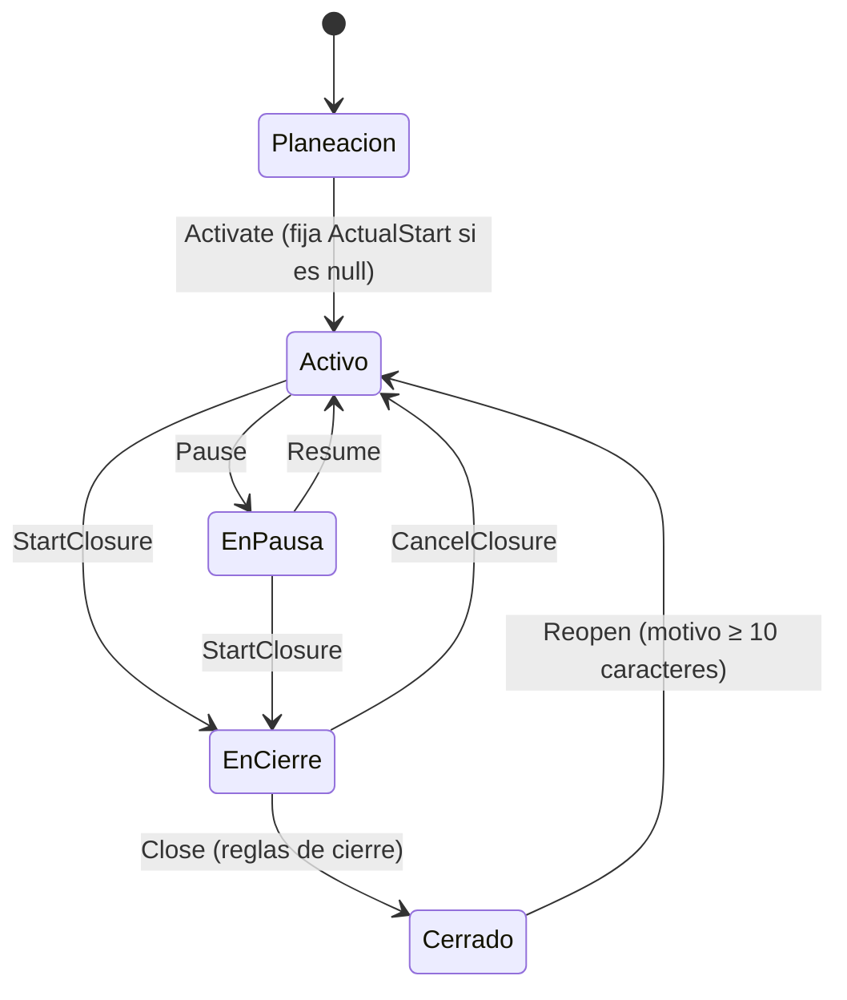

# Modelo de datos — ProjectM

Documento derivado **exclusivamente del código fuente** de la rama `vercel` (EF Core 9 + PostgreSQL vía Npgsql). Cada afirmación cita entre paréntesis el archivo de origen. Lo que no se puede confirmar desde el código se marca con **⚠️ A CONFIRMAR**.

Rutas abreviadas usadas en las citas:

| Alias | Ruta real |
|---|---|
| `Domain/…` | `backend/src/ProjectM.Domain/…` |
| `Persistence/…` | `backend/src/ProjectM.Api/Infrastructure/Persistence/…` |
| `Migrations/Inicial.cs` | `backend/src/ProjectM.Api/Infrastructure/Persistence/Migrations/20261016220932_Inicial.cs` |
| `Seed/…` | `backend/src/ProjectM.Api/Infrastructure/Seed/…` |
| `Features/…` | `backend/src/ProjectM.Api/Features/…` |
| `Api/…` | `backend/src/ProjectM.Api/…` |

---

## 1. Visión general

- Un único `DbContext`, `AppDbContext`, que hereda de `IdentityDbContext<AppUser, AppRole, Guid>`: las tablas de ASP.NET Identity y las de negocio viven en la misma base (`Persistence/AppDbContext.cs`).
- Proveedor: Npgsql (`UseNpgsql(...)` con `EnableRetryOnFailure(5)`); la cadena de conexión acepta formato clave=valor o URI `postgresql://…` (la que muestra Supabase), y las URIs se convierten exigiendo SSL (`Api/Program.cs`, `Persistence/ConnectionStrings.cs`).
- La rama `main` usa SQL Server con otras migraciones (`Fase1_Identidad`, `Fase2_Proyectos`, `Fase5_Colaboracion`), secuencia `NEXT VALUE FOR` y columna calculada `CONCAT('PRJ-', …)`; este documento solo describe PostgreSQL (`git show main:backend/src/ProjectM.Api/Infrastructure/Persistence/Configurations/ProjectConfigurations.cs`; `CLAUDE.md`).
- Esquema: `public` (no se configura otro esquema en `Persistence/AppDbContext.cs`).
- Áreas del dominio (`Domain/`):
  - **Users**: `AppUser`, `AppRole`, `RefreshToken`, roles globales (`Domain/Users/AppUser.cs`).
  - **Projects**: `Space`, `Client`, `Project`, `ProjectMember`, `Milestone`, `Risk`, `ProjectTemplate`, `ProjectTemplateTask`, cierre (`ClosureChecklistTemplateItem`, `ProjectClosureChecklistItem`, `ProjectClosure`, `LessonLearned`) (`Domain/Projects/*.cs`).
  - **Tasks**: `TaskList`, `TaskItem`, `Tag`, `TaskTag`, `CustomFieldDefinition`, `CustomFieldValue`, `Attachment` (`Domain/Tasks/*.cs`).
  - **Collaboration**: `Comment`, `ActivityLog`, `Notification` (`Domain/Collaboration/Collaboration.cs`).
  - **Common**: `Entity` (base con `Id` y eventos de dominio), `Guard`, `DomainException` (`Domain/Common/*.cs`).

### 1.1 Convenciones globales de mapeo

| Convención | Detalle | Fuente |
|---|---|---|
| Strings sin longitud explícita | `varchar(500)` (`HaveMaxLength(500)`). Por eso columnas de Identity como `PasswordHash`, `SecurityStamp`, `PhoneNumber`, `ClaimType` quedan en `character varying(500)` | `Persistence/AppDbContext.cs` (`ConfigureConventions`), `Migrations/Inicial.cs` |
| Decimales | `numeric(18,2)` por defecto (salvo `CustomFieldValues.NumberValue`, `numeric(18,4)`) | `Persistence/AppDbContext.cs`, `Persistence/Configurations/TaskConfigurations.cs` |
| Enums | Se guardan como **texto** (`HasConversion<string>()`, `varchar(20)`) y la API los serializa como string (`JsonStringEnumConverter`, también en SignalR) | `Persistence/Configurations/*.cs`, `Api/Program.cs` |
| `Id` | `Guid` generado en cliente (`Guid.NewGuid()` en `Entity`), y `ValueGeneratedNever()` para toda entidad que hereda de `Entity` | `Domain/Common/Entity.cs`, `Persistence/AppDbContext.cs` |
| `DomainEvents` | Ignorado en el modelo (no se persiste) | `Persistence/AppDbContext.cs` |
| Fechas de calendario | `DateOnly` → `date` | `Migrations/Inicial.cs` |
| Instantes | `DateTimeOffset` → `timestamp with time zone`; se obtienen de `AppClock.Now` (= `TimeProvider.GetUtcNow()`, UTC) | `Migrations/Inicial.cs`, `Api/Infrastructure/AppClock.cs` |
| Concurrencia | `uint RowVersion` → columna de sistema `xmin` (`xid`) en `Projects` y `Tasks` | `Persistence/Configurations/ProjectConfigurations.cs`, `Persistence/Configurations/TaskConfigurations.cs`, `Migrations/Inicial.cs` |
| Borrado lógico | `IsDeleted` + `HasQueryFilter(!IsDeleted)` en `Tasks`, `Comments` y `Attachments` | `Persistence/Configurations/TaskConfigurations.cs`, `Persistence/Configurations/CollaborationConfigurations.cs` |
| Valores por defecto | Salvo `Projects.Number` (`nextval`), **no hay defaults en BD**: los valores iniciales son inicializadores de C# en las entidades | `Migrations/Inicial.cs`, `Domain/**` |

---

## 2. Diagrama entidad-relación

Las relaciones sin FK física en la base (columnas `Guid` sueltas) se omiten del diagrama y se describen en cada sección.

```mermaid
erDiagram
    Users ||--o{ UserRoles : "tiene"
    Roles ||--o{ UserRoles : "asigna"
    Users ||--o{ UserClaims : "tiene"
    Users ||--o{ UserLogins : "tiene"
    Users ||--o{ UserTokens : "tiene"
    Roles ||--o{ RoleClaims : "tiene"
    Users ||--o{ RefreshTokens : "posee"

    Spaces ||--o{ Projects : "agrupa"
    Clients |o--o{ Projects : "cliente de"
    Users ||--o{ Projects : "gestiona (ManagerId)"
    Projects ||--o{ ProjectMembers : "tiene"
    Users ||--o{ ProjectMembers : "es miembro"
    Projects ||--o{ Milestones : "tiene"
    Projects ||--o{ Risks : "tiene"
    Users |o--o{ Risks : "responsable (OwnerId)"
    Projects ||--o{ ProjectClosureChecklistItems : "checklist"
    Users |o--o{ ProjectClosureChecklistItems : "marcado por (DoneById)"
    Projects ||--o| ProjectClosures : "acta"
    Users |o--o{ ProjectClosures : "cerrado por (ClosedById)"
    ProjectClosures ||--o{ LessonsLearned : "lecciones"
    ProjectTemplates ||--o{ ProjectTemplateTasks : "tareas plantilla"

    Projects ||--o{ TaskLists : "listas"
    TaskLists ||--o{ Tasks : "contiene"
    Projects ||--o{ Tasks : "pertenece (NoAction)"
    Tasks |o--o{ Tasks : "subtareas (ParentTaskId)"
    Milestones |o--o{ Tasks : "hito (MilestoneId)"
    Users |o--o{ Tasks : "responsable (AssigneeId)"
    Users ||--o{ Tasks : "creada por (CreatedById)"
    Tasks ||--o{ TaskTags : "etiquetas"
    Tags ||--o{ TaskTags : "etiqueta"
    Projects ||--o{ CustomFieldDefinitions : "campos"
    CustomFieldDefinitions ||--o{ CustomFieldValues : "valores"
    Tasks ||--o{ CustomFieldValues : "valores"
    Tasks ||--o{ Attachments : "adjuntos"
    Users ||--o{ Attachments : "subido por"

    Tasks ||--o{ Comments : "comentarios"
    Users ||--o{ Comments : "autor"
    Projects ||--o{ ActivityLogs : "historial"
    Users |o--o{ ActivityLogs : "actor"
    Users ||--o{ Notifications : "destinatario"

    ClosureChecklistTemplateItems {
        uuid Id PK
    }
```



(Fuentes: `Persistence/Configurations/*.cs`, `Persistence/AppDbContext.cs`, `Migrations/Inicial.cs`. `ClosureChecklistTemplateItems` no tiene relaciones: se **copia** al proyecto al iniciar el cierre, `Domain/Projects/Project.cs#StartClosure`.)

---

## 3. Enumeraciones

Todas se persisten como `varchar(20)` con el nombre del miembro y se serializan como string en la API (`Persistence/Configurations/*.cs`, `Api/Program.cs`).

| Enum | Valores (persistidos/serializados) | Etiqueta legible | Fuente |
|---|---|---|---|
| `ProjectStatus` | `Planeacion`, `Activo`, `EnPausa`, `EnCierre`, `Cerrado` | Planeación, Activo, En pausa, En cierre, Cerrado | `Domain/Projects/Enums.cs`, `Domain/Projects/Project.cs#Label` |
| `ProjectHealth` | `EnTiempo`, `EnRiesgo`, `Retrasado` | — | `Domain/Projects/Enums.cs` |
| `RiskStatus` | `Abierto`, `Mitigado`, `Cerrado` | — | `Domain/Projects/Enums.cs` |
| `TaskItemStatus` | `Pendiente`, `EnProgreso`, `EnRevision`, `Completada`, `Bloqueada` | Pendiente, En progreso, En revisión, Completada, Bloqueada | `Domain/Tasks/TaskItem.cs`, `Domain/Collaboration/Collaboration.cs#TaskStatusLabels` |
| `TaskPriority` | `Baja`, `Normal`, `Alta`, `Urgente` | — | `Domain/Tasks/TaskItem.cs` |
| `CustomFieldType` | `Texto`, `Numero`, `Fecha`, `Seleccion` | — | `Domain/Tasks/TaskExtras.cs` |
| `DomainErrorKind` (no persistido) | `Validation` (HTTP 400), `Conflict` (HTTP 409) | — | `Domain/Common/DomainException.cs`, `Api/Infrastructure/Errors/GlobalExceptionHandler.cs` |

"Vencida" **no es un estado**: se deriva de `DueDate < hoy` en tareas abiertas (`Domain/Tasks/TaskItem.cs#IsOverdue`).

Constantes de texto (no enums, columnas `varchar(50)`):

- `ActivityTypes`: `ProjectCreated`, `TaskCreated`, `TaskUpdated`, `TaskStatusChanged`, `TaskAssigned`, `TaskDeleted`, `CommentAdded`, `AttachmentAdded`, `ProjectStatusChanged`, `ProjectClosed`, `ProjectReopened`, `MemberAdded` (`Domain/Collaboration/Collaboration.cs`).
- `NotificationTypes`: `TaskAssigned`, `TaskStatusChanged`, `Mention`, `Comment`, `TaskDueSoon`, `TaskOverdue`, `ProjectClosed`, `ProjectReopened`, `AddedToProject` (`Domain/Collaboration/Collaboration.cs`).
- Roles globales (tabla `Roles`): `Admin`, `Gestor`, `Miembro`, `Observador` (`Domain/Users/AppUser.cs#Roles`).

---

## 4. Usuarios e identidad

### 4.1 `Users` (`AppUser : IdentityUser<Guid>`)

Tabla renombrada de `AspNetUsers` a `Users` (`Persistence/AppDbContext.cs`).

| Columna | Tipo | Null | Notas |
|---|---|---|---|
| `Id` | `uuid` | no | PK. Generado en cliente (`Seed/IdentitySeeder.cs` usa `Guid.NewGuid()`) |
| `FullName` | `varchar(150)` | no | Obligatorio (`Persistence/AppDbContext.cs`) |
| `IsActive` | `boolean` | no | C#: `true` por defecto. Un usuario inactivo no puede iniciar sesión (`Domain/Users/AppUser.cs`, `Features/Auth/*.cs`) |
| `CreatedAt` | `timestamptz` | no | |
| `UserName`, `NormalizedUserName`, `Email`, `NormalizedEmail` | `varchar(256)` | sí | Columnas estándar de Identity |
| `EmailConfirmed`, `PhoneNumberConfirmed`, `TwoFactorEnabled`, `LockoutEnabled` | `boolean` | no | Identity |
| `PasswordHash`, `SecurityStamp`, `ConcurrencyStamp`, `PhoneNumber` | `varchar(500)` | sí | Identity (longitud por la convención global) |
| `LockoutEnd` | `timestamptz` | sí | Identity |
| `AccessFailedCount` | `integer` | no | Identity |

(Columnas: `Migrations/Inicial.cs`.)

Índices: `UserNameIndex` único sobre `NormalizedUserName`; `EmailIndex` sobre `NormalizedEmail` (no único); `IX_Users_IsActive` (`Migrations/Inicial.cs`, `Persistence/AppDbContext.cs`).

Relaciones: los usuarios son referenciados por casi todas las tablas con `ON DELETE RESTRICT` (gestor, miembro, responsable, autor, etc.) salvo `RefreshTokens`, `Notifications` y las tablas de Identity, que hacen cascada (ver cada sección). En la práctica no hay borrado físico de usuarios, sino `IsActive` (⚠️ A CONFIRMAR: no se revisó todo `Features/Users`; la combinación de FKs `Restrict` hace inviable borrar un usuario con actividad).

### 4.2 Tablas de Identity renombradas

| Tabla | Clave | Notas | Fuente |
|---|---|---|---|
| `Roles` (`AppRole`) | `Id uuid` | `Name`/`NormalizedName varchar(256)`, `ConcurrencyStamp varchar(500)`; índice único `RoleNameIndex` sobre `NormalizedName` | `Persistence/AppDbContext.cs`, `Migrations/Inicial.cs` |
| `UserRoles` | PK (`UserId`, `RoleId`) | FKs a `Users` y `Roles` en cascada; índice `IX_UserRoles_RoleId` | idem |
| `UserClaims` | `Id integer` identity (`IdentityByDefaultColumn`) | FK `UserId` → `Users` cascada | idem |
| `UserLogins` | PK (`LoginProvider`, `ProviderKey`) | FK `UserId` → `Users` cascada | idem |
| `UserTokens` | PK (`UserId`, `LoginProvider`, `Name`) | FK `UserId` → `Users` cascada | idem |
| `RoleClaims` | `Id integer` identity | FK `RoleId` → `Roles` cascada | idem |

El rol global de un usuario vive en `UserRoles` (`Domain/Users/AppUser.cs`).

### 4.3 `RefreshTokens` (`RefreshToken`)

| Columna | Tipo | Null | Notas |
|---|---|---|---|
| `Id` | `uuid` | no | PK. `RefreshToken` **no** hereda de `Entity`, así que no recibe `ValueGeneratedNever` explícito (⚠️ A CONFIRMAR: quién asigna el `Id`; por convención EF lo genera en cliente para `Guid`) |
| `UserId` | `uuid` | no | FK → `Users.Id`, **CASCADE** |
| `TokenHash` | `varchar(64)` | no | Solo se guarda el hash SHA-256 del token; índice **único** |
| `CreatedAt`, `ExpiresAt` | `timestamptz` | no | |
| `RevokedAt` | `timestamptz` | sí | |
| `ReplacedById` | `uuid` | sí | Token que lo sustituyó en la rotación. **Sin FK** |
| `CreatedByIp` | `varchar(64)` | sí | |

Índices: `IX_RefreshTokens_TokenHash` (único), `IX_RefreshTokens_UserId_ExpiresAt`. Regla: activo si `RevokedAt is null && ExpiresAt > now` (`Domain/Users/AppUser.cs`, `Persistence/Configurations/RefreshTokenConfiguration.cs`, `Migrations/Inicial.cs`).

---

## 5. Proyectos

### 5.1 `Spaces` (`Space`)

Agrupador de proyectos (área, departamento, línea de negocio) (`Domain/Projects/Space.cs`).

| Columna | Tipo | Null | Notas |
|---|---|---|---|
| `Id` | `uuid` | no | PK |
| `Name` | `varchar(100)` | no | Índice **único** `IX_Spaces_Name` |
| `Description` | `varchar(500)` | sí | |
| `Color` | `varchar(20)` | no | Nombre de tono de la paleta (`primary`, `secondary`, `accent`, `success`, `danger`); C#: `"primary"` |
| `Position` | `integer` | no | Orden |
| `CreatedAt` | `timestamptz` | no | |

(`Persistence/Configurations/ProjectConfigurations.cs`, `Migrations/Inicial.cs`.) Un espacio con proyectos no se puede eliminar: FK `Projects.SpaceId` es `RESTRICT` y el endpoint lo comprueba antes (`Features/Spaces/SpaceEndpoints.cs`).

### 5.2 `Clients` (`Client`)

| Columna | Tipo | Null | Notas |
|---|---|---|---|
| `Id` | `uuid` | no | PK |
| `Name` | `varchar(150)` | no | Índice **único** `IX_Clients_Name` |
| `CreatedAt` | `timestamptz` | no | |

(`Domain/Projects/Space.cs`, `Persistence/Configurations/ProjectConfigurations.cs`, `Migrations/Inicial.cs`.)

### 5.3 `Projects` (`Project`)

| Columna | Tipo | Null | Notas |
|---|---|---|---|
| `Id` | `uuid` | no | PK |
| `Number` | `integer` | no | `DEFAULT nextval('"ProjectNumbers"')`; índice **único** `IX_Projects_Number` |
| `Code` | `varchar(20)` | no | **Columna generada almacenada**: `'PRJ-' \|\| CASE WHEN "Number" > 9999 THEN "Number"::text ELSE lpad("Number"::text, 4, '0') END` → `PRJ-0001`. Setter privado en el dominio. Índice `IX_Projects_Code` (no único) |
| `SpaceId` | `uuid` | no | FK → `Spaces.Id`, **RESTRICT**; índice |
| `Name` | `varchar(150)` | no | |
| `ClientId` | `uuid` | sí | FK → `Clients.Id`, **RESTRICT**; índice |
| `Objective` | `varchar(2000)` | sí | |
| `Scope` | `varchar(4000)` | sí | |
| `PlannedStart`, `PlannedEnd` | `date` | no | |
| `ActualStart`, `ActualEnd` | `date` | sí | Se fijan en `Activate` y `Close` |
| `Budget` | `numeric(18,2)` | sí | |
| `Currency` | `varchar(3)` | no | C#: `"USD"` |
| `ManagerId` | `uuid` | no | FK → `Users.Id`, **RESTRICT**; índice |
| `Status` | `varchar(20)` | no | `ProjectStatus`; setter privado (solo cambia por métodos de ciclo de vida); C#: `Planeacion`; índice `IX_Projects_Status` |
| `Health` | `varchar(20)` | no | `ProjectHealth`; C#: `EnTiempo` |
| `TemplateId` | `uuid` | sí | Plantilla usada al abrir. **Sin FK** (⚠️ A CONFIRMAR si es intencional, p. ej. para poder borrar plantillas) |
| `CreatedAt` | `timestamptz` | no | |
| `CreatedById` | `uuid` | no | **Sin FK** a `Users` (⚠️ A CONFIRMAR si es intencional) |
| `ClosedAt` | `timestamptz` | sí | Setter privado |
| `ClosedById` | `uuid` | sí | Setter privado. **Sin FK** (⚠️ A CONFIRMAR) |
| `xmin` | `xid` | no | Propiedad `RowVersion` (`uint`), token de concurrencia (`IsRowVersion()`) |

(`Domain/Projects/Project.cs`, `Persistence/Configurations/ProjectConfigurations.cs`, `Migrations/Inicial.cs`.)

Hijos con borrado en **cascada** desde `Projects`: `ProjectMembers`, `Milestones`, `Risks`, `ProjectClosureChecklistItems`, `ProjectClosures`, `TaskLists`, `CustomFieldDefinitions`, `ActivityLogs`. `Tasks.ProjectId` es **NO ACTION** (las tareas se borran por la ruta `Projects → TaskLists → Tasks`) (`Persistence/Configurations/*.cs`). No existe endpoint para borrar proyectos (no hay `MapDelete` de proyecto en `Features/Projects/ProjectEndpoints.cs`).

#### Ciclo de vida (máquina de estados)



Reglas (`Domain/Projects/Project.cs`, `Domain/Projects/Closure.cs`):

- Toda transición pasa por `Transition(to, allowedFrom…)`: si el proyecto está `Cerrado` lanza `PROYECTO_CERRADO`; si el estado actual no está permitido lanza `TRANSICION_INVALIDA` ("No se puede pasar de X a Y"). Cada transición levanta `ProjectStatusChanged`.
- `StartClosure`: copia el checklist global (`ClosureChecklistTemplateItems`, ordenado por `Position`) al proyecto **solo si aún no tiene ítems**, y crea el borrador del acta (`ProjectClosure`) si no existe.
- `Close(metrics, force, justification, …)`: exige estado `EnCierre` (si no, `TRANSICION_INVALIDA`). `ClosureRules.Validate` reúne los problemas y se lanza el primero:
  - `CHECKLIST_INCOMPLETO` — hay ítems obligatorios sin marcar.
  - `ACTA_INCOMPLETA` (validación) — el acta no tiene `Summary`.
  - `TAREAS_ABIERTAS` — hay tareas abiertas y no se pidió cierre forzado.
  - `JUSTIFICACION_REQUERIDA` (validación) — cierre forzado con justificación de menos de 20 caracteres (`MinJustificationLength = 20`).
  - Al cerrar copia al acta las fechas planeadas/reales, métricas (`TotalTasks`, `CompletedTasks`, `OpenTasksAtClose`), `IsForced = force && OpenTasks > 0`, `ForceJustification`, `ClosedById/At`; fija `ActualEnd = hoy`, `ClosedAt`, `ClosedById`, estado `Cerrado`, y levanta `ProjectStatusChanged` + `ProjectClosed`.
- `Reopen(reason)`: solo desde `Cerrado` (`TRANSICION_INVALIDA`), motivo obligatorio ≥ 10 caracteres (`MOTIVO_REQUERIDO`); vuelve a `Activo`, limpia `ActualEnd`, `ClosedAt`, `ClosedById`; levanta `ProjectStatusChanged` + `ProjectReopened`. Que solo un Admin pueda reabrir se valida en la capa de autorización (comentario en `Domain/Projects/Project.cs`).
- `EnsureEditable()`: un proyecto cerrado es de solo lectura (`PROYECTO_CERRADO`). El chequeo centralizado de escritura lo hace `ProjectGuard` (`CLAUDE.md`).
- `ForceStatusForSeed`: fija el estado sin reglas, solo para seed/pruebas.
- `ProjectMetrics(TotalTasks, CompletedTasks)`: `OpenTasks = Total − Completed`; `ProgressPercent` redondeado, 0 si no hay tareas.

### 5.4 `ProjectMembers` (`ProjectMember`)

| Columna | Tipo | Null | Notas |
|---|---|---|---|
| `ProjectId` | `uuid` | no | PK compuesta; FK → `Projects.Id`, **CASCADE** |
| `UserId` | `uuid` | no | PK compuesta; FK → `Users.Id`, **RESTRICT**; índice `IX_ProjectMembers_UserId` |
| `AddedAt` | `timestamptz` | no | |

No hereda de `Entity` (sin `Id` propio) (`Domain/Projects/Project.cs`, `Persistence/Configurations/ProjectConfigurations.cs`, `Migrations/Inicial.cs`). Agregar miembros genera el evento `MemberAdded` vía `db.AddEvent` (`Features/Projects/ProjectEndpoints.cs`).

### 5.5 `Milestones` (`Milestone`)

| Columna | Tipo | Null | Notas |
|---|---|---|---|
| `Id` | `uuid` | no | PK |
| `ProjectId` | `uuid` | no | FK → `Projects.Id`, **CASCADE** |
| `Name` | `varchar(150)` | no | |
| `Description` | `varchar(1000)` | sí | |
| `DueDate` | `date` | no | |
| `CompletedAt` | `timestamptz` | sí | |

Índice `IX_Milestones_ProjectId_DueDate`. `Tasks.MilestoneId` es **NO ACTION**, por eso al borrar un hito el endpoint primero pone `MilestoneId = null` en sus tareas (incluidas las borradas lógicamente) (`Domain/Projects/Tracking.cs`, `Persistence/Configurations/ProjectConfigurations.cs`, `Features/Projects/TrackingEndpoints.cs`).

### 5.6 `Risks` (`Risk`)

| Columna | Tipo | Null | Notas |
|---|---|---|---|
| `Id` | `uuid` | no | PK |
| `ProjectId` | `uuid` | no | FK → `Projects.Id`, **CASCADE** |
| `Title` | `varchar(200)` | no | |
| `Description` | `varchar(2000)` | sí | |
| `Probability` | `integer` | no | 1 = baja, 2 = media, 3 = alta; C#: 2; el validador exige 1–3 |
| `Impact` | `integer` | no | C#: 2; el validador exige 1–3 |
| `Status` | `varchar(20)` | no | `RiskStatus`; C#: `Abierto` |
| `OwnerId` | `uuid` | sí | FK → `Users.Id`, **RESTRICT** |
| `Mitigation` | `varchar(2000)` | sí | |
| `CreatedAt` | `timestamptz` | no | |

`Severity = Probability × Impact` es calculada en C# y **no se persiste** (`Ignore`). Índices `IX_Risks_ProjectId_Status`, `IX_Risks_OwnerId` (`Domain/Projects/Tracking.cs`, `Persistence/Configurations/ProjectConfigurations.cs`, `Features/Projects/TrackingEndpoints.cs`, `Migrations/Inicial.cs`).

### 5.7 `ProjectTemplates` y `ProjectTemplateTasks`

`ProjectTemplates` (`ProjectTemplate`): `Id uuid` PK, `Name varchar(150)` no nulo con índice **único**, `Description varchar(1000)` nula, `CreatedAt timestamptz` (`Domain/Projects/Tracking.cs`, `Persistence/Configurations/ProjectConfigurations.cs`, `Migrations/Inicial.cs`).

`ProjectTemplateTasks` (`ProjectTemplateTask`):

| Columna | Tipo | Null | Notas |
|---|---|---|---|
| `Id` | `uuid` | no | PK |
| `TemplateId` | `uuid` | no | FK → `ProjectTemplates.Id`, **CASCADE**; índice |
| `ListName` | `varchar(100)` | no | Lista que se crea en el proyecto; C#: `"General"` |
| `Title` | `varchar(200)` | no | |
| `Description` | `varchar(4000)` | sí | |
| `Priority` | `varchar(20)` | no | `TaskPriority`; C#: `Normal` |
| `StartOffsetDays` | `integer` | no | Días desde el inicio planeado del proyecto |
| `DurationDays` | `integer` | no | C#: 1 |
| `Position` | `integer` | no | |

(`Domain/Projects/Tracking.cs`, `Persistence/Configurations/ProjectConfigurations.cs`, `Migrations/Inicial.cs`.)

### 5.8 `ClosureChecklistTemplateItems` (`ClosureChecklistTemplateItem`)

Checklist de cierre global, configurable por Admin (`Domain/Projects/Closure.cs`).

| Columna | Tipo | Null | Notas |
|---|---|---|---|
| `Id` | `uuid` | no | PK |
| `Text` | `varchar(300)` | no | |
| `IsRequired` | `boolean` | no | C#: `true` |
| `Position` | `integer` | no | |

Sin relaciones ni índices adicionales (`Persistence/Configurations/ProjectConfigurations.cs`, `Migrations/Inicial.cs`).

### 5.9 `ProjectClosureChecklistItems` (`ProjectClosureChecklistItem`)

Copia del checklist en el proyecto al iniciar el cierre (`Domain/Projects/Closure.cs`).

| Columna | Tipo | Null | Notas |
|---|---|---|---|
| `Id` | `uuid` | no | PK |
| `ProjectId` | `uuid` | no | FK → `Projects.Id`, **CASCADE**; índice |
| `Text` | `varchar(300)` | no | |
| `IsRequired` | `boolean` | no | |
| `Position` | `integer` | no | |
| `IsDone` | `boolean` | no | |
| `DoneById` | `uuid` | sí | FK → `Users.Id`, **RESTRICT**; índice |
| `DoneAt` | `timestamptz` | sí | |
| `Notes` | `varchar(1000)` | sí | |

(`Persistence/Configurations/ProjectConfigurations.cs`, `Migrations/Inicial.cs`.)

### 5.10 `ProjectClosures` (`ProjectClosure`) — acta de cierre

Relación **1:0..1** con `Projects`: la PK es `ProjectId` (no hereda de `Entity`) (`Domain/Projects/Closure.cs`, `Persistence/Configurations/ProjectConfigurations.cs`).

| Columna | Tipo | Null | Notas |
|---|---|---|---|
| `ProjectId` | `uuid` | no | PK y FK → `Projects.Id`, **CASCADE** |
| `Summary` | `varchar(4000)` | sí | Obligatorio para cerrar (`ACTA_INCOMPLETA`) |
| `Deliverables` | `text[]` | no | Lista de entregables (colección primitiva) |
| `PlannedStart`, `PlannedEnd`, `ActualStart`, `ActualEnd` | `date` | sí | Se copian del proyecto al cerrar |
| `TotalTasks`, `CompletedTasks`, `OpenTasksAtClose` | `integer` | no | Métricas al cerrar |
| `IsForced` | `boolean` | no | |
| `ForceJustification` | `varchar(2000)` | sí | Solo si `IsForced` |
| `ClosedById` | `uuid` | sí | FK → `Users.Id`, **RESTRICT**; índice |
| `ClosedAt` | `timestamptz` | sí | |

(`Migrations/Inicial.cs`.)

### 5.11 `LessonsLearned` (`LessonLearned`)

| Columna | Tipo | Null | Notas |
|---|---|---|---|
| `Id` | `uuid` | no | PK |
| `ProjectId` | `uuid` | no | FK → **`ProjectClosures.ProjectId`** (no a `Projects`), **CASCADE**; índice |
| `Category` | `varchar(100)` | no | C#: `"General"` |
| `WhatWentWell`, `WhatToImprove`, `Recommendation` | `varchar(2000)` | sí | |
| `Position` | `integer` | no | |

La FK cuelga del acta (`ProjectClosure.Lessons`), así que una lección requiere que exista el acta del proyecto (`Domain/Projects/Closure.cs`, `Persistence/Configurations/ProjectConfigurations.cs`, `Migrations/Inicial.cs`).

---

## 6. Tareas

### 6.1 `TaskLists` (`TaskList`)

| Columna | Tipo | Null | Notas |
|---|---|---|---|
| `Id` | `uuid` | no | PK |
| `ProjectId` | `uuid` | no | FK → `Projects.Id`, **CASCADE** |
| `Name` | `varchar(100)` | no | |
| `Position` | `integer` | no | Orden entero; al crear = número de listas del proyecto; al reordenar = índice en la lista enviada |
| `CreatedAt` | `timestamptz` | no | |

Índice `IX_TaskLists_ProjectId_Position` (`Domain/Tasks/TaskItem.cs`, `Persistence/Configurations/TaskConfigurations.cs`, `Features/Tasks/TaskSupportEndpoints.cs`). Borrar una lista elimina **físicamente** sus tareas (primero subtareas, luego padres, ignorando el filtro de borrado lógico) (`Features/Tasks/TaskSupportEndpoints.cs`).

### 6.2 `Tasks` (`TaskItem`)

| Columna | Tipo | Null | Notas |
|---|---|---|---|
| `Id` | `uuid` | no | PK |
| `ProjectId` | `uuid` | no | FK → `Projects.Id`, **NO ACTION** (desnormalizado para consultas/permisos) |
| `ListId` | `uuid` | no | FK → `TaskLists.Id`, **CASCADE** |
| `ParentTaskId` | `uuid` | sí | FK → `Tasks.Id` (autorreferencia, subtareas), **NO ACTION**; índice |
| `MilestoneId` | `uuid` | sí | FK → `Milestones.Id`, **NO ACTION**; índice |
| `Title` | `varchar(200)` | no | |
| `Description` | `text` | sí | Columna `text` sin límite en BD (⚠️ A CONFIRMAR: el snapshot conserva la anotación `maxLength: 500` de la convención global; no se verificó si el validador limita la longitud) |
| `AssigneeId` | `uuid` | sí | FK → `Users.Id`, **RESTRICT** |
| `Status` | `varchar(20)` | no | `TaskItemStatus`; setter privado; C#: `Pendiente` |
| `Priority` | `varchar(20)` | no | `TaskPriority`; C#: `Normal` |
| `StartDate`, `DueDate` | `date` | sí | |
| `CompletedAt` | `timestamptz` | sí | Setter privado; lo gestiona `ChangeStatus` |
| `BlockedReason` | `varchar(500)` | sí | Setter privado; solo con estado `Bloqueada` |
| `Position` | `double precision` | no | Orden fraccional (ver §9) |
| `CreatedById` | `uuid` | no | FK → `Users.Id`, **RESTRICT**; índice |
| `CreatedAt`, `UpdatedAt` | `timestamptz` | no | |
| `IsDeleted` | `boolean` | no | Borrado lógico + filtro global |
| `xmin` | `xid` | no | `RowVersion`, token de concurrencia |

(`Domain/Tasks/TaskItem.cs`, `Persistence/Configurations/TaskConfigurations.cs`, `Migrations/Inicial.cs`.)

Índices:

| Índice | Columnas | Notas |
|---|---|---|
| `IX_Tasks_ProjectId_Status` | `ProjectId`, `Status` | |
| `IX_Tasks_ListId_Position` | `ListId`, `Position` | |
| `IX_Tasks_AssigneeId_Status_DueDate` | `AssigneeId`, `Status`, `DueDate` | "Mis tareas" / carga |
| `IX_Tasks_ParentTaskId` | `ParentTaskId` | |
| `IX_Tasks_MilestoneId` | `MilestoneId` | |
| `IX_Tasks_CreatedById` | `CreatedById` | Creado por convención de FK |
| `IX_Tasks_DueDate` | `DueDate` | **Filtrado**: `WHERE "CompletedAt" IS NULL AND NOT "IsDeleted"` (tareas abiertas, para vencimientos) |

(`Persistence/Configurations/TaskConfigurations.cs`, `Migrations/Inicial.cs`.)

Comportamiento de borrado: el comentario de configuración explica que solo `Project → Lists → Tasks` hace cascada y el resto es `NoAction` para evitar rutas múltiples de cascada en SQL Server (`Persistence/Configurations/TaskConfigurations.cs`). El borrado de una tarea por la API es **lógico** y alcanza también a sus subtareas (`IsDeleted = true` vía `ExecuteUpdate`, más evento `TaskDeleted` con `db.AddEvent`) (`Features/Tasks/TaskEndpoints.cs#Delete`).

Reglas de dominio (`Domain/Tasks/TaskItem.cs`, `Features/Tasks/TaskEndpoints.cs`):

- `ChangeStatus(status, blockedReason, now)`:
  - Pasar a `Bloqueada` exige motivo (`MOTIVO_BLOQUEO_REQUERIDO`, validación); el motivo se recorta y admite máx. 500 caracteres (`Guard.Required`). Al salir de `Bloqueada` el motivo se limpia.
  - Pasar a `Completada` fija `CompletedAt = now` (se conserva si ya estaba completada); salir de `Completada` lo limpia.
  - Actualiza `UpdatedAt` y, si el estado cambia, levanta `TaskStatusChanged`.
  - No hay restricción de transiciones entre estados de tarea: cualquier estado puede pasar a cualquier otro (solo aplican las reglas anteriores).
- Completar una tarea exige que todos los campos personalizados obligatorios del proyecto tengan valor (`CAMPOS_REQUERIDOS`, `TaskRules.EnsureRequiredFieldsAsync`).
- `SetDates(start, due)`: `DueDate` no puede ser anterior a `StartDate` (`RANGO_FECHAS`, `Guard.DateRange`).
- `Assign(assigneeId)`: si cambia y no es nulo, levanta `TaskAssigned`. El responsable debe ser miembro del proyecto y el hito debe pertenecer al proyecto (`TaskRules.ValidateRefsAsync`).
- Al mover una tarea a otra lista, sus subtareas la acompañan (`ExecuteUpdate` de `ListId`) (`Features/Tasks/TaskEndpoints.cs#Move`).
- `IsOpen = Status != Completada`; `IsOverdue(today) = IsOpen && DueDate < today`.

### 6.3 `Tags` (`Tag`) y `TaskTags` (`TaskTag`)

`Tags`: etiqueta global reutilizable entre proyectos. `Id uuid` PK; `Name varchar(50)` no nulo con índice **único**; `Color varchar(20)` no nulo (tono de paleta: `primary`, `secondary`, `accent`, `success`, `danger`, `neutral`; C#: `"secondary"`) (`Domain/Tasks/TaskExtras.cs`, `Persistence/Configurations/TaskConfigurations.cs`, `Migrations/Inicial.cs`).

`TaskTags` (N:M): PK (`TaskId`, `TagId`); `TaskId` → `Tasks.Id` **CASCADE**; `TagId` → `Tags.Id` **CASCADE**; índice `IX_TaskTags_TagId`. Asignar etiquetas reemplaza el conjunto completo (borra y reinserta solo IDs válidos) (`Persistence/Configurations/TaskConfigurations.cs`, `Features/Tasks/TaskEndpoints.cs#SetTags`).

### 6.4 `CustomFieldDefinitions` (`CustomFieldDefinition`)

Campo personalizado a nivel de proyecto (`Domain/Tasks/TaskExtras.cs`).

| Columna | Tipo | Null | Notas |
|---|---|---|---|
| `Id` | `uuid` | no | PK |
| `ProjectId` | `uuid` | no | FK → `Projects.Id`, **CASCADE** |
| `Name` | `varchar(100)` | no | |
| `Type` | `varchar(20)` | no | `CustomFieldType` |
| `Options` | `text[]` | no | Opciones válidas para `Seleccion` |
| `IsRequired` | `boolean` | no | |
| `Position` | `integer` | no | Al crear = número de campos del proyecto |

Índice `IX_CustomFieldDefinitions_ProjectId_Position` (`Persistence/Configurations/TaskConfigurations.cs`, `Migrations/Inicial.cs`, `Features/Tasks/TaskSupportEndpoints.cs`).

Reglas (`CustomFieldDefinition.Parse`, `Domain/Tasks/TaskExtras.cs`):

- Valor vacío: si el campo es obligatorio y `enforceRequired` → `CAMPO_REQUERIDO` (un obligatorio no puede vaciarse); si no, se interpreta como "sin valor" (null).
- `Texto`: máx. 1000 caracteres → `TextValue`.
- `Numero`: `decimal` en cultura invariante → `NumberValue`.
- `Fecha`: formato `yyyy-MM-dd` → `DateValue`.
- `Seleccion`: debe estar en `Options` → `TextValue`.
- Errores de formato: `CAMPO_INVALIDO` (validación).
- Los obligatorios **no bloquean el alta rápida** de tareas; se exigen al completar (`CLAUDE.md`, `Features/Tasks/TaskEndpoints.cs#TaskRules`).
- Al cambiar las opciones de un campo de selección se borran los valores que quedaron fuera; al borrar un campo se borran antes sus valores (la FK es `NoAction`) (`Features/Tasks/TaskSupportEndpoints.cs`).

### 6.5 `CustomFieldValues` (`CustomFieldValue`)

| Columna | Tipo | Null | Notas |
|---|---|---|---|
| `TaskId` | `uuid` | no | PK compuesta; FK → `Tasks.Id`, **CASCADE** |
| `FieldId` | `uuid` | no | PK compuesta; FK → `CustomFieldDefinitions.Id`, **NO ACTION**; índice |
| `TextValue` | `varchar(1000)` | sí | Para `Texto` y `Seleccion` |
| `NumberValue` | `numeric(18,4)` | sí | Para `Numero` |
| `DateValue` | `date` | sí | Para `Fecha` |

Una fila por (tarea, campo); solo una de las tres columnas de valor se llena según el tipo. `AsString()` da la representación canónica para la API (`Domain/Tasks/TaskExtras.cs`, `Persistence/Configurations/TaskConfigurations.cs`, `Migrations/Inicial.cs`).

### 6.6 `Attachments` (`Attachment`)

| Columna | Tipo | Null | Notas |
|---|---|---|---|
| `Id` | `uuid` | no | PK |
| `TaskId` | `uuid` | no | FK → `Tasks.Id`, **CASCADE**; índice |
| `FileName` | `varchar(255)` | no | |
| `ContentType` | `varchar(150)` | no | |
| `SizeBytes` | `bigint` | no | |
| `StorageKey` | `varchar(100)` | no | Clave del archivo en `IFileStorage` (disco local o S3/Supabase Storage) |
| `UploadedById` | `uuid` | no | FK → `Users.Id`, **RESTRICT**; índice |
| `CreatedAt` | `timestamptz` | no | |
| `IsDeleted` | `boolean` | no | Borrado lógico + filtro global; "el archivo se conserva para el historial" |

(`Domain/Tasks/TaskExtras.cs`, `Persistence/Configurations/TaskConfigurations.cs`, `Migrations/Inicial.cs`, `Features/Tasks/TaskSupportEndpoints.cs`; proveedores de almacenamiento: `CLAUDE.md`.) Subir un adjunto levanta `AttachmentAdded`.

---

## 7. Colaboración

### 7.1 `Comments` (`Comment`)

| Columna | Tipo | Null | Notas |
|---|---|---|---|
| `Id` | `uuid` | no | PK |
| `TaskId` | `uuid` | no | FK → `Tasks.Id`, **CASCADE** |
| `AuthorId` | `uuid` | no | FK → `Users.Id`, **RESTRICT**; índice |
| `Body` | `varchar(5000)` | no | |
| `Mentions` | `uuid[]` | no | Usuarios mencionados con @; el endpoint solo conserva miembros del proyecto (`ValidMentionsAsync`). **Sin FK** (arreglo) |
| `CreatedAt` | `timestamptz` | no | |
| `EditedAt` | `timestamptz` | sí | |
| `IsDeleted` | `boolean` | no | Borrado lógico + filtro global |

Índice `IX_Comments_TaskId_CreatedAt` (`Domain/Collaboration/Collaboration.cs`, `Persistence/Configurations/CollaborationConfigurations.cs`, `Features/Collaboration/CollaborationEndpoints.cs`, `Migrations/Inicial.cs`). Crear un comentario levanta `CommentAdded` con menciones y extracto.

### 7.2 `ActivityLogs` (`ActivityLog`)

Historial inmutable de lo ocurrido en un proyecto y sus tareas (`Domain/Collaboration/Collaboration.cs`).

| Columna | Tipo | Null | Notas |
|---|---|---|---|
| `Id` | `uuid` | no | PK |
| `ProjectId` | `uuid` | no | FK → `Projects.Id`, **CASCADE** |
| `TaskId` | `uuid` | sí | **Sin FK a propósito**: "el historial sobrevive a la eliminación de la tarea" |
| `ActorId` | `uuid` | sí | FK → `Users.Id`, **RESTRICT**; null = "Sistema" |
| `Type` | `varchar(50)` | no | Uno de `ActivityTypes` |
| `Message` | `varchar(1000)` | no | Texto legible en español sin el nombre del actor |
| `Data` | `jsonb` | sí | Detalle estructurado (estados, campos, motivos), serializado con `JsonSerializerDefaults.Web` |
| `CreatedAt` | `timestamptz` | no | |

Índices: `IX_ActivityLogs_ProjectId_CreatedAt` (`CreatedAt` **descendente**), `IX_ActivityLogs_TaskId_CreatedAt`, `IX_ActivityLogs_ActorId` (`Persistence/Configurations/CollaborationConfigurations.cs`, `Migrations/Inicial.cs`, `Api/Infrastructure/Events/DomainEventDispatcher.cs`).

### 7.3 `Notifications` (`Notification`)

Notificación in-app; fuente de verdad para cualquier canal (in-app, correo, WhatsApp) (`Domain/Collaboration/Collaboration.cs`).

| Columna | Tipo | Null | Notas |
|---|---|---|---|
| `Id` | `uuid` | no | PK |
| `UserId` | `uuid` | no | Destinatario; FK → `Users.Id`, **CASCADE** |
| `Type` | `varchar(50)` | no | Uno de `NotificationTypes` |
| `Title` | `varchar(300)` | no | |
| `Body` | `varchar(1000)` | sí | |
| `Link` | `varchar(300)` | sí | Ruta del SPA, p. ej. `/projects/{id}/tareas?task={id}` |
| `ProjectId`, `TaskId`, `ActorId` | `uuid` | sí | **Sin FK** (⚠️ A CONFIRMAR si es intencional, como en `ActivityLogs.TaskId`) |
| `CreatedAt` | `timestamptz` | no | |
| `ReadAt` | `timestamptz` | sí | null = no leída |

Índices: `IX_Notifications_UserId_ReadAt_CreatedAt` (`CreatedAt` descendente; bandeja/no leídas) e `IX_Notifications_TaskId_Type` (deduplicación de avisos de vencimiento) (`Persistence/Configurations/CollaborationConfigurations.cs`, `Migrations/Inicial.cs`, `Api/Infrastructure/Notifications/DueDateNotifier.cs`).

---

## 8. Eventos de dominio → historial y notificaciones

Mecanismo (`Domain/Common/Entity.cs`, `Persistence/AppDbContext.cs`, `Api/Infrastructure/Events/DomainEventDispatcher.cs`):

1. Las entidades que heredan de `Entity` acumulan eventos con `Raise(...)`; cuando el cambio se hace con `ExecuteUpdate/ExecuteDelete` (sin entidad rastreada) el código usa `db.AddEvent(...)`.
2. `AppDbContext.SaveChangesAsync`: ejecuta `DetectChanges`, **detecta ediciones de tareas** (`RaiseTaskUpdates`) y genera `TaskUpdated` cuando cambian `Title`, `Description`, `Priority`, `StartDate`, `DueDate`, `MilestoneId` o `ListId`; recoge todos los eventos, los limpia de las entidades y llama a `DomainEventDispatcher.BeforeSaveAsync`.
3. `BeforeSaveAsync` agrega filas `ActivityLog` y `Notification` al mismo contexto, así que se guardan **en la misma transacción** que el cambio. El actor es el usuario actual (o null/"Sistema"). Nunca se notifica al autor de su propia acción.
4. Tras confirmar, `AfterSaveAsync` entrega las notificaciones por `NotificationSender` (canales `INotificationChannel`, v1 SignalR) y publica `projectChanged` al grupo SignalR del proyecto.

| Evento | Origen | `ActivityLog.Type` | Notificación |
|---|---|---|---|
| `ProjectCreated` | `Features/Projects/ProjectEndpoints.cs` | `ProjectCreated` | — |
| `ProjectStatusChanged` | `Project.Transition/Close/Reopen` | `ProjectStatusChanged` (solo si ni origen ni destino es `Cerrado`) | — |
| `ProjectClosed` | `Project.Close` | `ProjectClosed` (`Data.forced`) | `ProjectClosed` a todos los miembros |
| `ProjectReopened` | `Project.Reopen` | `ProjectReopened` (`Data.reason`) | `ProjectReopened` a todos los miembros |
| `MemberAdded` | `db.AddEvent` en `Features/Projects/ProjectEndpoints.cs` | `MemberAdded` | `AddedToProject` al usuario agregado |
| `TaskCreated` | `Features/Tasks/TaskEndpoints.cs` | `TaskCreated` | — |
| `TaskUpdated` | Change tracker (`AppDbContext.RaiseTaskUpdates`) | `TaskUpdated` (`Data.fields`) | — |
| `TaskStatusChanged` | `TaskItem.ChangeStatus` | `TaskStatusChanged` (`Data.from/to`) | `TaskStatusChanged` al responsable |
| `TaskAssigned` | `TaskItem.Assign` | `TaskAssigned` (`Data.assigneeId`) | `TaskAssigned` al nuevo responsable |
| `TaskDeleted` | `db.AddEvent` en `Features/Tasks/TaskEndpoints.cs#Delete` | `TaskDeleted` | — |
| `AttachmentAdded` | `Features/Tasks/TaskSupportEndpoints.cs` | `AttachmentAdded` | — |
| `CommentAdded` | `Features/Collaboration/CollaborationEndpoints.cs` | `CommentAdded` (`Data.commentId`) | `Mention` a cada mencionado; `Comment` al responsable y creador de la tarea que no fueron mencionados |

(Tabla derivada de `Api/Infrastructure/Events/DomainEventDispatcher.cs` y `Domain/Collaboration/Collaboration.cs`.)

Notificaciones fuera de eventos: `DueDateNotifier` (servicio en segundo plano) crea `TaskDueSoon` (vence mañana; máximo una cada ~20 h por tarea/usuario) y `TaskOverdue` (vencida en los últimos 7 días; una sola por tarea/usuario), para tareas con responsable, no completadas y de proyectos no cerrados (`Api/Infrastructure/Notifications/DueDateNotifier.cs`).

---

## 9. Orden fraccional de tareas

`Tasks.Position` es `double precision` (`Domain/Tasks/TaskItem.cs`, `Migrations/Inicial.cs`). Lógica en `TaskOrdering` (`Features/Tasks/TaskEndpoints.cs`):

- `Step = 1000`. Alta: `max(Position)` de la lista (incluye borradas lógicamente) + `Step`.
- Mover entre dos vecinas (`beforeId`, `afterId`): sin vecinas → `Step`; solo posterior → `after − Step`; solo anterior → `before + Step`; ambas → punto medio `(before + after) / 2`. Las vecinas deben pertenecer al proyecto.
- **Rebalanceo**: si el hueco entre vecinas es menor que `1e-6`, se renumeran todas las tareas del **proyecto** (no solo de la lista) a `(i + 1) × Step` conservando el orden y se recalcula el punto medio (⚠️ A CONFIRMAR: el rebalanceo abarca todo el proyecto mientras que el alta calcula el máximo por lista; parece intencional para que el orden sirva entre columnas de Kanban, pero no está documentado).
- Las listas (`TaskLists.Position`), campos personalizados, ítems de checklist y lecciones usan `integer` simple (`Migrations/Inicial.cs`).

---

## 10. Concurrencia optimista (`xmin`)

- `Project.RowVersion` y `TaskItem.RowVersion` son `uint` marcados con `IsRowVersion()`; Npgsql los mapea a la columna de sistema `xmin` (tipo `xid`), que PostgreSQL cambia en cada actualización de la fila (`Persistence/Configurations/ProjectConfigurations.cs`, `Persistence/Configurations/TaskConfigurations.cs`, `Migrations/Inicial.cs`).
- La API expone `RowVersion` como **string** en los DTOs y lo recibe en las actualizaciones (`Features/Projects/ProjectDtos.cs`, `Features/Tasks/TaskDtos.cs`); `ConcurrencyHelper.SetOriginalRowVersion` lo parsea a `uint` (si no es válido → error de validación `rowVersion`) y lo fija como valor original para que EF agregue `WHERE xmin = @v` (`Features/Projects/ProjectEndpoints.cs`).
- Un conflicto (`DbUpdateConcurrencyException`) se traduce a **409** `CONFLICTO_CONCURRENCIA` (`Api/Infrastructure/Errors/GlobalExceptionHandler.cs`, `Api/Infrastructure/Errors/AppException.cs`).
- Las demás tablas no tienen token de concurrencia (salvo `ConcurrencyStamp` de Identity en `Users`/`Roles`) (`Migrations/Inicial.cs`).

---

## 11. Generación de IDs, fechas e "hoy"

- **IDs**: `Entity.Id = Guid.NewGuid()` y `ValueGeneratedNever()` para todos los tipos `Entity`; EF nunca espera un valor de la BD y las entidades pueden referenciarse antes de guardar (p. ej. `ProjectTemplateTask.TemplateId = t.Id` en el seeder) (`Domain/Common/Entity.cs`, `Persistence/AppDbContext.cs`, `Seed/ReferenceDataSeeder.cs`). Excepciones: `UserClaims.Id` y `RoleClaims.Id` son `integer` identity de Identity (`Migrations/Inicial.cs`); tablas con PK compuesta (`ProjectMembers`, `TaskTags`, `CustomFieldValues`) y `ProjectClosures` (PK = `ProjectId`) no tienen `Id` propio.
- **Número de proyecto**: secuencia `ProjectNumbers` (`StartsAt(1)`, `IncrementsBy(1)`) usada como default de `Projects.Number`; `Code` se calcula en BD (`Persistence/AppDbContext.cs`, `Persistence/Configurations/ProjectConfigurations.cs`).
- **`DateOnly` vs `DateTimeOffset`**: las fechas de calendario (`PlannedStart/End`, `ActualStart/End`, `StartDate`, `DueDate`, `Milestone.DueDate`, `CustomFieldValues.DateValue`) son `DateOnly` → `date`; los instantes (`CreatedAt`, `UpdatedAt`, `CompletedAt`, `ClosedAt`, `ReadAt`, …) son `DateTimeOffset` → `timestamptz` en UTC (`Migrations/Inicial.cs`, `Api/Infrastructure/AppClock.cs`).
- **"Hoy"**: `AppClock.Today` convierte la hora UTC a la zona `App:TimeZone` (IANA; UTC si falta o no existe). Se usa para `ActualStart`/`ActualEnd`, vencimientos y el seed demo (`Api/Infrastructure/AppClock.cs`, `Domain/Projects/Project.cs`).

---

## 12. Datos semilla

Se ejecutan en cada arranque, en este orden y de forma idempotente, después de las migraciones (`Api/Program.cs`):

1. **`IdentitySeeder`** (`Seed/IdentitySeeder.cs`): crea los roles `Admin`, `Gestor`, `Miembro`, `Observador` si faltan; crea el Admin inicial (`FullName = "Administrador"`, `EmailConfirmed = true`, rol `Admin`) con `Seed:AdminEmail`/`Seed:AdminPassword` si están configurados y el correo no existe.
2. **`ReferenceDataSeeder`** (`Seed/ReferenceDataSeeder.cs`):
   - Checklist de cierre global (si la tabla está vacía): 4 ítems obligatorios — "Entregables aceptados formalmente por el cliente", "Documentación final entregada y archivada", "Cierre administrativo y financiero completado", "Lecciones aprendidas registradas en el acta" — y 1 opcional, "Accesos y recursos liberados".
   - Plantilla "Proyecto estándar" (si no hay plantillas) con 8 tareas en las listas Inicio, Planificación, Ejecución y Cierre, con prioridad, desfase y duración en días.
3. **`DemoSeeder`** (`Seed/DemoSeeder.cs`): solo con `Seed:Demo = true` y `Seed:DemoPassword`; no hace nada si ya existen usuarios `@projectm.demo`. Crea 7 usuarios demo (Gestor/Miembro/Observador), 2 espacios, etiquetas, proyectos con listas, hitos, campos personalizados, tareas/subtareas, riesgos, comentarios y notificaciones, con **fechas relativas a hoy**. Antes de guardar limpia los eventos de dominio de todas las entidades para no generar historial duplicado.

Configuración por defecto: `Seed.Demo = false`, credenciales vacías (`Api/appsettings.json`).

---

## 13. Migraciones

### 13.1 Migraciones existentes (rama `vercel`)

| Migración | Descripción | Fuente |
|---|---|---|
| `20261016220932_Inicial` | Única migración de PostgreSQL. Crea la secuencia `ProjectNumbers`, las 7 tablas de Identity renombradas, `RefreshTokens` y todas las tablas de negocio (§4–§7) con sus FKs, índices (incluido el filtrado `IX_Tasks_DueDate` y los descendentes de `ActivityLogs`/`Notifications`), la columna generada `Projects.Code`, las columnas `xmin` y los tipos `jsonb`, `text[]` y `uuid[]` | `Migrations/Inicial.cs` |

Archivos acompañantes: `20261016220932_Inicial.Designer.cs` y `AppDbContextModelSnapshot.cs` (estado del modelo que EF compara al generar la siguiente migración) (`backend/src/ProjectM.Api/Infrastructure/Persistence/Migrations/`). La rama `main` conserva su propio historial de migraciones de SQL Server (`git ls-tree main -- backend/src/ProjectM.Api/Infrastructure/Persistence/Migrations`).

### 13.2 Cómo crear una migración

No hay .NET SDK local; `dotnet` corre en contenedor (`CLAUDE.md`):

```bash
powershell -File scripts/dotnet.ps1 ef migrations add <Nombre> --project src/ProjectM.Api --output-dir Infrastructure/Persistence/Migrations
```

`dotnet ef` usa `DesignTimeDbContextFactory`, que construye el contexto con `UseNpgsql("Host=design-time;…")` sin arrancar la aplicación ni conectarse a una base (`Persistence/DesignTimeDbContextFactory.cs`). Tras generarla, revisar el `Up`/`Down` y que el snapshot se haya actualizado.

### 13.3 Cómo se aplican

- Al arrancar, si `Database:MigrateOnStartup = true`, la API ejecuta `Database.MigrateAsync()` antes de los seeders (`Api/Program.cs`). El valor por defecto es `false` (`Api/appsettings.json`).
- Docker Compose lo activa con `Database__MigrateOnStartup: "true"` (`docker-compose.yml`) y Render también (`render.yaml`, `Database__MigrateOnStartup = "true"`).

---

## 14. Seguridad en Supabase (producción)

En Supabase el esquema `public` se publica por la API REST (PostgREST). La guía de despliegue indica, **después del primer arranque de la API** (cuando ya existen las tablas), habilitar **RLS en todas las tablas de `public` sin políticas** y revocar todos los privilegios de `anon` y `authenticated` sobre tablas, secuencias y funciones, incluidos los privilegios por defecto para objetos futuros. La API .NET se conecta como `postgres` (dueño de las tablas, al que no le aplica RLS), así que no se ve afectada. Las tablas que agreguen migraciones futuras quedan sin permisos para `anon`/`authenticated`, pero hay que volver a ejecutar el bloque para habilitarles RLS (`docs/DEPLOY.md`, paso 1.5 "Bloquear la API REST de Supabase").

⚠️ A CONFIRMAR: este paso es manual (SQL Editor) y **no** forma parte de ninguna migración EF, así que no puede verificarse desde el código que se aplicó en el entorno real.

---

## 15. Resumen de comportamientos de borrado

| FK (hija → padre) | ON DELETE | Fuente |
|---|---|---|
| `Projects → Spaces`, `Projects → Clients`, `Projects → Users (ManagerId)` | RESTRICT | `Persistence/Configurations/ProjectConfigurations.cs` |
| `ProjectMembers → Projects` / `→ Users` | CASCADE / RESTRICT | idem |
| `Milestones`, `Risks`, `ProjectClosureChecklistItems`, `ProjectClosures`, `TaskLists`, `CustomFieldDefinitions`, `ActivityLogs` → `Projects` | CASCADE | `Persistence/Configurations/*.cs` |
| `LessonsLearned → ProjectClosures` | CASCADE | `Persistence/Configurations/ProjectConfigurations.cs` |
| `ProjectTemplateTasks → ProjectTemplates` | CASCADE | idem |
| `Tasks → TaskLists` | CASCADE | `Persistence/Configurations/TaskConfigurations.cs` |
| `Tasks → Projects`, `Tasks → Tasks (padre)`, `Tasks → Milestones` | NO ACTION | idem |
| `Tasks → Users` (`AssigneeId`, `CreatedById`) | RESTRICT | idem |
| `TaskTags → Tasks` / `→ Tags` | CASCADE / CASCADE | idem |
| `CustomFieldValues → Tasks` / `→ CustomFieldDefinitions` | CASCADE / NO ACTION | idem |
| `Attachments → Tasks` / `→ Users` | CASCADE / RESTRICT | idem |
| `Comments → Tasks` / `→ Users` | CASCADE / RESTRICT | `Persistence/Configurations/CollaborationConfigurations.cs` |
| `ActivityLogs → Users (ActorId)` | RESTRICT | idem |
| `Notifications → Users` | CASCADE | idem |
| `RefreshTokens → Users`, tablas de Identity → `Users`/`Roles` | CASCADE | `Persistence/Configurations/RefreshTokenConfiguration.cs`, `Migrations/Inicial.cs` |
| `Risks.OwnerId`, `ProjectClosureChecklistItems.DoneById`, `ProjectClosures.ClosedById` → `Users` | RESTRICT | `Persistence/Configurations/ProjectConfigurations.cs` |

Columnas `uuid` que referencian otra tabla **sin FK física**: `Projects.TemplateId`, `Projects.CreatedById`, `Projects.ClosedById`, `RefreshTokens.ReplacedById`, `ActivityLogs.TaskId` (intencional, documentado en código), `Notifications.ProjectId/TaskId/ActorId`, `Comments.Mentions` (arreglo) (`Migrations/Inicial.cs`, `Persistence/Configurations/CollaborationConfigurations.cs`).
