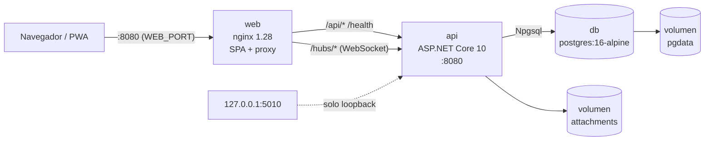
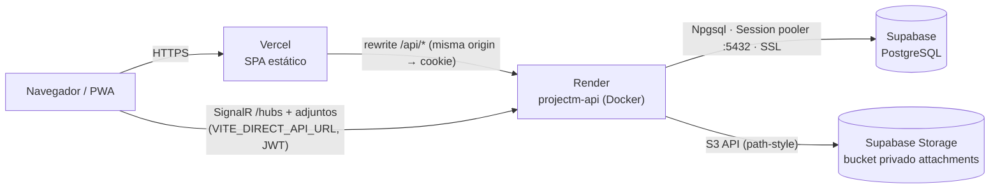
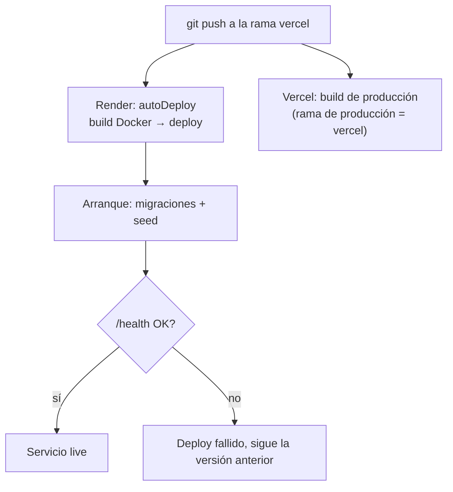

# Construcción y despliegue

Cómo se construye ProjectM y en qué infraestructura corre. Hay dos topologías soportadas: **Docker Compose** (autohospedado, también para desarrollo) y **Vercel + Render + Supabase** (nube, rama `vercel`). La guía operativa clic a clic de la nube está en [DEPLOY.md](DEPLOY.md). Este documento describe la arquitectura de despliegue y cómo se construye cada pieza.

## 1. Artefactos de build

| Pieza | Cómo se construye | Resultado | Fuente |
|---|---|---|---|
| API | Dockerfile multi-etapa: `sdk:10.0` hace `dotnet restore` y `dotnet publish -c Release`; luego se copia a `aspnet:10.0` | Imagen que corre como usuario `app`, expone 8080 y tiene `/data/attachments` creado | (backend/src/ProjectM.Api/Dockerfile) |
| Web (Compose) | `node:24-alpine` ejecuta `npm ci` y `npm run build` (`tsc -b && vite build`); `dist/` se copia a `nginx:1.28-alpine` con `nginx.conf` | Imagen nginx que sirve el SPA y hace de proxy | (frontend/Dockerfile), (frontend/package.json) |
| Web (Vercel) | Vercel ejecuta `npm run build` con framework `vite` y publica `dist/` | Sitio estático con rewrites y headers | (frontend/vercel.json) |
| Pruebas | `tests.Dockerfile` (perfil `test`) | Contenedor que ejecuta `dotnet test` | (backend/tests.Dockerfile), (docker-compose.yml) |

El build de Vite genera además el service worker y el manifest de la PWA (vite-plugin-pwa, `registerType: 'prompt'`) (frontend/vite.config.ts).

## 2. Topología A: Docker Compose



| Servicio | Imagen / build | Puertos | Volúmenes | Notas | Fuente |
|---|---|---|---|---|---|
| `db` | `postgres:16-alpine` | ninguno publicado | `pgdata` | Healthcheck `pg_isready`; base `projectm` | (docker-compose.yml) |
| `api` | `backend/src/ProjectM.Api/Dockerfile` | `127.0.0.1:5010→8080` | `attachments:/data/attachments` | Espera a que `db` esté sano; migra al arrancar | (docker-compose.yml) |
| `web` | `frontend/Dockerfile` | `${WEB_PORT:-8080}→80` | — | Proxy de `/api/`, `/hubs/` (con upgrade a WebSocket, timeout 3600 s) y `/health` | (docker-compose.yml), (frontend/nginx.conf) |
| `tests` | `backend/tests.Dockerfile` | — | — | Solo con `--profile test` | (docker-compose.yml) |

Detalles de nginx (frontend/nginx.conf):
- `log_format sin_query` registra `$uri` sin query string, porque SignalR envía el JWT en `?access_token=`.
- Cabeceras `X-Content-Type-Options`, `X-Frame-Options DENY` y `Referrer-Policy`.
- `client_max_body_size 25m`.
- `sw.js`, `manifest.webmanifest` e `index.html` sin caché; `/assets/` con caché de 1 año e `immutable`.
- Fallback de SPA con `try_files … /index.html`.

En esta topología los adjuntos van a disco (`Storage__Provider` no se define, así que queda `Local`) y `Proxy__ForwardLimit` queda en 1 (docker-compose.yml), (backend/src/ProjectM.Api/Program.cs).

Comandos:

```bash
cp .env.example .env    # completar secretos
docker compose up -d --build
docker compose logs -f api
```

## 3. Topología B: Vercel + Render + Supabase (rama `vercel`)



| Componente | Configuración en el repo | Puntos clave | Fuente |
|---|---|---|---|
| Vercel (frontend) | `frontend/vercel.json` | Rewrite `/api/:path*` → `https://projectm-api.onrender.com/api/:path*`, para que la cookie de refresh sea del mismo origen; fallback de SPA; HSTS y cabeceras de seguridad; sin caché para `sw.js`, `manifest` e `index.html` | (frontend/vercel.json) |
| Variables de Vercel | `frontend/.env.example` | `VITE_DIRECT_API_URL` = URL pública de Render (SignalR y adjuntos); `VITE_API_URL` vacío | (frontend/.env.example), (frontend/src/api/client.ts) |
| Render (API) | `render.yaml` (Blueprint) | `runtime: docker`, `dockerContext: ./backend`, `healthCheckPath: /health`, `autoDeploy: true`, región `oregon` | (render.yaml) |
| Variables de Render | `render.yaml` | Con valor: `PORT=8080`, `ASPNETCORE_ENVIRONMENT=Production`, `Database__MigrateOnStartup=true`, `Seed__Demo=false`, `App__TimeZone`, `Auth__SecureCookies=true`, `Proxy__ForwardLimit=2`, `Storage__Provider=S3`, `Storage__S3__Bucket`. Generada: `Jwt__Key`. Secretas (`sync: false`): cadena de BD, CORS, admin y credenciales S3 | (render.yaml) |
| Supabase PostgreSQL | — | Usar el **Session pooler** (puerto 5432); la conexión directa es solo IPv6. La API acepta la URI `postgresql://…` y fuerza SSL | (docs/DEPLOY.md), (backend/src/ProjectM.Api/Infrastructure/Persistence/ConnectionStrings.cs) |
| Supabase Storage | — | Bucket privado `attachments`; la descarga pasa siempre por la API, que valida permisos | (backend/src/ProjectM.Api/Infrastructure/Storage/S3FileStorage.cs) |
| Seguridad de Supabase | — | RLS activado en todas las tablas de `public` y permisos revocados a `anon`/`authenticated` (paso 1.5) | (docs/DEPLOY.md) |

`Proxy__ForwardLimit=2` le dice a la API que hay dos proxies confiables (Vercel y el balanceador de Render). Así obtiene la IP real del cliente para el rate limiting del login (render.yaml), (backend/src/ProjectM.Api/Program.cs).

⚠️ A CONFIRMAR: el plan de Render. `render.yaml` declara `plan: starter` (siempre encendido), pero el servicio de producción actual se creó en el plan **Free**, que se suspende tras 15 minutos sin tráfico. Mientras está suspendido, `DueDateNotifier` no corre y las conexiones SignalR se cortan.

⚠️ A CONFIRMAR: la URL de Render está fija en el rewrite de `frontend/vercel.json`. Si el servicio cambia de nombre o de dominio, hay que editarla y redesplegar.

## 4. Arranque de la API (ambas topologías)

Secuencia de `Program.cs` al iniciar (backend/src/ProjectM.Api/Program.cs):

1. Valida la configuración de JWT: si `Jwt:Key` tiene menos de 32 caracteres, lanza una excepción y el contenedor termina (backend/src/ProjectM.Api/Infrastructure/ServiceRegistration.cs).
2. Si `Database:MigrateOnStartup`, aplica las migraciones pendientes de EF (`MigrateAsync`).
3. `IdentitySeeder` crea los roles y el Admin inicial; `ReferenceDataSeeder`, los datos de referencia; `DemoSeeder`, los datos demo si `Seed:Demo`.
4. Mapea `/health`, el grupo `/api/v1` y el hub `/hubs/notifications`.
5. Si `Notifications:DueDateJob` (por defecto `true`), arranca el servicio en segundo plano `DueDateNotifier`.

Las claves de DataProtection se guardan dentro del contenedor y no persisten entre despliegues; ASP.NET lo advierte al arrancar. ⚠️ A CONFIRMAR: el impacto. La autenticación usa JWT y refresh tokens en base de datos, no cookies cifradas con DataProtection, pero los tokens de Identity (p. ej. restablecer contraseña), si se usaran, quedarían inválidos tras cada redespliegue.

## 5. Flujo de publicación



- Render redespliega en cada commit de la rama configurada (`autoDeploy: true`) (render.yaml).
- La rama de producción de Vercel se define en el panel del proyecto (Settings → Environments → Production → Branch Tracking); no está en el repositorio. ⚠️ A CONFIRMAR en cada entorno.
- Con `healthCheckPath: /health`, Render solo da por bueno el despliegue si `/health` responde 200, lo que exige conexión a la base (render.yaml), (backend/src/ProjectM.Api/Program.cs).
- No hay pipeline de CI en el repositorio (no existe `.github/`). Las pruebas se corren a mano (SETUP.md §5).

## 6. Operación

| Tarea | Cómo | Fuente |
|---|---|---|
| Salud | `GET /health` → `{"status":"ok"}` o 503 | (backend/src/ProjectM.Api/Program.cs) |
| Registros | `docker compose logs -f api` / panel Logs de Render | (docker-compose.yml) |
| Respaldo (Compose) | Volúmenes `pgdata` y `attachments` | (docker-compose.yml) |
| Respaldo (nube) | Backups de Supabase según el plan contratado | (docs/DEPLOY.md) |
| Nueva migración | Generarla (SETUP.md §4), commit y push; se aplica sola al arrancar | (backend/src/ProjectM.Api/Program.cs) |
| Rotar `Jwt__Key` | Cambiar la variable y redesplegar; invalida los access tokens emitidos | (backend/src/ProjectM.Api/Infrastructure/ServiceRegistration.cs) |

Más detalle operativo (costos, dominio propio, problemas frecuentes) en [DEPLOY.md](DEPLOY.md). La evaluación de la PWA está en [PWA.md](PWA.md).
