# Manual de usuario de ProjectM

Bienvenido a ProjectM, la herramienta del equipo para organizar proyectos y tareas: quién hace qué, para cuándo y cómo va cada proyecto, desde que se abre hasta que se cierra con su acta.

Este manual explica cada pantalla con lenguaje sencillo. Las capturas se tomaron con los datos de demostración; los nombres y cifras que veas en tu equipo serán otros.

> Al final de cada sección, una línea *Fuente* indica de qué parte del programa sale la información, para quien necesite verificarla.

---

## Contenido

1. [Conceptos básicos](#1-conceptos-básicos)
2. [Entrar y salir](#2-entrar-y-salir)
3. [La pantalla principal](#3-la-pantalla-principal)
4. [Inicio (dashboard)](#4-inicio-dashboard)
5. [Notificaciones](#5-notificaciones)
6. [Mis tareas](#6-mis-tareas)
7. [Proyectos](#7-proyectos)
8. [Abrir un proyecto nuevo](#8-abrir-un-proyecto-nuevo)
9. [Dentro de un proyecto](#9-dentro-de-un-proyecto)
10. [Trabajar con tareas](#10-trabajar-con-tareas)
11. [Detalle de una tarea](#11-detalle-de-una-tarea)
12. [Riesgos, bloqueos e hitos](#12-riesgos-bloqueos-e-hitos)
13. [Equipo del proyecto](#13-equipo-del-proyecto)
14. [Actividad](#14-actividad)
15. [Cerrar un proyecto](#15-cerrar-un-proyecto)
16. [Ajustes del proyecto](#16-ajustes-del-proyecto)
17. [Administración (solo Admin)](#17-administración-solo-admin)
18. [Modo oscuro, celular e instalar la app](#18-modo-oscuro-celular-e-instalar-la-app)
19. [Preguntas frecuentes](#19-preguntas-frecuentes)

---

## 1. Conceptos básicos

**¿Cómo se organiza el trabajo?**

```
Espacio  ›  Proyecto  ›  Lista  ›  Tarea  ›  Subtarea
```

- **Espacio:** un área o grupo de proyectos, por ejemplo "Tecnología".
- **Proyecto:** un trabajo con objetivo, fechas, gestor y equipo. Tiene un código, por ejemplo **PRJ-0001**.
- **Lista:** una etapa o grupo de tareas dentro del proyecto, por ejemplo "Diseño" o "QA".
- **Tarea:** algo concreto por hacer, con responsable y fecha. Puede tener **subtareas**.

**Estados de una tarea.** El color te ayuda a reconocerlos de un vistazo:

| Estado | Significa |
|---|---|
| Pendiente | Aún no empieza |
| En progreso | Alguien está trabajando en ella |
| En revisión | Terminada, esperando revisión |
| Completada | Lista |
| Bloqueada | No puede avanzar; siempre lleva un **motivo** |
| Vencida | Pasó su fecha sin completarse (la app la marca sola) |

**Etapas de un proyecto:** Planeación → Activo ⇄ En pausa → En cierre → Cerrado.

**Salud de un proyecto:** En tiempo, En riesgo o Retrasado. La define el gestor.

**Roles. Lo que puedes hacer depende de tu rol:**

| Rol | Puede |
|---|---|
| **Administrador** | Todo, incluidos usuarios, plantillas, checklist de cierre y reabrir proyectos cerrados |
| **Gestor** | Abrir proyectos y gestionar y cerrar los proyectos de los que es responsable |
| **Miembro** | Crear, editar, mover y comentar tareas en los proyectos donde participa |
| **Observador** | Ver los proyectos donde participa, sin modificar nada |

Si un botón no aparece en tu pantalla, es probable que tu rol no lo permita.

*Fuente: README.md; backend/src/ProjectM.Domain/Projects/Enums.cs; backend/src/ProjectM.Domain/Tasks/TaskItem.cs; frontend/src/lib/status.ts*

---

## 2. Entrar y salir

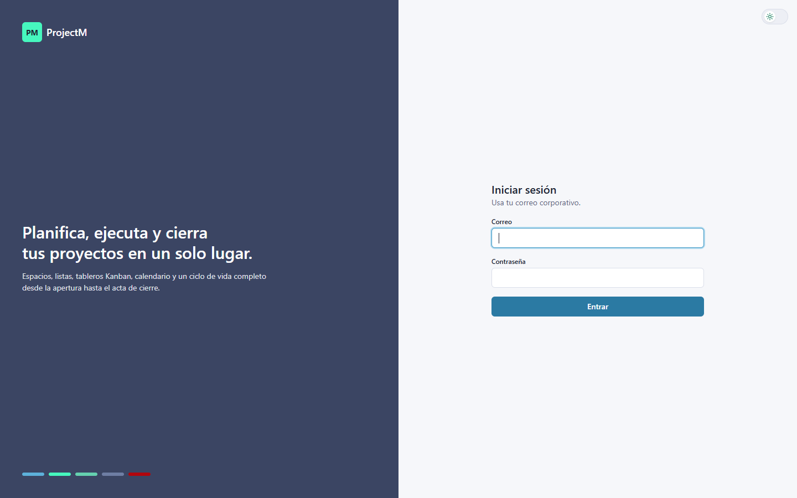

1. Escribe tu **correo** y tu **contraseña** (te los entrega el administrador).
2. Pulsa **Entrar**.

- Si te equivocas **5 veces seguidas**, tu cuenta se bloquea **15 minutos** por seguridad.
- La sesión se mantiene aunque recargues la página. Para salir, abre el menú con tu nombre (arriba a la derecha) y elige **Cerrar sesión** (ver la sección 3).
- **Primer ingreso:** si tu contraseña la asignó un administrador (cuenta nueva o restablecida), la app te pedirá **cambiarla** antes de continuar: escribe la actual, la nueva (mínimo 10 caracteres, con mayúscula, minúscula y número) y confírmala.
- **Cambiar tu contraseña cuando quieras:** menú con tu nombre → **Cambiar contraseña**. Al hacerlo se cierran tus sesiones en otros dispositivos.
- **¿Olvidaste tu contraseña?** Pídele al administrador que la restablezca (sección 17.1).

*Fuente: frontend/src/features/auth/LoginPage.tsx; backend/src/ProjectM.Api/Infrastructure/ServiceRegistration.cs; docs/API.md*

---

## 3. La pantalla principal

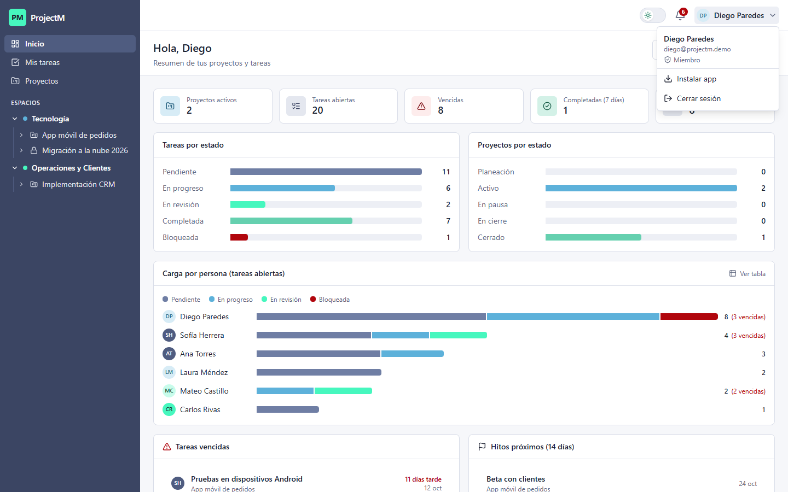

- **Barra lateral (izquierda):**
  - **Inicio**, **Mis tareas** y **Proyectos**.
  - **Espacios**: el árbol con tus proyectos. Pulsa la flecha junto a un proyecto para ver sus listas. El candado 🔒 indica un proyecto cerrado.
  - **+ Nuevo proyecto**, dentro de cada espacio (si tu rol lo permite).
  - El **+** junto a "Espacios" crea un espacio nuevo, con nombre, descripción y color.
  - **Administración** (solo Admin): Usuarios, Plantillas, Checklist de cierre y Sistema de diseño.
- **Barra superior (derecha):**
  - Interruptor **claro/oscuro** (☀/☾).
  - **Campana** de notificaciones, con el número de avisos sin leer.
  - **Tu nombre**: menú con tu correo, tu rol, **Instalar app**, **Cambiar contraseña** y **Cerrar sesión**.

En el celular, la barra lateral se abre con el botón ☰.

*Fuente: frontend/src/components/layout/MainLayout.tsx; frontend/src/components/layout/SpaceTree.tsx; frontend/src/components/layout/AppShell.tsx*

---

## 4. Inicio (dashboard)

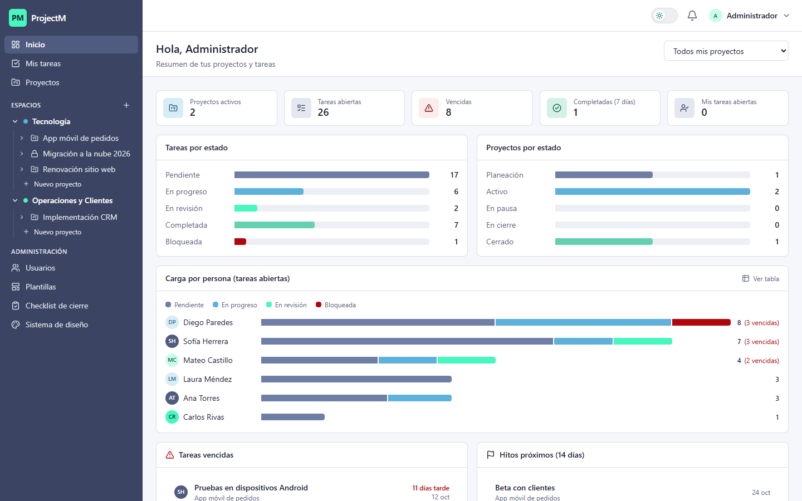

Resumen de **todos tus proyectos**. Con el selector de arriba a la derecha puedes filtrar uno solo.

- **Tarjetas superiores:** proyectos activos, tareas abiertas, vencidas, completadas en los últimos 7 días y **tus** tareas abiertas.
- **Tareas por estado** y **Proyectos por estado:** barras con la cantidad de cada uno.
- **Carga por persona:** cuántas tareas abiertas tiene cada integrante, por estado, y cuántas están vencidas (en rojo). **Ver tabla / Ver gráfico** alterna entre barras y tabla.
- **Tareas vencidas:** lista con cuántos días de retraso lleva cada una.
- **Hitos próximos (14 días):** las fechas clave que se acercan.

Al pulsar una tarea se abre su detalle (sección 11).

> Solo cuentan los proyectos que puedes ver. Las tareas de proyectos cerrados no suman a la carga.

*Fuente: frontend/src/features/dashboard/DashboardPage.tsx; backend/src/ProjectM.Api/Features/Dashboard*

---

## 5. Notificaciones

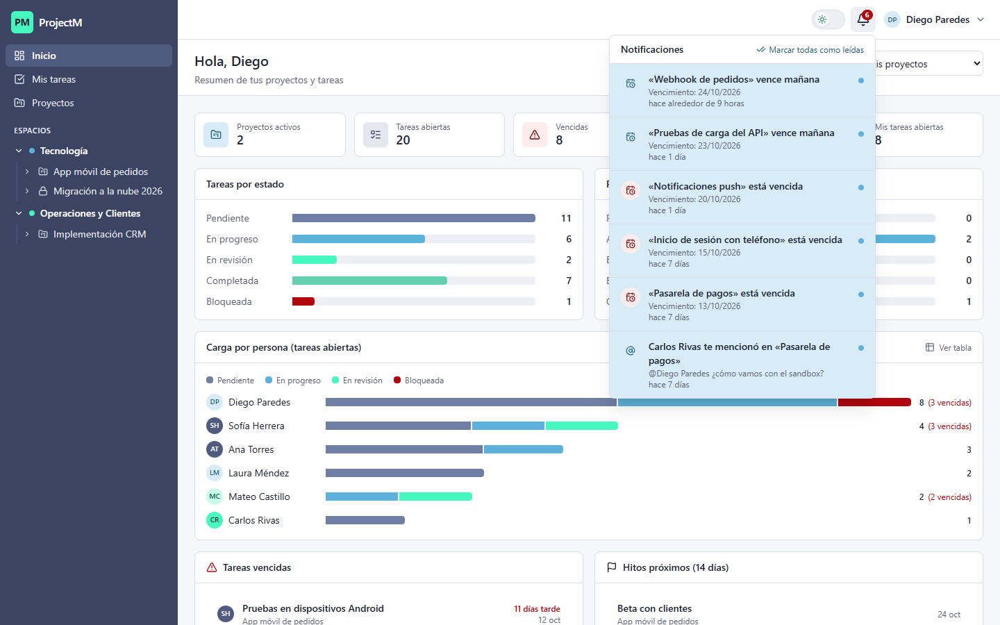

La **campana** te avisa, en tiempo real y sin recargar la página, cuando:
- te asignan una tarea;
- alguien te **menciona** con @ en un comentario;
- una de tus tareas **vence mañana** o **ya está vencida** (la app lo revisa sola cada hora);
- ocurren otros cambios relevantes en tus proyectos.

Cada aviso muestra qué pasó y hace cuánto. Pulsarlo te lleva a la tarea. Los no leídos tienen un punto azul; **Marcar todas como leídas** los limpia.

*Fuente: frontend/src/components/layout/NotificationBell.tsx; backend/src/ProjectM.Api/Infrastructure/Notifications; frontend/src/app/realtime.tsx*

---

## 6. Mis tareas


Todas las tareas **asignadas a ti**, de todos tus proyectos, agrupadas por urgencia: **Vencidas**, **Hoy**, **Esta semana** y **Más adelante**.

- Cada fila muestra el proyecto y la lista, las etiquetas, el estado, el responsable, la fecha y la prioridad.
- La casilla de la izquierda marca la tarea como completada.
- **Incluir completadas** muestra también las ya terminadas.
- La pestaña **Calendario** las muestra por fecha:

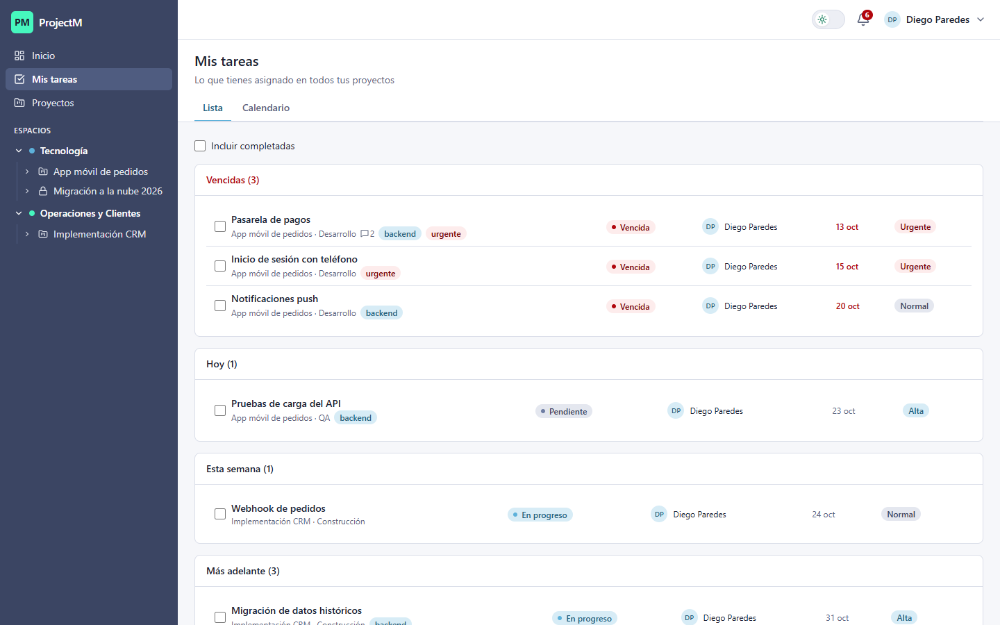

*Fuente: frontend/src/features/tasks/MyTasksPage.tsx; frontend/src/features/tasks/CalendarView.tsx*

---

## 7. Proyectos

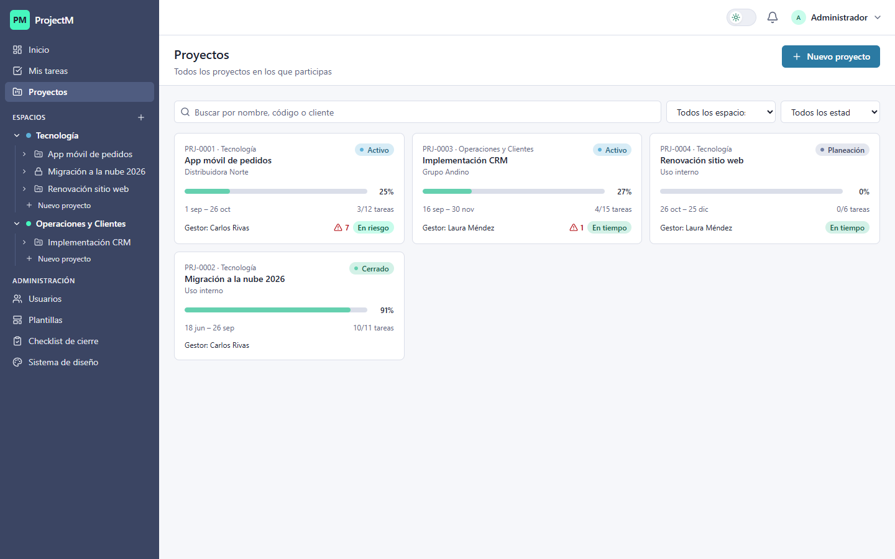

Las tarjetas de los proyectos en los que participas. Cada una muestra:
- código, espacio, nombre y cliente;
- estado (Planeación, Activo, En pausa, En cierre, Cerrado);
- barra de **avance** (% de tareas completadas) y tareas completadas sobre el total;
- fechas planeadas, gestor, número de tareas vencidas (⚠) y salud.

Arriba puedes **buscar** por nombre, código o cliente, y filtrar por **espacio** y por **estado**. El botón **Nuevo proyecto** abre el asistente de apertura.

*Fuente: frontend/src/features/projects/ProjectsPage.tsx*

---

## 8. Abrir un proyecto nuevo

Solo **Gestores** y **Administradores**. Es un asistente de tres pasos.

**Paso 1: Datos generales**

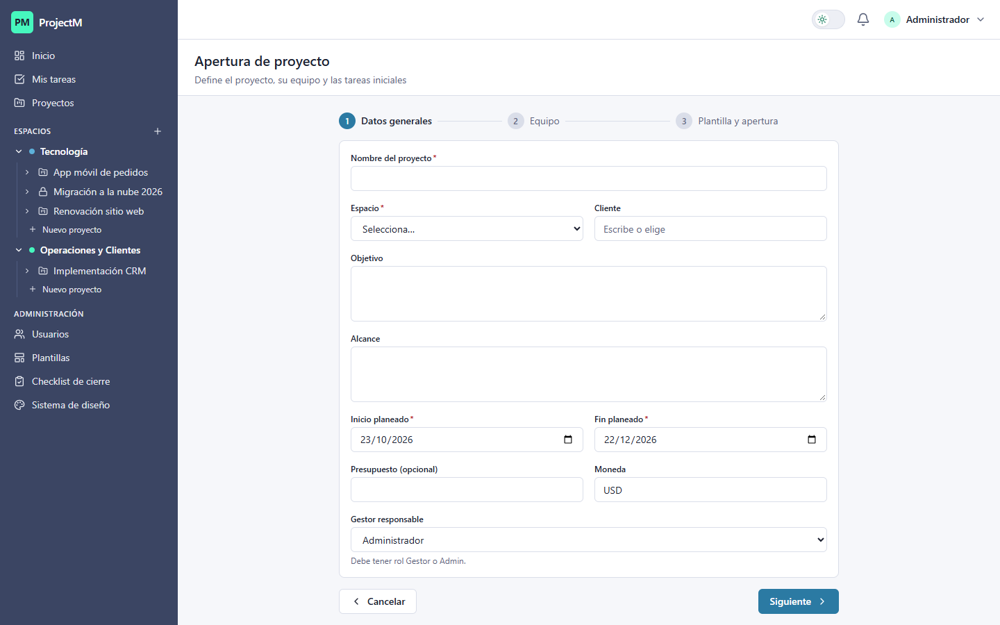

- **Obligatorios:** nombre, espacio, inicio planeado y fin planeado.
- **Opcionales:** cliente (escribe uno nuevo o elige uno existente), objetivo, alcance, presupuesto y moneda.
- **Gestor responsable:** debe tener rol Gestor o Admin.

**Paso 2: Equipo.** Marca a las personas que participarán. El gestor se agrega solo.

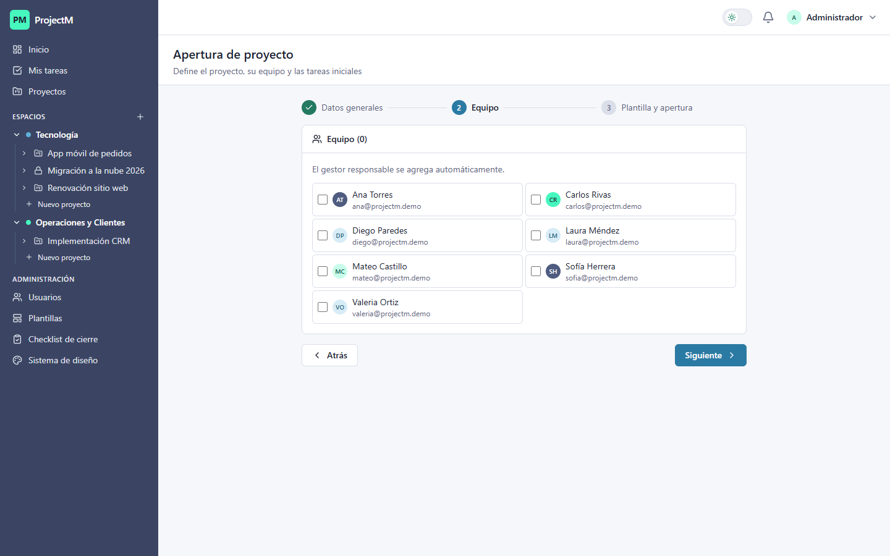

**Paso 3: Plantilla y apertura**

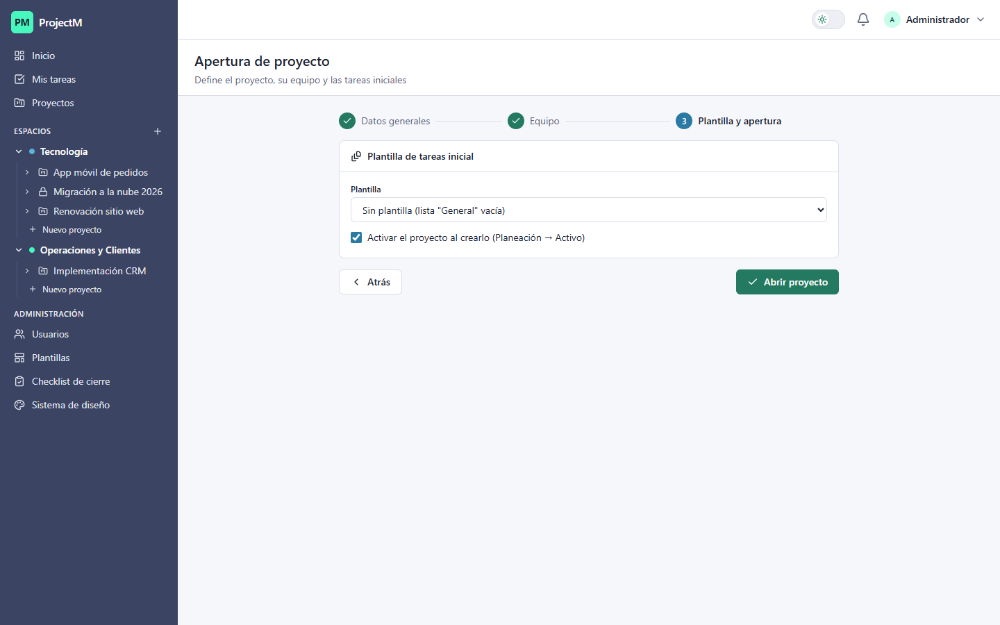

- **Plantilla:** crea automáticamente las listas y tareas iniciales. Sin plantilla, se crea una lista "General" vacía.
- **Activar el proyecto al crearlo:** lo pasa directamente de Planeación a Activo. Si lo desmarcas, queda en Planeación y luego lo activas con el botón **Activar proyecto**.
- Pulsa **Abrir proyecto**. Con **Atrás** vuelves al paso anterior sin perder lo escrito.

*Fuente: frontend/src/features/projects/NewProjectPage.tsx; backend/src/ProjectM.Api/Features/Projects*

---

## 9. Dentro de un proyecto

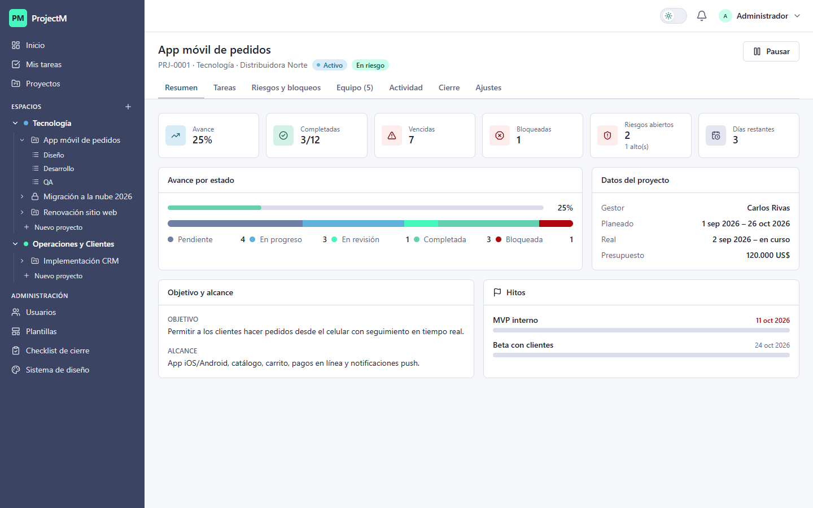

El encabezado muestra el nombre, el código, el espacio, el cliente, el **estado** y la **salud**. Según la etapa y tu rol, a la derecha aparece:

| Botón | Cuándo |
|---|---|
| **Activar proyecto** | En Planeación |
| **Pausar** / **Reanudar** | Activo / En pausa |
| **Reabrir** (solo Admin) | Cerrado; pide un motivo |

**Pestañas:** Resumen · Tareas · Riesgos y bloqueos · Equipo · Actividad · Cierre (o **Acta de cierre** si ya está cerrado) · Ajustes (solo quien gestiona el proyecto).

**Resumen:**
- **Indicadores:** avance, completadas, vencidas, bloqueadas, riesgos abiertos y días restantes (o de retraso).
- **Avance por estado.**
- **Datos del proyecto:** gestor, fechas planeadas y reales, presupuesto.
- **Objetivo y alcance.**
- **Hitos** con su avance.

Un proyecto en **Planeación** se ve así antes de activarlo:

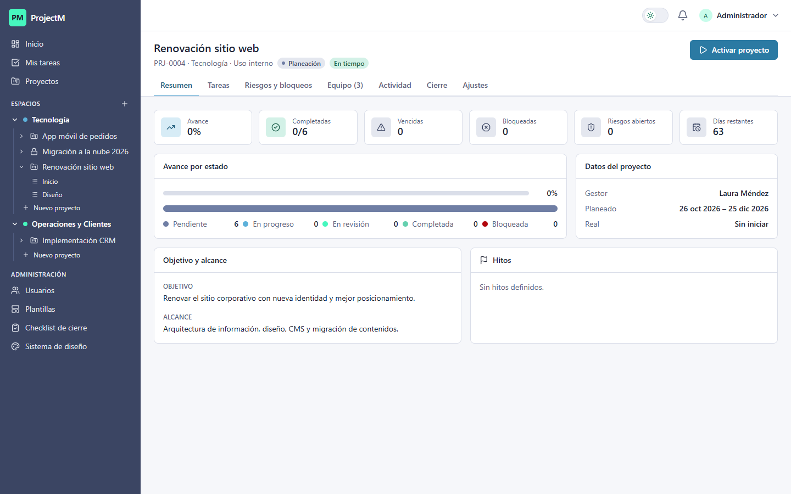

*Fuente: frontend/src/features/projects/ProjectPage.tsx; frontend/src/features/projects/OverviewTab.tsx*

---

## 10. Trabajar con tareas

La pestaña **Tareas** tiene tres vistas. Arriba, la barra de filtros: búsqueda, lista, estado, responsable, prioridad, etiqueta y **Vencidas**. Los filtros quedan en la dirección de la página, así que puedes compartir el enlace ya filtrado.

### 10.1 Vista Lista

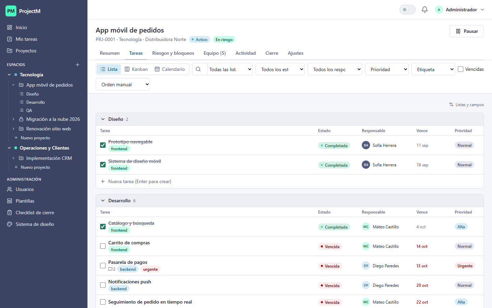

- Las tareas aparecen agrupadas por lista. Cada grupo se pliega con su flecha.
- **Crear rápido:** escribe en "Nueva tarea (Enter para crear)" y pulsa Enter.
- La casilla marca la tarea como completada.
- Pulsa el título para abrir el detalle (sección 11).
- **Orden:** "Orden manual" u otros criterios.
- **Listas y campos:** crea, renombra o elimina listas, y define **campos personalizados** (texto, número, fecha o selección). Si marcas uno como *obligatorio para completar la tarea*, la app no deja completarla hasta llenarlo.

### 10.2 Vista Kanban

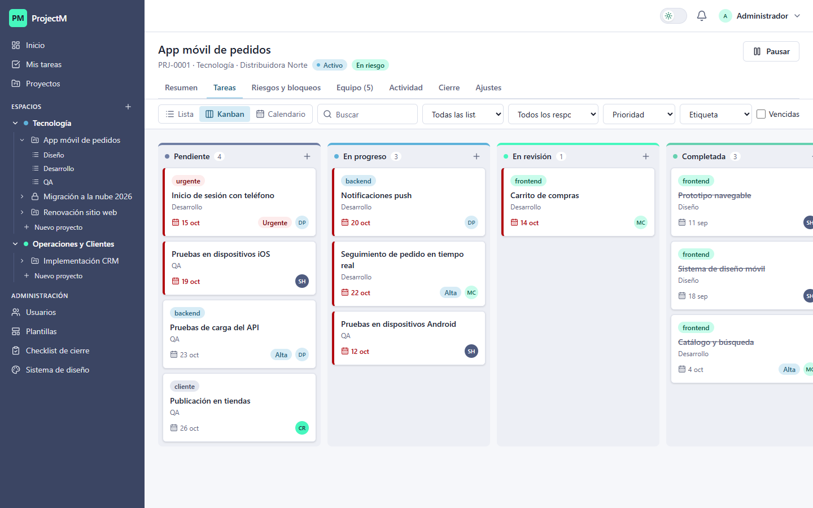

- Una columna por estado. **Arrastra** una tarjeta a otra columna para cambiar su estado, o dentro de la misma columna para reordenarla.
- En el celular, **mantén presionada** la tarjeta para arrastrarla; si solo deslizas, el tablero se desplaza.
- El **+** de cada columna crea una tarea con ese estado ("Título y Enter").
- Cada tarjeta muestra las etiquetas, la lista, la fecha (en rojo si está vencida), la prioridad y las iniciales del responsable.

### 10.3 Vista Calendario

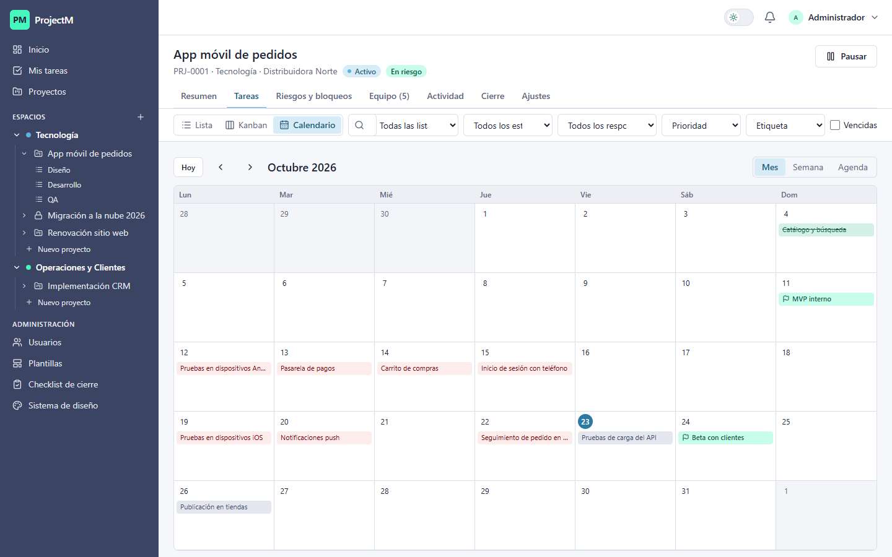

- Vistas **Mes**, **Semana** y **Agenda** (en el celular se usa la Agenda).
- Las tareas aparecen en su fecha de vencimiento (o de inicio); los hitos llevan una banderita.
- **Arrastra** una tarea a otro día para reprogramarla.
- **Hoy** vuelve a la fecha actual; las flechas cambian de mes o de semana.

*Fuente: frontend/src/features/tasks/TaskToolbar.tsx; ListView.tsx; KanbanView.tsx; CalendarView.tsx; ListManager.tsx; useTaskFilters.ts*

---

## 11. Detalle de una tarea

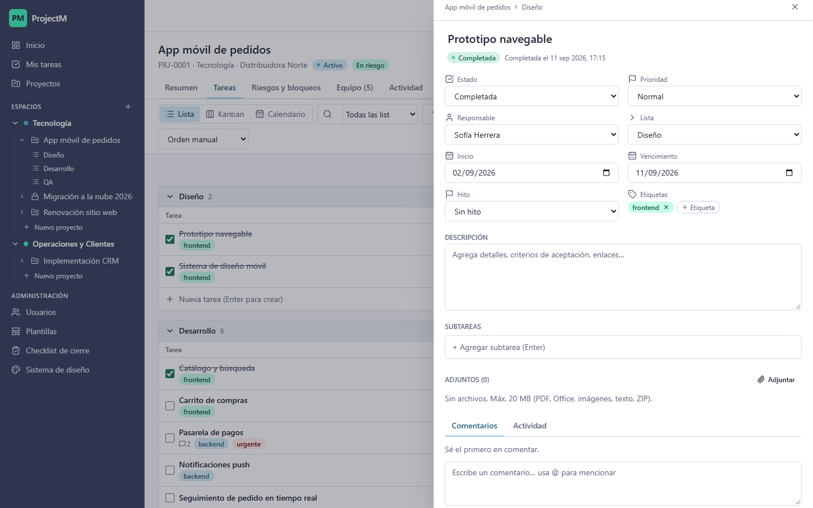

Al abrir una tarea aparece un panel a la derecha (a pantalla completa en el celular). Puedes compartir el enlace: abre directamente esa tarea.

- **Título:** se edita directamente.
- **Estado, prioridad, responsable, lista, fechas de inicio y vencimiento, hito y etiquetas** (pulsa **+ Etiqueta** para agregar).
- **Bloquear:** al elegir "Bloqueada", la app pide el **motivo del bloqueo**.
- **Descripción:** detalles, criterios de aceptación y enlaces.
- **Campos personalizados**, si el proyecto los tiene.
- **Subtareas:** escribe y pulsa Enter.
- **Adjuntos:** botón **Adjuntar**. Máximo 20 MB por archivo; se admiten PDF, Office, imágenes, texto y ZIP.
- **Comentarios:** escribe y envía con **Ctrl + Enter**. Usa **@** para mencionar a alguien, que recibirá una notificación. Puedes editar o eliminar tus comentarios.
- **Actividad:** historial de cambios de la tarea.

> Si otra persona modificó la tarea al mismo tiempo, verás "Otra persona modificó la tarea. Se recargaron los datos." Revisa y vuelve a aplicar tu cambio.

*Fuente: frontend/src/features/tasks/TaskDrawer.tsx; frontend/src/features/collab/TaskConversation.tsx; backend/src/ProjectM.Api/Infrastructure/Storage/FileStorage.cs*

---

## 12. Riesgos, bloqueos e hitos

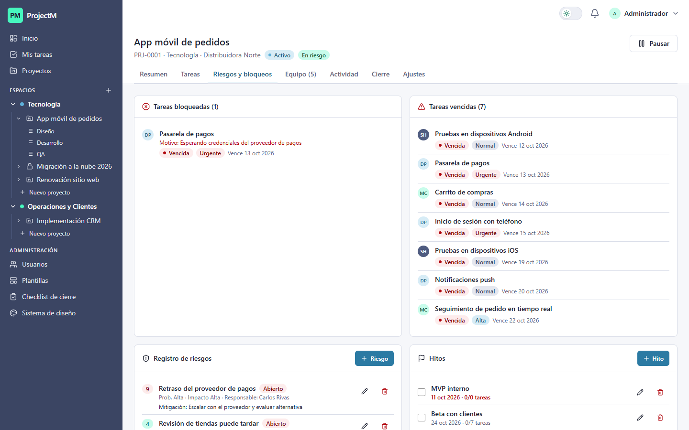

La pestaña **Riesgos y bloqueos** reúne lo que puede frenar el proyecto:

- **Tareas bloqueadas**, con su motivo.
- **Tareas vencidas**, con su prioridad y fecha.
- **Registro de riesgos:**
  - Botón **+ Riesgo**.
  - Cada riesgo tiene probabilidad, impacto, responsable y mitigación. El número de la izquierda es su **severidad** (probabilidad × impacto; 9 es la máxima).
  - Estados: Abierto, Mitigado y Cerrado.
  - El lápiz edita el riesgo; la papelera lo elimina.
- **Hitos:**
  - Botón **+ Hito**.
  - Cada hito muestra su fecha y cuántas de sus tareas están completas.
  - La casilla lo marca como cumplido.

*Fuente: frontend/src/features/projects/TrackingTab.tsx; backend/src/ProjectM.Domain/Projects/Tracking.cs*

---

## 13. Equipo del proyecto

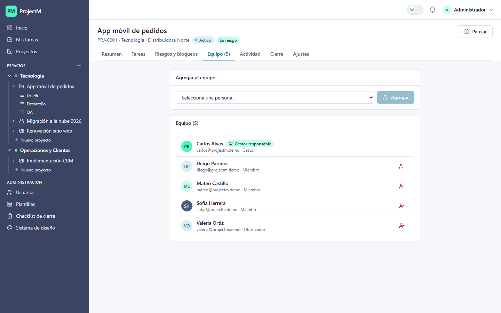

- **Agregar al equipo:** elige una persona y pulsa **Agregar**.
- Cada integrante muestra su correo y su rol. El **gestor responsable** lleva una insignia.
- El icono rojo quita a la persona del proyecto.
- Lo que cada persona puede hacer en el proyecto depende de su **rol** (sección 1).

*Fuente: frontend/src/features/projects/TeamTab.tsx*

---

## 14. Actividad

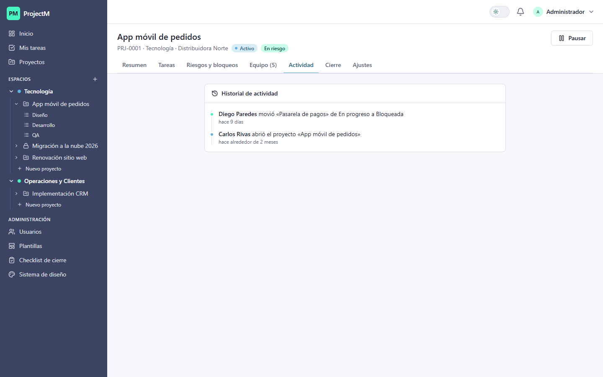

Historial automático de lo que pasó en el proyecto: quién creó, movió, completó o bloqueó tareas, quién abrió o cerró el proyecto, etc. Nadie necesita registrarlo: la app lo hace sola.

*Fuente: frontend/src/features/collab/ActivityTab.tsx; backend/src/ProjectM.Api/Infrastructure/Events*

---

## 15. Cerrar un proyecto

Lo hace el **gestor responsable** o un **Administrador**.

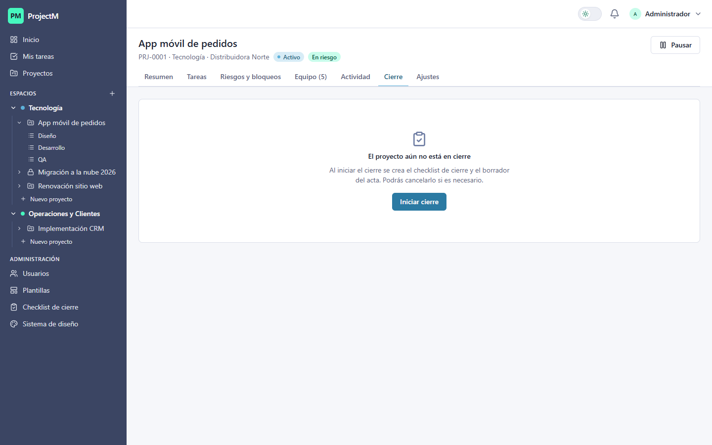

1. En la pestaña **Cierre**, pulsa **Iniciar cierre**. El proyecto pasa a **En cierre** y se crean:
   - el **checklist de cierre**, copiado de la plantilla que define el Admin (sección 17.3);
   - el **borrador del acta**.
2. Completa el **acta** y pulsa **Guardar acta**:
   - **Resumen del proyecto** (obligatorio);
   - **Entregables**;
   - **Lecciones aprendidas**: categoría, qué funcionó bien, qué mejorar y recomendación.
3. Marca los ítems del **checklist**. Los **obligatorios** deben estar todos hechos.
4. El recuadro **Validación** te dice qué falta, o "Todo listo para cerrar".
5. Pulsa **Cerrar proyecto** y confirma:
   - Si **no quedan tareas abiertas**: **Confirmar cierre**.
   - Si **quedan tareas abiertas**, puedes hacer un **cierre forzado**: escribe una **justificación de al menos 20 caracteres** y pulsa **Forzar cierre**. La justificación queda escrita en el acta.
6. ¿Te arrepentiste antes de cerrar? **Cancelar cierre** devuelve el proyecto a Activo.

**Proyecto cerrado: el acta**

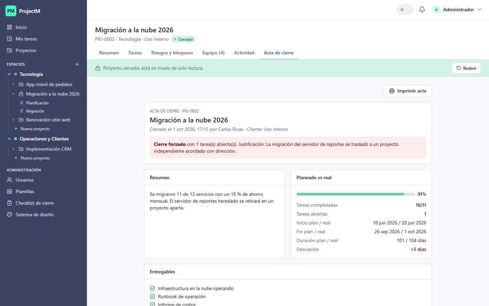

- Todo el proyecto queda en **solo lectura**: nadie puede modificarlo.
- El acta muestra el resumen, una comparación **planeado vs real** (tareas, fechas, duración y desviación en días), los entregables y las lecciones aprendidas. Si hubo cierre forzado, aparece destacado.
- **Imprimir acta** genera una versión para imprimir o guardar en PDF.
- Solo un **Administrador** puede **Reabrir** el proyecto, indicando el motivo.

*Fuente: frontend/src/features/projects/ClosureTab.tsx; backend/src/ProjectM.Domain/Projects/Closure.cs; frontend/src/features/projects/ProjectPage.tsx*

---

## 16. Ajustes del proyecto

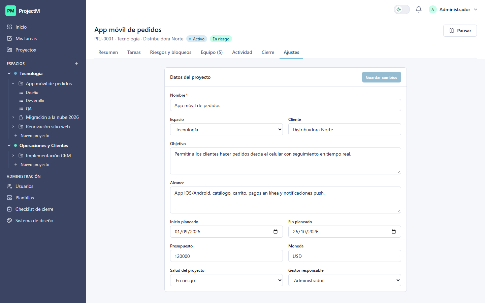

Solo para quien gestiona el proyecto. Aquí puedes cambiar:
- nombre, espacio y cliente;
- objetivo y alcance;
- fechas planeadas, presupuesto y moneda;
- **salud** (En tiempo, En riesgo, Retrasado);
- gestor responsable (solo un Administrador puede cambiarlo).

Luego pulsa **Guardar cambios**.

⚠️ A CONFIRMAR (posible error): en la captura, el selector "Gestor responsable" muestra "Administrador", aunque el gestor del proyecto es Carlos Rivas. En el código, la lista de personas del selector se carga después que el formulario (`people?.map(...)` en `SettingsTab.tsx`), así que el navegador puede quedarse en la primera opción. Si es así, al guardar cualquier otro cambio el gestor se cambiaría sin querer. Mientras se confirma, revisa ese campo antes de pulsar **Guardar cambios**.

*Fuente: frontend/src/features/projects/SettingsTab.tsx*

---

## 17. Administración (solo Admin)

### 17.1 Usuarios

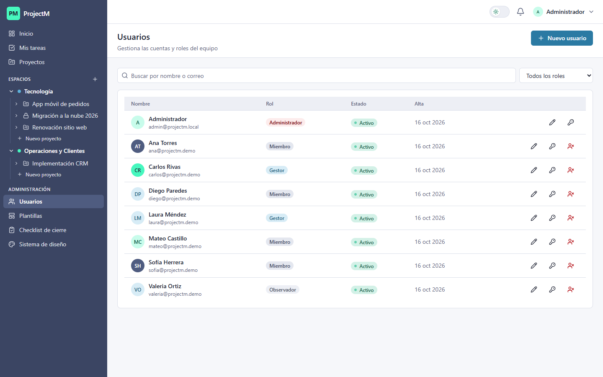

- **Nuevo usuario:** nombre completo, correo, rol y contraseña inicial. La contraseña necesita al menos 10 caracteres, con mayúscula, minúscula y número.
- Busca por nombre o correo y filtra por rol.
- Acciones de cada fila:
  - ✏️ **Editar**: nombre, rol o activo/inactivo.
  - 🔑 **Restablecer contraseña**: cierra todas las sesiones de esa persona.
  - 🚫 **Desactivar**: la persona ya no puede entrar, pero su historial se conserva.

### 17.2 Plantillas de proyecto

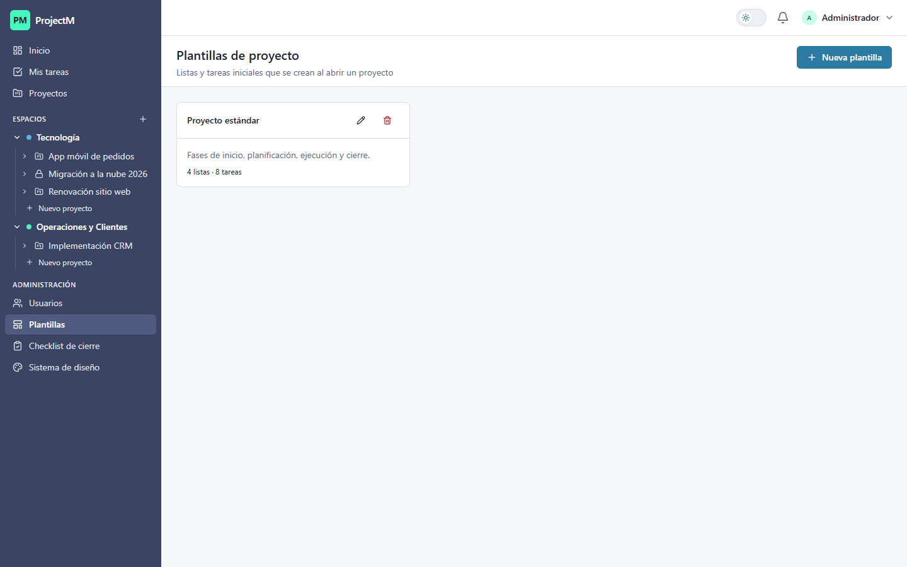

Definen las **listas y tareas iniciales** que se crean al abrir un proyecto (paso 3 del asistente).
- Cada tarea de la plantilla tiene título, lista, prioridad, **desfase** (días desde el inicio planeado) y **duración** (días). Así, las fechas se calculan solas.
- Puedes crear, editar y eliminar plantillas.

### 17.3 Checklist de cierre

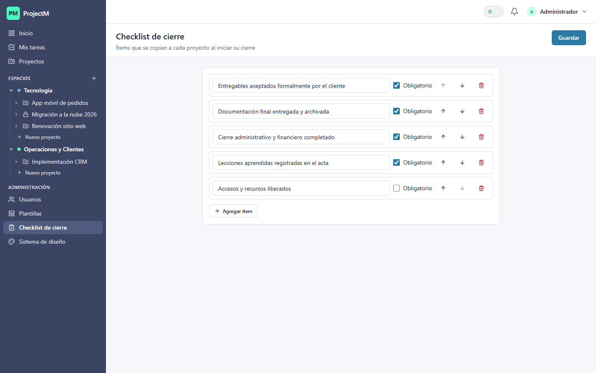

Los ítems que se copian a cada proyecto cuando inicia su cierre.
- Marca cuáles son **obligatorios**.
- Ordénalos con las flechas y elimínalos con la papelera.
- **Agregar ítem**, y luego **Guardar**.
- Los cambios aplican a los cierres que se inicien **después** de guardar.

### 17.4 Sistema de diseño

Página de referencia visual (colores, botones, insignias) para quien mantiene la aplicación. No afecta los datos.

*Fuente: frontend/src/features/admin/UsersPage.tsx; TemplatesPage.tsx; ClosureChecklistPage.tsx; frontend/src/features/design/DesignSystemPage.tsx; backend/src/ProjectM.Api/Infrastructure/ServiceRegistration.cs*

---

## 18. Modo oscuro, celular e instalar la app

**Modo oscuro.** Usa el interruptor ☀/☾ de la barra superior. La primera vez, la app sigue la configuración de tu dispositivo; después recuerda tu elección.

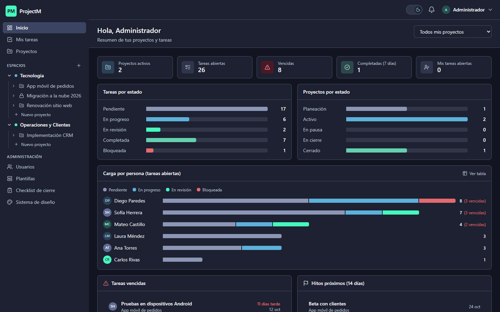

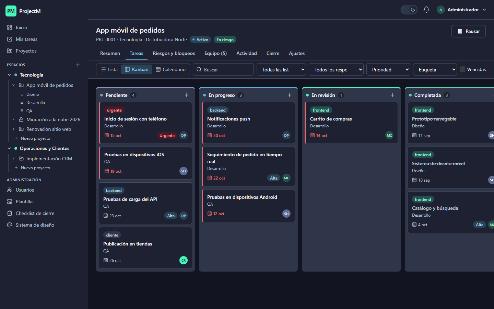

**En el celular** funciona igual, adaptado a la pantalla:
- menú lateral con ☰;
- tablas convertidas en tarjetas;
- filtros plegados en un botón **Filtros**;
- calendario en vista Agenda;
- Kanban con "mantener presionado para arrastrar".

<p>
  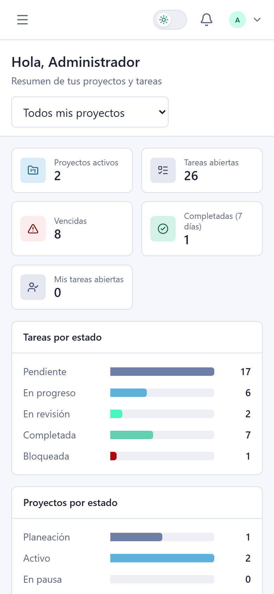
  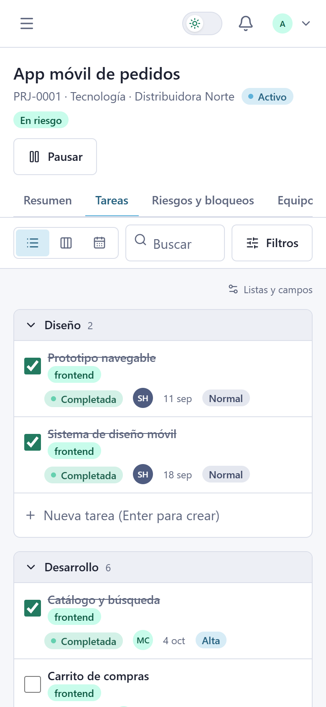
</p>

**Instalar la app.** En el menú de tu nombre elige **Instalar app**. Queda como un ícono en tu pantalla de inicio o escritorio y se abre en su propia ventana.
- En **iPhone/iPad**, la app muestra las instrucciones: en Safari, **Compartir → Agregar a inicio**.
- Cuando haya una versión nueva, verás un aviso para actualizar.
- Si pierdes la conexión, aparece un aviso de **sin conexión**.

*Fuente: frontend/src/app/theme.tsx; frontend/src/app/pwa.tsx; frontend/vite.config.ts; docs/PWA.md*

---

## 19. Preguntas frecuentes

**No veo un proyecto.** Solo ves los proyectos de los que eres miembro (el Admin los ve todos). Pide al gestor que te agregue al equipo.

**No me deja completar una tarea.** Tiene campos personalizados obligatorios sin llenar. Complétalos en el detalle de la tarea.

**No puedo editar nada en un proyecto.** Puede estar **Cerrado** (solo lectura) o tu rol puede ser Observador.

**Moví una tarea y volvió a su lugar.** Probablemente otra persona la cambió al mismo tiempo, o el proyecto está cerrado. Recarga y vuelve a intentarlo.

**¿Se pierden mis datos si cierro el navegador?** No. Todo se guarda en el servidor al momento.

**La app tarda en responder la primera vez del día.** En la instalación en la nube con plan gratuito, el servidor "se duerme" tras un rato sin uso y tarda cerca de un minuto en despertar (ver DEPLOYMENT.md).

*Fuente: backend/src/ProjectM.Api/Infrastructure/Authorization; backend/src/ProjectM.Domain/Tasks/TaskItem.cs; docs/DEPLOYMENT.md*
