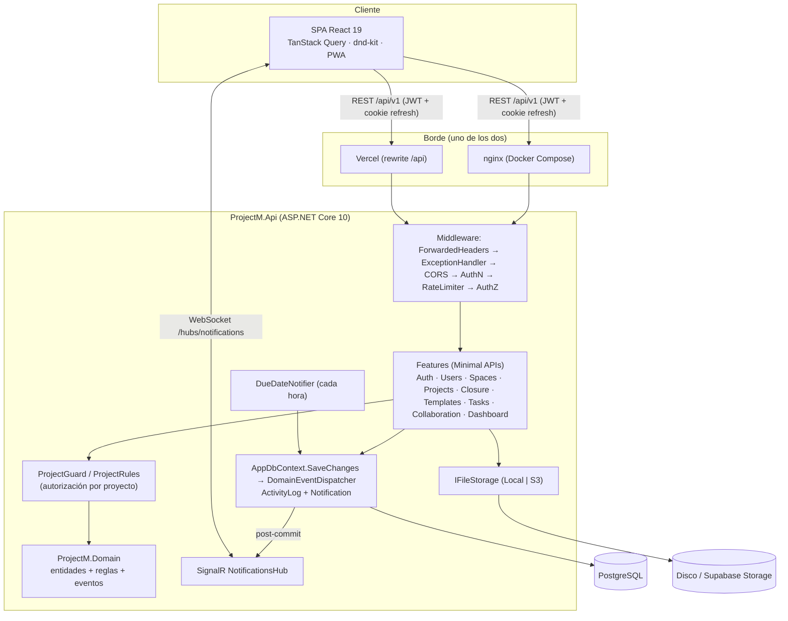
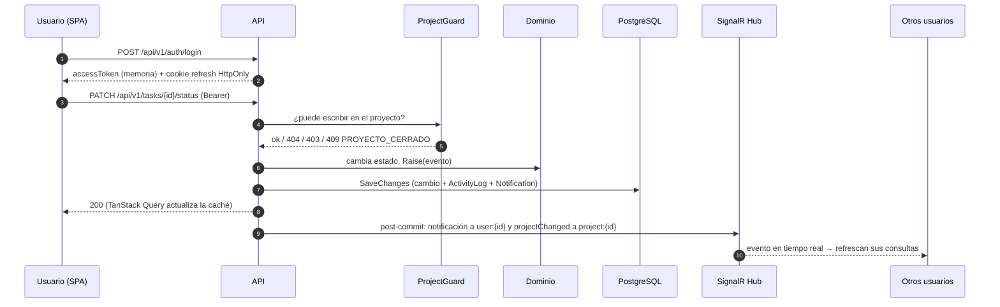

# ProjectM: documentación técnica

> Documentación generada a partir del código fuente de la rama `vercel`. Cada afirmación cita entre paréntesis el archivo que la respalda. Lo que el código no deja claro está marcado con **⚠️ A CONFIRMAR**.

| Documento | Contenido |
|---|---|
| **README.md** (este) | Propósito, stack, arquitectura, flujo de datos y glosario |
| [SETUP.md](SETUP.md) | Requisitos, instalación, variables de entorno y pruebas |
| [ARCHITECTURE.md](ARCHITECTURE.md) | Módulos, dependencias, patrones y decisiones de diseño |
| [API.md](API.md) | Todos los endpoints REST y el hub de SignalR |
| [DATA_MODEL.md](DATA_MODEL.md) | Entidades, tablas, relaciones (ER) y migraciones |
| [DEPLOYMENT.md](DEPLOYMENT.md) | Construcción, contenedores e infraestructura |
| [MANUAL_USUARIO.md](MANUAL_USUARIO.md) | Manual funcional con capturas, para usuarios finales |
| [DEPLOY.md](DEPLOY.md) | Guía clic a clic para Supabase, Render y Vercel |
| [PWA.md](PWA.md) | Evaluación e implementación de la app instalable |

## 1. Qué es ProjectM

ProjectM es un gestor de proyectos web al estilo ClickUp, en español y para un solo equipo (un solo tenant) (README.md), (CLAUDE.md). Organiza el trabajo en **Espacios › Proyectos › Listas › Tareas › Subtareas** (backend/src/ProjectM.Domain/Projects/Space.cs), (backend/src/ProjectM.Domain/Tasks/TaskItem.cs).

Las tareas tienen responsable, estado, prioridad, fechas, etiquetas, campos personalizados, adjuntos y comentarios con @menciones. Se ven en vista Lista, Kanban o Calendario (frontend/src/features/tasks/useTaskFilters.ts).

Cada proyecto recorre un ciclo de vida formal: **apertura** con asistente y plantilla de tareas, **seguimiento** con avance, hitos, riesgos y bloqueos, y **cierre** con checklist, acta y lecciones aprendidas. Un proyecto cerrado queda en solo lectura (backend/src/ProjectM.Domain/Projects/Project.cs), (backend/src/ProjectM.Domain/Projects/Closure.cs).

Además, la aplicación:
- registra la actividad y envía notificaciones en tiempo real por SignalR;
- avisa automáticamente de tareas por vencer y vencidas;
- ofrece un dashboard de carga y estado;
- controla el acceso con cuatro roles globales (Admin, Gestor, Miembro, Observador) y permisos por proyecto;
- se instala como PWA y tiene modo oscuro y diseño responsive (backend/src/ProjectM.Api/Infrastructure/Notifications), (backend/src/ProjectM.Domain/Users/AppUser.cs), (frontend/vite.config.ts).

## 2. Stack

| Capa | Tecnología | Fuente |
|---|---|---|
| Lenguajes | C# (.NET 10), TypeScript 6 | (backend/src/ProjectM.Api/ProjectM.Api.csproj), (frontend/package.json) |
| API | ASP.NET Core 10 Minimal APIs por feature, FluentValidation 12, ProblemDetails | (backend/src/ProjectM.Api/Program.cs) |
| Autenticación | ASP.NET Identity + JWT Bearer, refresh token rotativo en cookie HttpOnly, rate limiting | (backend/src/ProjectM.Api/Infrastructure/ServiceRegistration.cs) |
| Persistencia | EF Core 10 + Npgsql 10.0.3 sobre PostgreSQL (16 en local, Supabase en la nube) | (backend/src/ProjectM.Api/ProjectM.Api.csproj), (docker-compose.yml) |
| Tiempo real | SignalR (`/hubs/notifications`) | (backend/src/ProjectM.Api/Program.cs) |
| Archivos | `IFileStorage`: disco local o S3 (AWSSDK.S3 4.x, Supabase Storage) | (backend/src/ProjectM.Api/Infrastructure/Storage/FileStorage.cs), (backend/src/ProjectM.Api/Infrastructure/Storage/S3FileStorage.cs) |
| Tareas en segundo plano | `DueDateNotifier` (hosted service horario) | (backend/src/ProjectM.Api/Program.cs) |
| Frontend | React 19, Vite 8, Tailwind CSS v4, TanStack Query 5, React Router 7, react-hook-form + zod, dnd-kit, date-fns, lucide-react, @microsoft/signalr | (frontend/package.json) |
| PWA | vite-plugin-pwa + Workbox | (frontend/vite.config.ts) |
| Pruebas | xUnit + FluentAssertions + WebApplicationFactory; Vitest + Testing Library | (backend/tests/*/*.csproj), (frontend/package.json) |
| Lint / formato | oxlint, Prettier | (frontend/package.json) |
| Gestores de paquetes | NuGet (vía contenedor SDK), npm | (scripts/dotnet.ps1), (frontend/package-lock.json) |
| Contenedores | Docker Compose (`db`, `api`, `web`, `tests`), nginx 1.28 | (docker-compose.yml), (frontend/Dockerfile) |
| Nube (rama `vercel`) | Vercel (SPA), Render (API Docker), Supabase (Postgres + Storage) | (frontend/vercel.json), (render.yaml) |

No hay colas de mensajes ni caché distribuida. Los eventos de dominio se despachan en proceso, dentro del guardado de EF (backend/src/ProjectM.Api/Infrastructure/Events).

## 3. Estructura del repositorio

```text
ProjectM/
├─ backend/
│  ├─ ProjectM.sln, Directory.Build.props, tests.Dockerfile
│  ├─ src/
│  │  ├─ ProjectM.Domain/        Entidades y reglas puras (Projects, Tasks, Collaboration, Users, Common)
│  │  └─ ProjectM.Api/           Punto de entrada (Program.cs), Dockerfile
│  │     ├─ Features/            Auth, Users, Spaces, Projects, Closure, Templates, Tasks, Collaboration, Dashboard
│  │     └─ Infrastructure/      Auth, Authorization, Errors, Events, Notifications, Persistence (+Migrations),
│  │                             Pagination, Realtime, Seed, Storage, Validation, AppClock
│  └─ tests/                     ProjectM.UnitTests, ProjectM.IntegrationTests
├─ frontend/
│  ├─ src/                       main.tsx · api/ · app/ (router, auth, theme, realtime, pwa) · components/ · features/ · lib/ · styles/
│  ├─ vite.config.ts, vercel.json, nginx.conf, Dockerfile, .env.example
├─ scripts/                      dotnet.ps1 (dotnet en contenedor), test.ps1 (pruebas)
├─ docs/                         esta documentación
├─ docker-compose.yml, render.yaml, .env.example
└─ README.md, PLAN.md, CLAUDE.md
```

Puntos de entrada: `backend/src/ProjectM.Api/Program.cs` (API) y `frontend/src/main.tsx` (SPA), con rutas en `frontend/src/app/router.tsx`.

## 4. Arquitectura



Fuentes: (backend/src/ProjectM.Api/Program.cs), (backend/src/ProjectM.Api/Infrastructure/Authorization), (backend/src/ProjectM.Api/Infrastructure/Events), (backend/src/ProjectM.Api/Infrastructure/Realtime), (frontend/nginx.conf), (frontend/vercel.json). El detalle está en [ARCHITECTURE.md](ARCHITECTURE.md).

## 5. Flujo de datos de alto nivel



1. **Autenticación.** El login devuelve un access token JWT, que el SPA guarda solo en memoria, y una cookie de refresh rotativa con `path=/api/v1/auth`. Al recargar la página, el SPA renueva la sesión con `POST /auth/refresh` (backend/src/ProjectM.Api/Features/Auth/AuthEndpoints.cs), (frontend/src/api/client.ts).
2. **Lectura.** El SPA consulta `/api/v1/...` con TanStack Query. Los listados vienen paginados como `{ items, page, pageSize, totalCount }` (backend/src/ProjectM.Api/Infrastructure/Pagination).
3. **Escritura.** Cada endpoint que toca un proyecto pasa por `ProjectGuard`. Las entidades emiten eventos de dominio, y `AppDbContext` los convierte en `ActivityLog` y `Notification` dentro del mismo guardado (backend/src/ProjectM.Api/Infrastructure/Persistence/AppDbContext.cs), (backend/src/ProjectM.Api/Infrastructure/Events). ARCHITECTURE.md explica la excepción de los `ExecuteUpdate`.
4. **Tiempo real.** Tras confirmar, la API envía la notificación al grupo `user:{id}` y `projectChanged` al grupo `project:{id}`. Los clientes conectados invalidan sus consultas (backend/src/ProjectM.Api/Infrastructure/Realtime), (frontend/src/app/realtime.tsx).
5. **Archivos.** Los adjuntos suben a la API, que valida permisos, extensión y tamaño y los guarda en disco o en S3. La descarga siempre pasa por la API (backend/src/ProjectM.Api/Features/Tasks/TaskSupportEndpoints.cs), (backend/src/ProjectM.Api/Infrastructure/Storage).
6. **Procesos programados.** `DueDateNotifier` revisa cada hora las tareas que vencen mañana o ya vencieron y notifica sin duplicar (backend/src/ProjectM.Api/Infrastructure/Notifications).

## 6. Roles y permisos (resumen)

| Rol | Alcance | Fuente |
|---|---|---|
| Admin | Todo: usuarios, plantillas, checklist de cierre, cualquier proyecto; único que reabre proyectos cerrados | (backend/src/ProjectM.Domain/Users/AppUser.cs), (backend/src/ProjectM.Api/Infrastructure/Authorization) |
| Gestor | Abre proyectos; gestiona y cierra los proyectos donde es responsable | (backend/src/ProjectM.Api/Infrastructure/Authorization) |
| Miembro | Trabaja las tareas de los proyectos donde es miembro | (backend/src/ProjectM.Api/Infrastructure/Authorization) |
| Observador | Solo lectura de los proyectos donde es miembro | (backend/src/ProjectM.Api/Infrastructure/Authorization) |

La matriz exacta está en `ProjectRules`, probada por `PermissionMatrixTests` (backend/tests/ProjectM.UnitTests/PermissionMatrixTests.cs). Ver [ARCHITECTURE.md](ARCHITECTURE.md) y [API.md](API.md).

## 7. Glosario del dominio

| Término | Significado en ProjectM | Fuente |
|---|---|---|
| **Espacio** | Agrupador de proyectos (p. ej. un área: "Tecnología"), con color | (backend/src/ProjectM.Domain/Projects/Space.cs) |
| **Cliente** | Organización para la que se hace el proyecto (o "Uso interno") | (backend/src/ProjectM.Domain/Projects/Space.cs) |
| **Proyecto** | Unidad de trabajo con objetivo, alcance, fechas planeadas y reales, presupuesto, gestor y equipo. Tiene un código `PRJ-0001` generado por una secuencia | (backend/src/ProjectM.Domain/Projects/Project.cs), (DATA_MODEL.md) |
| **Estado del proyecto** | `Planeacion` → `Activo` ⇄ `EnPausa` → `EnCierre` → `Cerrado` (reabrible por Admin) | (backend/src/ProjectM.Domain/Projects/Enums.cs), (backend/src/ProjectM.Domain/Projects/Project.cs) |
| **Salud del proyecto** | Semáforo manual: `EnTiempo`, `EnRiesgo`, `Retrasado` | (backend/src/ProjectM.Domain/Projects/Enums.cs) |
| **Gestor responsable** | Usuario (rol Gestor o Admin) a cargo del proyecto; puede gestionarlo y cerrarlo | (backend/src/ProjectM.Domain/Projects/Project.cs) |
| **Equipo / miembro de proyecto** | Usuarios con acceso al proyecto; su rol global determina qué pueden hacer | (backend/src/ProjectM.Domain/Projects/Project.cs) |
| **Lista** | Agrupación de tareas dentro de un proyecto (p. ej. "Diseño", "QA") | (backend/src/ProjectM.Domain/Tasks/TaskItem.cs) |
| **Tarea / Subtarea** | Ítem de trabajo con estado, prioridad, responsable, fechas, etiquetas y campos personalizados. Una subtarea es una tarea con tarea padre | (backend/src/ProjectM.Domain/Tasks/TaskItem.cs) |
| **Estado de tarea** | `Pendiente`, `EnProgreso`, `EnRevision`, `Completada`, `Bloqueada` (con motivo) | (backend/src/ProjectM.Domain/Tasks/TaskItem.cs) |
| **Vencida** | Tarea no completada cuya fecha de vencimiento ya pasó según "hoy" (`AppClock`). Es un estado derivado, no se guarda | (backend/src/ProjectM.Api/Infrastructure/AppClock.cs), (frontend/src/lib/status.ts) |
| **Prioridad** | `Baja`, `Normal`, `Alta`, `Urgente` | (backend/src/ProjectM.Domain/Tasks/TaskItem.cs) |
| **Etiqueta** | Marca global reutilizable (p. ej. `backend`, `urgente`) | (backend/src/ProjectM.Domain/Tasks/TaskExtras.cs) |
| **Campo personalizado** | Campo extra por proyecto: `Texto`, `Numero`, `Fecha` o `Seleccion`. Si es obligatorio, se exige al completar la tarea (`CAMPOS_REQUERIDOS`) | (backend/src/ProjectM.Domain/Tasks/TaskExtras.cs), (CLAUDE.md) |
| **Hito** | Fecha clave del proyecto a la que se asocian tareas; muestra su avance | (backend/src/ProjectM.Domain/Projects/Tracking.cs) |
| **Riesgo** | Amenaza registrada con probabilidad e impacto (1–3). Severidad = probabilidad × impacto; estados `Abierto`, `Mitigado`, `Cerrado` | (backend/src/ProjectM.Domain/Projects/Tracking.cs), (backend/src/ProjectM.Domain/Projects/Enums.cs) |
| **Bloqueo** | Tarea en estado `Bloqueada` con su motivo; se resume en "Riesgos y bloqueos" | (backend/src/ProjectM.Domain/Tasks/TaskItem.cs) |
| **Plantilla de proyecto** | Listas y tareas iniciales que se copian al abrir un proyecto | (backend/src/ProjectM.Domain/Projects/Tracking.cs), (backend/src/ProjectM.Api/Features/Templates) |
| **Apertura** | Asistente de 3 pasos (datos generales, equipo, plantilla) que crea el proyecto y opcionalmente lo activa | (frontend/src/features/projects/NewProjectPage.tsx) |
| **Cierre** | Proceso que lleva el proyecto a `EnCierre`: genera el checklist y el borrador del acta, y termina en `Cerrado` | (backend/src/ProjectM.Domain/Projects/Closure.cs), (backend/src/ProjectM.Api/Features/Closure) |
| **Checklist de cierre** | Ítems (obligatorios u opcionales) que se copian a cada proyecto al iniciar su cierre; el Admin edita la plantilla global | (backend/src/ProjectM.Domain/Projects/Closure.cs) |
| **Acta de cierre** | Documento final: resumen, entregables, planeado vs real, lecciones aprendidas; se puede imprimir | (backend/src/ProjectM.Domain/Projects/Closure.cs), (frontend/src/features/projects) |
| **Cierre forzado** | Cerrar con tareas abiertas o ítems pendientes, con una justificación obligatoria que queda en el acta | (backend/src/ProjectM.Domain/Projects/Closure.cs) |
| **Lección aprendida** | Aprendizaje registrado en el acta de cierre | (backend/src/ProjectM.Domain/Projects/Closure.cs) |
| **Solo lectura** | Un proyecto `Cerrado` rechaza escrituras con 409 `PROYECTO_CERRADO` | (backend/src/ProjectM.Api/Infrastructure/Authorization), (backend/src/ProjectM.Api/Infrastructure/Errors/AppException.cs) |
| **Actividad** | Historial automático de cambios (`ActivityLog`) por proyecto y tarea | (backend/src/ProjectM.Domain/Collaboration/Collaboration.cs) |
| **Notificación** | Aviso personal (asignación, mención, vencimiento…) entregado en la campana y por SignalR | (backend/src/ProjectM.Domain/Collaboration/Collaboration.cs) |
| **Mención** | `@usuario` dentro de un comentario; notifica al mencionado | (backend/src/ProjectM.Api/Features/Collaboration) |
| **Carga por persona** | Tareas abiertas por responsable y estado, en el dashboard | (backend/src/ProjectM.Api/Features/Dashboard) |
| **Orden fraccional** | Posición decimal de cada tarea, que permite reordenar sin renumerar; se rebalancea cuando hace falta | (backend/src/ProjectM.Api/Features/Tasks), (DATA_MODEL.md) |
| **"Hoy"** | Fecha actual en la zona horaria del equipo (`App:TimeZone`) | (backend/src/ProjectM.Api/Infrastructure/AppClock.cs) |
